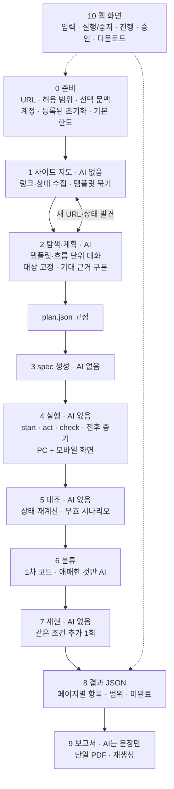

# WebTestPilot v2 설계

| 항목 | 내용 |
|---|---|
| 버전 | 3.2 (2026-10-15) — 팀 방향성 문서 반영, 사이트 탐색·보고·웹 화면까지 확장, 아키텍처 토론 합의 반영 |
| 근거 문서 | [프로젝트 방향성 공유본](../project-alignment/WebTestPilot_프로젝트_방향성_공유본.md), [Q1~Q66 최종 입장](../project-alignment/WebTestPilot_Q1-Q66_최종_입장.md), [AGENTS.md](../../AGENTS.md), [첫 유료 실측](../reviews/V2_LIVE_MAISON_2026-10-15.md), [비교군 분석](../reviews/AGENT_COMPARISON_2026-10-15.md) |
| 위치 | 팀 전체의 제품 기준 설계. `qa/`가 `integration/`을 대체하는 것이 목표이며, 전환은 11장 M8 비교 평가를 통과한 뒤에 한다 |
| 표기 | 요구사항의 상태: **완료** = 구현·무료 검증됨, **부분** = 일부 구현, **미구현** |

> 이 문서는 설계 목표다. 구현 완료나 팀 전체 승인 완료를 뜻하지 않는다. 수치(한도·화면 크기·평가 규모)는 표시한 곳에서만 확정이고, 나머지는 측정 후 정한다.

---

## 1. 목표

### 1.1 제품 정의

WebTestPilot은 **개발·QA 단계의 승인된 웹사이트를 자동으로 탐색·검사하고, 페이지별 결함 후보의 재현 절차와 증거를 정리한 단일 PDF를 제공하는 QA 보조 도구**다.

- **시스템이 하는 일:** 검사할 기능 발견, 검사 행동 준비·실행, 문제 후보 판단, 추가 1회 재현, 증거·보고서 정리.
- **사람이 하는 일:** 결과를 실제로 검증하고, 결함 여부를 최종 확인하고, 수정에 착수한다.
- **사용자가 하지 않는 일:** 페이지별 테스트 스크립트나 클릭 순서 작성, 시간·토큰 예산 계산.

### 1.2 성공 기준

- **수집한 페이지 수나 입력 크기 감소로 판단하지 않는다.** 다음으로 판단한다.
  - 실제 검사를 수행했는가 (실행 완료와 미완료의 구분)
  - 결함 후보가 정확한가 (탐지율·오탐·미탐)
  - 제공한 조건으로 재현되는가 (자동 재현, 보고서만 보고 사람이 재현할 수 있는가)
  - 보고서가 검증에 필요한 자료를 담고 있는가
  - 시간과 API 비용
- **최종 성능은 개발에 쓰지 않은 독립 앱에서 잰다.** Maison 같은 개발 사이트의 통과율·적중률은 제품 성능이 아니다 (AGENTS.md).
- **정직성:** 계획, 실제 실행, 판정을 구분한다. skip·미계획·중단·보류를 분모에서 숨기지 않는다. 검사 통과는 실제로 완료한 범위의 결과이지 사이트 전체 정상 보장이 아니다.

### 1.3 하지 않는 것

| 구분 | 내용 |
|---|---|
| 제외 | 모든 결함 탐지 보장, 모든 브라우저·실기기 지원, 무제한 긴 업무 흐름, 장기 유지용 회귀 테스트 파일 생성, 정확한 코드 원인 진단·자동 수정, 담당자 검토 입력·이슈 관리, 공개 다중 사용자 서비스, 실결제·외부 발송·운영 데이터 삭제 |
| 조건부 확장 | 서버(AWS) 배포, 추가 사이트·기능·버그 범주, 재사용 테스트 파일, 상용 도구 비교, 경험자 작업 시간 실험. 핵심 파이프라인과 평가를 희생하면서 필수 범위에 넣지 않는다 |

---

## 2. 요구사항

### 2.1 입력과 실행 준비

| ID | 요구사항 | 근거 | 상태 |
|---|---|---|---|
| IN-1 | 기본 입력은 시작 URL과 허용 범위(origin·행동). 요구사항·사이트 설명은 선택 문맥 | Q2, Q23 | **부분** — URL·origin·쓰기 허용은 있음. 요구사항이 필수라 선택 문맥이 아님 |
| IN-2 | 요구사항 없이도 자율 탐색으로 검사할 기능을 찾는다 | Q11 | **미구현** — M3 |
| IN-3 | 테스트 계정 기본 자동 로그인, 어려우면 사용자가 로그인 상태를 준비하는 경로 | Q49, Q53 | **미구현** — M5 |
| IN-4 | 등록된 초기화(reset/seed) 절차만 호출·확인. 없으면 비변경 검사만 하고 나머지는 보류 | Q13, Q20, Q21 | **미구현** — M5 (지금은 시작 URL 이동만) |
| IN-5 | 실행 한도는 프로그램 기본값. 사용자가 예산을 계산해 입력하지 않는다 | Q23, Q27 | **부분** — 비용 예약은 있으나 `--budget`가 필수 |
| IN-6 | 허용 범위 밖이거나 불명확한 행동은 실행 중 승인 요청. 거절되면 의존 검사만 보류 | Q55 | **미구현** — M5 (지금은 정책 위반을 막고 기록만) |

### 2.2 탐색과 검사

| ID | 요구사항 | 근거 | 상태 |
|---|---|---|---|
| EX-1 | 관찰 → 검사 → 새 URL·상태 발견을 반복하며 범위·한도 안에서 넓게 탐색 | Q14, Q26 | **미구현** — M3 (지금은 시작 URL 한 곳에서 대화 1번) |
| EX-2 | 같은 URL의 다른 상태(로그인, 펼친 메뉴, 입력 결과)도 검사 대상 | 방향성 5장 | **부분** — 탐색 중 행동 후 상태에서 대상 고정 가능 |
| EX-3 | 짧은 다중 페이지 흐름(목록→상세, 작성→확인)을 상태를 유지하며 검사 | Q16 | **부분** — 시나리오가 페이지를 넘나들 수 있음. 관계 비교 없음 |
| EX-4 | 기대 근거를 구분: 요구사항 / 화면·HTML의 명시적 제약 / 관찰 / AI 추정. AI 추정만으로는 결함 확정 금지 | Q7, Q22 | **부분** — requirement·observed·heuristic 3종. 명시적 제약 종류 없음 |
| EX-5 | 네 범주: 기능, 입력 검증, 이동·라우팅, UI 표시·조작 | Q9, Q24 | **부분** — 기능 위주. 라우팅(URL 읽기)·UI(시각) 검사 없음 |
| EX-6 | PC Chrome + 모바일 화면 크기의 반응형 UI·상호작용 추가 검사 | Q50, Q54 | **미구현** — M4 |
| EX-7 | 업무 규칙을 모르면 최소한의 질문으로 보완, 답이 없으면 관련 판정만 보류 | Q12, Q17 | **미구현** — M5 |

### 2.3 실행·증거·판정·재현

| ID | 요구사항 | 근거 | 상태 |
|---|---|---|---|
| RUN-1 | 계획·실제 실행·판정을 분리하고, 실행 여부가 불명확한 행동을 구분 | Q43 | **완료** — plan/ledger/verdict 분리, `uncertain_execution` |
| RUN-2 | 행동 전후 스크린샷 자동 기록. 최초·발견·재현 증거를 초기화 전에 보존. 화면 크기·스크롤 위치 기록 | Q65, Q66 | **부분** — 시작 snapshot·실패 시점 snapshot·스크린샷만 |
| RUN-3 | 후보는 같은 시작 조건에서 실제 행동을 추가 1회 실행. 새 AI 탐색으로 대체하지 않음 | Q10, Q28 | **부분** — 최초 실행 폴더의 plan·정책으로 재실행. 같은 시작 조건 준비(초기화·서버 상태)는 없고 시작 화면 지문만 비교 |
| RUN-4 | 재현 결과와 기대 근거는 별도로 판단. 재현 실패·초기화 불가·실행 미완료를 구분 | Q10, Q28 | **부분** — 지금은 reproduced·flaky·reproduction_inconclusive 한 축뿐. 결과와 사유(초기화 불가·실행 미완료·시작 상태 다름)를 나눈 두 축은 M5 |
| RUN-5 | 이미지 저장과 모델 전달을 분리. 기능·입력·라우팅은 구조 관찰, UI는 이미지와 함께 판단 | Q25 | **부분** — 저장만. 모델 전달 없음 |
| RUN-6 | 중지·한도 도달 시 완료된 검사와 증거를 보존하고 부분 결과 제공 | Q56 | **부분** — 단계별 저장·덮어쓰기 금지. 사용자 중지 없음 |

### 2.4 결과와 사용자 화면

| ID | 요구사항 | 근거 | 상태 |
|---|---|---|---|
| OUT-1 | JSON이 사실 원본. 페이지가 다르면 별도 항목, 같은 조건의 반복 발견은 새 결함이 아님 | Q29, Q60, Q62 | **부분** — 검사·시나리오 단위 JSON. 페이지별 항목 없음 |
| OUT-2 | 실행 전체의 단일 PDF: 범위·종료 이유·미완료, 페이지별 문제, 기대/실제, 재현 절차, 주요 증거 | Q29, Q63 | **미구현** — M6 |
| OUT-3 | 보고서 AI는 문장·요약·레이아웃만. JSON에 없는 사실·원인·재현 성공을 추가하지 않음 | Q33 | **미구현** — M6 |
| OUT-4 | PDF 실패 시 JSON·증거 보존, 저장된 결과로 보고서만 재생성 | Q39 | **미구현** — M6 |
| OUT-5 | 웹 화면: 입력, 실행·중지, 진행 상태, 승인·준비 안내, JSON·PDF·증거 다운로드, 보고서 재생성 | Q48 | **미구현** — M7 |

### 2.5 비기능

| ID | 요구사항 | 상태 |
|---|---|---|
| NF-1 | 승인된 테스트 환경·가상 데이터 전제. 허용 origin 밖·권한 없는 쓰기 요청 차단 | **부분** — 직접 요청은 차단. 외부로의 리다이렉트는 요청이 이미 나간 뒤 위반으로 기록하고 시나리오를 무효로 할 뿐 차단하지 못함. 결과에서 차단한 요청과 발생한 위반을 구분해 보고 |
| NF-2 | 비밀번호·API 키·세션은 모델 입력·공유 결과에 넣지 않음. 텍스트 마스킹만으로 이미지 속 비밀값이 사라진다고 가정하지 않음 | **부분** — 실행 코드에 키 환경변수 미전달. 로그인 비밀값·증거(스크린샷·snapshot·trace) 속 비밀값 처리 없음 (Q51) |
| NF-3 | 웹페이지 문구는 데이터일 뿐 지시가 아님 | **부분** — 권한·범위·기대값 변경은 코드가 막음(강제됨). 페이지 문구가 모델의 검사 목표 선택에 주는 영향은 검증하지 않음 |
| NF-4 | 자유로운 생성 코드를 제한 없이 실행하지 않음 | **완료** — spec은 템플릿, AI 코드 없음 |
| NF-5 | 모든 모델 호출 전 비용 예약, 가격·사용량을 모르면 중단. 보고서 생성 몫을 남김 | **부분** — 예약은 완료. 보고서 몫 예약 없음 |
| NF-6 | 평가 정답(버그 위치·라벨)은 모델 입력에 넣지 않음 | **완료** — `eval/`에만 둠 |
| NF-7 | 한 실행 환경에서 한 작업만 활성 실행, 여러 사이트는 순차 | **미구현** — M7 |

---

## 3. 설계 원칙

1. **AI는 판단이 필요한 곳에만 쓴다.** 탐색·계획, 애매한 실패 분류, 보고서 문장 정리. 실행·대조·재현은 코드가 한다.
2. **규칙은 코드가 강제하고 프롬프트는 짧게 쓴다.** 프롬프트에는 역할·목표·좋은 결과의 모습만 넣는다. 금지 규칙은 스키마 검증·도구 권한·대조 규칙으로 옮긴다.
3. **이미 있는 것을 쓴다.** 페이지 표현은 Playwright 접근성 snapshot(ref), 실행은 Playwright Test, 증거는 trace·스크린샷.
4. **기대값은 AI가 바꿀 수 없는 곳에 둔다.** `plan.json`에 고정하고 spec은 ID만 참조한다.
5. **기록(ledger)을 믿지 않고 다시 계산한다.** 판정은 고정된 기대와 기록된 실제 값으로 프로그램이 계산한다.
6. **최초 결과는 지우지 않는다.** 재실행·재판정·보고서 재생성은 새 기록이다.
7. **사용자에게 스크립트를 쓰게 하지 않는다.** 추가 정보는 정확도를 높이는 문맥이지 시나리오가 아니다.

---

## 4. 전체 파이프라인

| 단계 | AI | 하는 일 | 산출물 | 상태 |
|---|---|---|---|---|
| 0 준비 | 없음 | 입력 검증, 로그인, 초기화 등록 확인, 기본 한도 | `run.json` | 부분 |
| 1 사이트 지도 | 없음 | 같은 origin 링크·상태 수집, 같은 템플릿 묶기 | `sitemap.json` | 미구현 |
| 2 탐색·계획 | Opus | 템플릿·흐름마다 새 대화로 탐색, 대상 고정, 계획 제출 | `plan.json` | 부분 (한 페이지) |
| 3 spec 생성 | 없음 | plan → 템플릿 spec | `specs/*.spec.ts` | 완료 |
| 4 실행 | 없음 | 헬퍼로 행동·검사, ledger·증거 기록 | `ledger.jsonl`, `evidence/` | 완료 (전후 스크린샷·모바일 제외) |
| 5 대조 | 없음 | ledger ↔ plan, 무효 판정, 요구사항 집계 | `results.json` | 완료 |
| 6 분류 | Sonnet (애매한 것만) | 결함 후보 / 자동화 실패 / 불확실 | `verdicts.json` | 부분 (mismatch 미분류) |
| 7 재현 | 없음 | 후보를 같은 조건으로 1회 재실행 | 재현 실행 폴더 | 부분 (초기화 미연동, 결과·사유 한 축) |
| 8 결과 JSON | 없음 | 페이지별 항목, 실행 범위·미완료 정리 | `report.json` | 미구현 |
| 9 보고서 | Sonnet (문장만) | JSON·증거 → 문서 → PDF | `report.pdf` | 미구현 |
| 10 웹 화면 | 없음 | 실행 관리와 결과 제공 | — | 미구현 |

---

## 5. 단계별 설계

### 0 준비

- **입력 (`run.json`):** 시작 URL, 허용 origin, 허용 행동(쓰기 여부), 선택 문맥(사이트 설명·요구사항 파일), 계정 참조, 초기화 절차 참조.
- **계정:** 비밀값은 실행 환경 변수나 별도 파일에 두고, 모델에는 `{{account:tester}}` 같은 자리표시자만 보인다. 로그인은 프로그램이 앱별 로그인 절차로 수행한다. 실패하면 "로그인 이후 기능 미검사"로 기록한다.
- **초기화:** `apps/<app>/reset.ts` 같은 등록된 절차만 호출하고, 결과를 확인한다(예: 확인용 GET이 기대 상태를 돌려주는지). AI는 등록된 절차 중에서 필요한 것을 고를 수만 있다.
- **기본 한도:** 전체 비용·시간·모델 호출 수, **행동 수**(탐색·실행·재현의 브라우저 행동을 모두 셈. 한 응답의 여러 도구 호출도 각각 셈), 템플릿당 탐색 턴, 변화 없는 반복 횟수. 사용자는 고급 설정에서만 바꾼다. **보고서 생성 몫은 처음부터 따로 떼어 둔다.** 한도에 닿으면 새 탐색을 멈추고 남은 검사는 미완료로 표시한다. 기본값은 M3 실측 후 정한다.
- **비밀값과 증거:** 로컬 원본 증거(스크린샷·snapshot·trace·로그)와 모델 입력·공유 결과(PDF)를 구분한다. 비밀번호 입력칸 등은 스크린샷에서 가린다(Playwright `mask`). 모델 입력과 PDF에는 가린 사본만 쓴다. 텍스트 마스킹만으로 이미지 속 비밀값이 사라졌다고 가정하지 않는다(Q51). — M5

### 1 사이트 지도 (AI 없음)

- 시작 URL에서 같은 origin 링크를 너비 우선으로 모은다. 쓰기 없이 GET만, 한도 안에서.
- **템플릿 묶기:** URL 패턴(`/product/:slug`)과 페이지 구조 지문(접근성 트리의 역할 구성)이 같으면 한 템플릿으로 묶는다. 묶기는 대화를 나누고 보고서의 범위를 표시하는 단위다.
- **기준 실행 (Q14):** 범위·한도 안에서 방문한 **독립 페이지·기능 상태는 모두** AI가 검토한다. 같은 템플릿의 페이지는 한 대화 안에서 요약으로 함께 검토한다. 같은 템플릿의 일부 페이지를 AI 검토에서 건너뛰는 "선택적 호출"은 기준 실행과 비교해 비용 감소와 미탐 증가를 함께 잰 뒤에만 켠다. 결과에는 페이지마다 "AI 검토함 / 건너뜀(사유)"을 남긴다.
- 탐색 중 새 URL·상태가 발견되면 지도에 추가한다(관찰 → 검사 → 새 발견의 반복).
- 방문 범위를 "사이트 전체"라고 표현하지 않는다. 보고서에는 방문한 템플릿·페이지와 방문하지 못한 링크를 함께 남긴다.

### 2 탐색·계획 (AI, 구현 일부 완료)

**대화 단위.** 템플릿(또는 짧은 흐름) 하나당 새 대화를 연다. 이전 페이지 원본을 누적하지 않고 요약과 증거 참조만 넘긴다.

**탐색 배분 (합의 #4, M3).** 우선순위 엔진 없이 단순하게 나눈다.
- **전역 한도 하나**(비용·행동·시간·호출)만 둔다. 실제 호출 전에는 실행·재현·보고서 몫을 뺀 잔액을 확인한다.
- **템플릿 큐 순환:** 템플릿마다 짧은 턴 묶음을 배정한다. 묶음이 끝났는데 미검사 페이지·상태가 남으면 그 템플릿을 큐 뒤에 다시 넣는다. 탐색 중 새 템플릿이 발견되면 큐에 추가한다. 묶음 크기는 "남은 예산 ÷ 남은 템플릿 수"로 임시 배분하고 실측 후 조정한다.
- **정체 종료:** 대화 안에서 화면 변화 없는 행동이 N번 반복되면 그 묶음을 끝낸다. 정체 종료는 완료가 아니라 **미완료 사유**로 남긴다. N은 실측 후 정한다.
- **기록 보존:** 모델 문맥에서 뺀 대화도 원본 관측·행동·관찰한 이상·고정한 계획은 저장하고, 다음 대화로 넘기는 요약에 그 참조를 남긴다.
- **분모:** 템플릿을 검토했다고 해서 그 템플릿의 모든 페이지·상태를 검사한 것으로 세지 않는다. 페이지·상태별 검사 이력을 따로 남긴다.

**AI 입력 세 묶음 (Q42).** 대화를 새로 열 때와 흐름을 이어 갈 때 다음을 넘긴다.

| 묶음 | 필드 | 상태 |
|---|---|---|
| 사이트 공통 문맥 | 사용자 설명·요구사항(있으면), 사이트 지도 요약(발견한 템플릿·기능), 허용 행동·origin, 등록된 초기화 절차 목록 | 허용 행동·요구사항만 있음 |
| 현재 페이지 관찰 | URL, 접근성 snapshot(ref), 오류(콘솔·네트워크 실패), 증거 참조, UI 검사에 필요한 이미지 | URL·snapshot만 |
| 현재 검사 흐름 | 목표, 시작 조건, 이전 행동과 결과 요약, 기대 근거, 이미 고정한 대상, 관찰한 이상 | 대화 안에서만 유지(대화를 넘는 인계 없음) |

사용자 제공 정보, 관찰 사실, AI 추정은 필드로 구분한다. — M3에서 세 묶음을 계약으로 고정한다.

**도구** (구현됨): `snapshot(ref?)`, `navigate`, `click`, `fill`, `select`, `press`, `pin`, `submit_plan`. 개발 중에는 같은 도구를 MCP 서버(`qa/src/mcp.ts`)로 노출해 Codex·Claude Code 구독으로 돌린다.

**대상 고정(pin).** ref를 그 자리에서 Target으로 바꾼다. 문자열을 코드로 실행하지 않고 데이터로 저장한다.

| 대상 종류 | 식별 방법 | 상태 |
|---|---|---|
| 이름 있는 컨트롤 | 역할 + 이름(숫자는 패턴) | 완료 |
| 같은 이름이 여럿 | 가까운 이름 있는 상위 요소로 범위 좁히기 | 완료 |
| ref 없는 텍스트(가격·개수) | 텍스트를 담은 요소 ref + 텍스트 | 완료 |
| 개수 세기 | 그룹(같은 부모의 같은 역할) | 완료 |
| 이름 없는 아이콘 버튼, 숫자만 있는 표시 | **유일한 작은 상위 그룹 안의 역할 + 순서** (예: 수량 그룹의 [−][값][+]). 그룹 자체의 유일성과 구성원 수를 pin 때 검증 | 미구현 — M2 |
| 동적 영역(로드마다 바뀜) | pin 때 다시 불러와 대상이 남는지 확인하고, 바뀌면 역할 기반 대상(예: "관련 상품의 첫 카드")만 허용 | 미구현 — M2 |

**계획 계약 (`plan.json`).** 요구사항 목록(있으면), 시나리오(시작 URL·화면 크기·행동·검사), 미계획 항목과 사유, 고정된 대상, 탐색 중 관찰한 이상(`observations`).

| 검사 필드 | 내용 | 상태 |
|---|---|---|
| `read` | text, value, checked, visible, count — 구현됨. 추가(합의 #2, 최소 집합만): **url**(라우팅), **items**(그룹 각 항목의 값 목록), **scroll**(scrollY), **overflow**(가로 넘침 = scrollWidth > 화면 폭), **visual**(UI, 이미지 판단) | text~count 완료, url·items M2, scroll·overflow·visual M4 |
| `op` | equals, contains — 구현됨. 추가: 수 비교(`<`, `>`, `≠`), 목록 조건(`all` 모든 항목이 조건을 만족 / `any` 하나라도) | M2 |
| 비교 값 | `expected`(고정 기대값) 또는 `expected_from`(관측 참조, 아래) | 고정값 완료, 관측 참조 M2 |
| `source` | **비교 규칙의 근거.** `requirement`(요구사항 인용) / `constraint`(화면 안내·HTML 제약 인용) / AI 추정. 아래 기대 근거 규칙 참고 | 현재 코드는 `requirement`·`observed`·`heuristic` 3종. M2에서 `constraint` 추가, `heuristic` → `inferred`(분류 상태 `passed_heuristic` → `passed_inferred`) |
| `precondition` | 이 검사가 뒤 행동의 **선행조건**인지 표시(합의 #5). 실패하면 그 검사에 의존하는 행동만 멈추고 "준비 실패"로 남긴다(결함 아님). 표시 없는 시작 시점 검사는 그대로 판정 대상 | M2 |
| `ready` | 비교 전 준비 조건(대상 표시·로딩 표시 사라짐). 못 맞추면 `not_ready` | M2 |
| `viewport` | desktop / mobile 화면 조건 | M4 |

**기대 근거와 관측 참조 (합의 #1, M1~M2).** 비교에 쓰는 **값의 출처**와 **비교 규칙의 근거**를 분리한다. 탐색 에이전트는 결함이 있을 수 있는 현재 앱을 보고 계획을 만들기 때문에, 화면에서 본 값을 그대로 정답으로 쓰면 결함 동작을 정상으로 고정해 놓치게 된다.

- **관측 참조(`expected_from`):** 실행 중 앞선 검사가 기록한 실제 값을 참조한다. 예: `S1.C1`(클릭 전 카드 이름 읽기)의 값 = 상세 제목. 참조에는 대상·읽기 방식·시점(어느 행동 뒤인지)·증거 ID가 고정된다. 같은 검사 자신이나 순환 참조는 거부한다. 참조할 값은 비교보다 앞선 시점에 먼저 기록돼야 한다.
- **비교 규칙의 근거(`source`):** "카드 이름과 상세 제목이 같아야 한다", "필터 해제 후 목록 수는 처음과 같아야 한다", "증가 버튼은 수량을 1 늘린다" 같은 규칙에는 요구사항·화면 제약·AI 추정 중 하나의 근거를 둔다. AI 추정 근거의 불일치는 검토 후보를 만들 뿐 결함 확정이 아니다.
- **금지:** 탐색 때 본 값을 고정 기대값으로 그대로 쓰는 검사(예: 행동 뒤 값이 탐색 때 본 그대로여야 한다). 관측값은 선행조건(`precondition`)·대상 식별·관측 참조로만 쓴다.
- **대상과 값 분리:** 기대값 텍스트로 대상을 찾지 않는다. 잘못 표시된 실제 값도 같은 대상에서 읽어야 한다.

**계획 검증** (코드): 모양 검사, 요구사항 분모(요구사항이 있을 때), 출처 인용, 항상 참인 검사 거부, 시작 상태 대상의 pin 페이지 — **구현됨**. 관측값 그대로 정답 금지·관측 참조의 시점·순환 검사 — M2. 화면 크기 일치 검사 — M4. **요구사항이 없으면 탐색형 시나리오**를 허용하되 규칙 근거는 `constraint`·AI 추정만 쓰고, 집계를 요구사항 기반 결과와 나눈다 — M3.

### 3 spec 생성 (완료)

plan에서 시나리오마다 spec을 템플릿으로 만든다. 순서는 `start` → 시작 시점 검사 → (`act` → 그 행동 뒤 검사)…. spec에는 ID만 JSON 문자열로 들어간다. 같은 plan이면 같은 코드다.

### 4 실행 (완료)

- **헬퍼:** `start`(시작 URL 이동과 시작 증거. 현재는 전체 화면 해시도 남기지만 M2에서 선행조건 검사로 대체), `act`(사전 확인 후 실행. 대상 사라짐·행동 불가는 `not_executed`, 실행 중 오류는 `uncertain_execution`으로 멈춤), `check`(기한까지 다시 읽기, 첫 읽기 값 보존). 모든 결과는 예외 전에 ledger에 쓴다.
- **텍스트 읽기 기준:** 탐색 때 모델이 본 것과 같은 기준(접근성 텍스트)으로 읽는다. 표시 텍스트(CSS 대소문자 변환)와 섞지 않는다. — M1 수정
- **증거:** 행동 전후 현재 화면 스크린샷을 자동 기록하고 화면 크기·스크롤 위치를 남긴다(M4). 지금은 시작·실패 시점만.
- **증거 완전성:** 촬영·snapshot 실패는 이미 ledger에 `captureErrors`로 남지만 대조 결과로 전달되지 않는다. 대조 결과에 증거 완전성을 별도 상태로 넘기고, 촬영 실패를 사이트 결함으로 보지 않는다. 이미지가 필요한 판단(UI 시각 검사)에 이미지가 없으면 판정하지 않고 "증거 부족"으로 남긴다(Q66). — M4
- **UI 시각 검사 경로 (`read: visual`):** 실행 단계는 판단하지 않고 현재 화면 스크린샷과 대상 위치(접근성 snapshot `boxes`)만 저장한다. 판정은 6단계의 시각 판정(Sonnet, 이미지 입력)이 계획에 고정된 기대 설명과 근거(요구사항·화면 제약·관찰)를 기준으로 한다. 이미지 토큰을 포함해 비용을 예약하고, 결과는 다른 검사와 따로 집계한다(Q25). — M4
- **화면 크기:** 시나리오에 `viewport`(desktop/mobile)를 둔다. 모바일은 PC 기능 검사를 반복하지 않고, 메뉴·모달·버튼 접근·가림·잘림을 추가 검사한다. 대표 크기 목록은 미정(14장).
- **정책:** 러너 컨텍스트에도 탐색 때와 같은 origin·쓰기 정책을 건다.
- **행동 실행 결과의 원인별 집계 (적응 실행 대신):** 계획된 행동마다 계획·시도·완료·미실행(`not_executed`, 사유별)·실행 여부 불명확을 집계한다. **행동 실행 실패율**과 **요구사항 검사 범위**(미계획·후속 중단 포함)를 따로 보고해, 분모에서 미계획이 숨지 않게 한다. 평균 아래 숨은 특정 흐름의 반복 실패도 따로 본다. — M4. 실행 중 AI가 대상을 다시 찾는 적응 실행은 보류한다(6.2).
- **콘솔·네트워크 신호:** trace에 이미 담긴 콘솔 오류·실패한 요청을 구조화해 추출하고, 해당 행동·페이지의 증거와 검토 대상으로 연결한다. 기대값 없이도 잡히는 신호지만 정상적인 거절(401·403·422 등 검사 의도대로의 응답)과 정책 차단은 결함으로 세지 않는다. — M4

### 5 대조 (완료)

- 고정된 기대값과 기록된 실제 값으로 상태를 다시 계산한다.
- 순서 위반·중복·정책 기록 누락이나 위반·시작 실패 뒤 기록이 있으면 시나리오를 **무효**로 하고 통과 집계에서 뺀다.
- 실행되지 않은 검사는 `not_run`, 깨진 ledger 줄은 문제로 남긴다.

### 6 분류 (부분) · 7 재현 (부분)

**현재 구현.**
- 1차 분류(코드): passed / passed_heuristic / mismatch / not_run(원인 연결) / invalid / uncertain_execution / needs_triage.
- AI 분류: **needs_triage만** 보낸다. 실패 시점 증거를 원문 그대로 인용해야 통과한다.
- 재현: 최초 실행 폴더의 plan·정책으로 1회. 실행 코드·시작 화면 지문이 다르면 `reproduction_inconclusive`. 결과는 reproduced / flaky / reproduction_inconclusive 한 축이다.

**목표 (변경 예정).**
- **분류 입력 구조화와 원래 결과 보존 (합의 #3) — M1~M4.**
  - mismatch도 AI 분류에 보낸다(M1). 결정적인 자동화 오류도 재현되므로 `reproduced`는 결함 확정이 아니다(첫 실측의 오탐 4건).
  - 분류 입력에 기대값·실제 값·읽기 방식·대상·시점·증거 완전성을 **필드로** 넣는다. 지금은 텍스트 증거 파일과 요약 문자열만 보낸다.
  - 분류는 원래 비교 결과 **위에 덧붙인다.** 자동화 실패로 분류돼도 최초 불일치 기록은 지우거나 통과로 바꾸지 않는다.
- **재현을 두 축으로 나눈다 — M5 (Q10·Q28).**
  - 결과: 재현됨 / 재현 안 됨 / 판단 불가
  - 사유(판단 불가일 때): 초기화 불가 · 시작 상태 다름 · 실행 미완료(도구·로그인 실패) · 실행 코드 다름
- **같은 시작 상태의 판단 (합의 #5) — M2~M5.** 전체 화면 해시 비교를 없앤다(추천 목록·시간 표시 때문에 정상 실행도 판단 불가가 된다). 대신 선행조건(`precondition`) 검사·대상 신원·확인된 초기화 결과가 최초와 같을 때만 같은 시작으로 본다. 모든 값의 동일성은 요구하지 않는다. 숨은 서버 상태를 확인하지 못했으면 "판단 불가"다.
- 등록된 초기화 절차가 있으면 재현 전에 호출하고 결과를 확인한다. 없으면 "초기화 불가"로 남긴다 — M5.

### 8 결과 JSON (미구현, M6)

판정 항목을 **페이지 × 문제** 단위로 묶는다. 같은 페이지·같은 조건의 반복 발견과 재현은 한 항목의 증거로 합치고, 다른 페이지는 별도 항목이다. 화면 크기가 다른 같은 문제는 한 항목에 조건별 증거로 붙인다.

| 보고 구역 | 들어가는 상태 |
|---|---|
| 재현 근거가 확보된 문제 | 기대 근거가 요구사항·화면 제약이고, AI 분류가 결함 후보로 보고, 재현된 항목 |
| 검토가 필요한 후보 | 관찰·AI 추정 근거의 불일치, 재현 안 됨(flaky), 시작 상태가 달라 재현을 판단하지 못한 항목, AI가 불확실로 둔 실패, 탐색 중 관찰한 이상 |
| 자동화 실패·미완료 | 자동화 실패(분류 결과와 함께 원래 불일치 표시), 실행 여부 불명확, 준비 미완료(not_ready), 선행조건 실패, 미실행, 정체 종료, 증거 부족, 로그인·초기화 실패·승인 거절로 보류된 검사, 실행 미완료로 재현을 판단하지 못한 항목 |
| 오류 신호 | 콘솔 오류·실패한 요청 중 정상 거절·정책 차단이 아닌 것. 기대값 없이 잡힌 신호라 검토 대상 |
| 통과한 검사 범위 | 실제로 완료한 검사만. "사이트 정상" 표현 금지 |
| 실행 범위 | 방문한 템플릿·페이지, 방문 못 한 링크, 종료 이유(완료·한도·중지), 비용·시간 |

### 9 보고서 (미구현, M6)

- 보고서 AI는 `report.json`과 증거 목록을 받아 문장·요약·레이아웃만 만든다. 수치·판정·재현 결과는 JSON에서 그대로 옮기고, 생성 후 프로그램이 PDF의 핵심 값과 JSON을 대조한다.
- HTML로 만든 뒤 Playwright로 PDF를 렌더링한다(이미 쓰는 도구). 주요 스크린샷과 오류 발췌를 PDF 안에 넣는다.
- 실패하면 JSON·증거를 보존하고, 저장된 결과로 보고서만 다시 만든다. 새 검사를 시작하지 않는다.

### 10 웹 화면 (미구현, M7)

입력(URL·범위·문맥·계정 참조), 실행·중지, 진행 상태(현재 템플릿, 소요 비용·시간), 승인·준비 안내(새 권한 요청, 로그인 실패), JSON·PDF·증거 다운로드, 보고서 재생성. 한 번에 한 실행만 활성. 담당자 검토 입력·이슈 관리는 넣지 않는다.

**실행 제어 상태 (Q12·Q17·Q55·Q56).** 엔진(M5)이 상태를 정하고 화면(M7)은 보여 주고 응답만 받는다.

| 요청 종류 | 흐름 |
|---|---|
| 권한 승인 (새 권한·불명확한 행동) | 요청 → 대기 → 승인이면 그 행동부터 재개 / 거절·시간 초과면 그 행동에 의존하는 검사만 "보류(승인 거절)"로 두고 독립 검사를 계속 |
| 업무 규칙 질문 (기대 동작을 모름) | 권한 승인과 구분한다. 질문 → 대기 → 답하면 기대 근거로 기록 / 답이 없으면 관련 판정만 "보류(규칙 미확인)"로 두고 계속. 보고서 생성 전에 답을 강제하지 않는다 |
| 사용자 중지 | 진행 중인 행동은 끝나면 기록하고, 끝나지 않으면 `uncertain_execution`으로 남긴다. 새 행동을 시작하지 않는다. 완료된 검사·증거로 부분 `report.json`을 만들고, 보고서 몫 예산 안에서 PDF를 만든다. 종료 이유는 "사용자 중지" |
| 한도 도달 | 중지와 같다. 종료 이유는 "한도 도달(종류)" |

프로그램이 꺼진 뒤 중간 지점에서 자동 복구하는 기능은 초기 범위에서 제외한다.

---

## 6. 결정 기록

### 6.1 실행 구조 변경 세 가지 (Q15·Q19 변경안, 팀 확인 필요)

**원래 결정 (그대로 인용).**
- Q19: "공식 Playwright MCP를 실행 도구 기반으로 채택한다. 기존 전처리기와 같은 브라우저·탭을 사용하고 증거·권한·사용량 기록이 연결되는지 검증한다. 채택을 이유로 Python 전처리기 전체를 미리 재작성하지 않는다."
- Q15: "AI는 검사 목표·행동·기대 조건·다음 행동·결과 해석을 선택한다. 프로그램은 허용 여부·요소·한도를 확인하고 MCP 도구로 실제 조작과 관찰·기록을 수행한다."

**추가 배경 (2026-10-15 사용자 설명).** MCP를 고른 이유는 정해진 스크립트로는 동적인 화면의 시나리오를 다 실행하지 못할 수 있다는 걱정이었다. 라이브러리 방식으로 그 걱정이 해소된다면 MCP를 고집할 필요는 없다.

| # | 변경 | 원래 결정 | v2 | 이유 |
|---|---|---|---|---|
| C1 | 실행 도구 | 공식 Playwright MCP | Playwright 라이브러리 위의 자체 도구. 개발·비교용으로 같은 도구를 자체 MCP 서버(`qa/src/mcp.ts`)로 노출 | MCP와 라이브러리의 브라우저 조작 능력은 같고, 자체 도구가 대상 고정·정책·증거 기록을 직접 강제할 수 있다 |
| C2 | 실행 중 AI 역할 (Q15) | AI가 실행 중에도 다음 행동·결과 해석을 선택 | AI는 탐색 중에 행동을 해 보고 계획을 고정한다. 실행은 결정적 spec이고 실행 중 AI는 없다. 결과 해석은 6단계 분류가 한다. (실행 중 AI가 대상을 다시 찾는 "적응 실행"은 토론 합의로 보류 — 6.2) | 재현성·비용, 그리고 AI가 실행 중에 기대를 바꾸는 문제를 막기 위해서다. 첫 실측(Maison)에서 계획된 행동 12개, fixture에서 행동 전부가 고정 spec으로 실행됐다 |
| C3 | 전처리기 재사용 | Python 전처리기를 미리 재작성하지 않음 | `integration/preprocessor`를 쓰지 않고 TypeScript로 새로 씀 (`browser.ts`, 사이트 지도는 M3) | 접근성 snapshot·ref를 그대로 쓰면서 자체 요약 view에서 생기던 참조 손실을 없애기 위해서다. 기존 전처리기의 URL 큐·범위 규칙은 M3에서 참고한다 |

- **같은 브라우저·탭 (Q19·Q41).** 탐색은 템플릿 대화마다 브라우저 컨텍스트 하나·탭 하나를 쓰고, 그 안에서 행동과 증거가 같은 탭에 묶인다. 실행은 시나리오마다 새 컨텍스트에서 시작한다(Q18의 "독립 검사 시작 시 초기 상태 준비"와 같은 경계). ledger에 컨텍스트·페이지 식별자를 남겨 행동과 증거의 연결을 검증할 수 있게 한다(M4).
- **다시 정할 조건.** 평가(M8)에서 계획된 행동 중 고정 실행이 실패하는 비율이 **20%를 넘으면** 실행 중 AI 조작의 범위를 넓히는 안을 다시 검토한다. 이 비율은 결과 JSON에 항상 남긴다.

### 6.2 그 밖의 결정

| 결정 | 내용 |
|---|---|
| spec 생성 방식 | 안 A — plan에서 템플릿 생성. AI가 테스트 코드를 쓰지 않는다 |
| 기대값 고정 | spec은 ID만, 헬퍼가 plan.json에서 읽음 |
| 판정 기준 | ledger를 다시 계산한 대조 결과 |
| 모델 | 계획 Opus 5.5, 분류·보고서 Sonnet 5.5. 비용이 크면 각각 한 단계 내림(Sonnet 5.5 · Haiku 5.5). 내린 결과는 따로 측정·보고 |
| 개발·평가 환경 | 개발 중 실행은 CLI 구독(MCP 서버), 테스트·평가는 Claude API |
| 서버 측 대체 모델 | 켜지 않음. 대체 모델 비용을 장부에 정확히 나눌 수 없어서. 거부는 `refusal`로 기록 |
| 적응 실행 보류 (토론 합의) | 실행 중 AI가 대상을 다시 찾는 기능을 만들지 않는다. 대신 행동 실행 결과를 원인별로 집계한다(4단계). 지금까지 고정 실행 실패는 0건이지만 이는 개발 사례의 계획된 행동에 대한 기록일 뿐, 독립 앱의 실행 가능성을 입증하지 않는다. 6.1의 20% 기준은 재검토 신호로만 쓴다 |
| 계산 검사는 최소 집합만 (토론 합의) | url·items·scroll·overflow, 수 비교, 목록 조건까지. 임의 CSS 속성·겹침 판정 같은 범용 표현 언어는 만들지 않는다. UI 문제는 이 사실들과 시각 판정(M4)을 함께 쓴다 |
| 대상 식별 실험 (토론 합의) | Playwright `normalize()`가 만든 locator를 후보로 쓰는 방식을 M1~M2 사이에 작게 실험한다. locator 코드 문자열을 실행하지 않고 데이터형 Target으로 저장한다는 계약은 유지한다 |

---

## 7. 데이터 계약

| 파일 | 만드는 단계 | 내용 | 상태 |
|---|---|---|---|
| `run.json` | 0 | 입력·허용 범위·한도·계정/초기화 참조(비밀값 제외) | 미구현 |
| `sitemap.json` | 1 | 방문 URL, 템플릿 묶음, 미방문 링크 | 미구현 |
| `plan.json` | 2 | 요구사항, 시나리오, 대상, 미계획, 관찰한 이상 | 완료(관찰·관계·화면 크기 필드 제외) |
| `manifest.json` | 4 | 입력·실행 헬퍼 해시, 버전, 한도 | 완료 |
| `ledger.jsonl` | 4 | start·act·check·policy 기록, 증거 경로 | 완료 |
| `results.json` | 5 | 재계산한 상태, 무효 사유, 요구사항 집계 | 완료 |
| `verdicts.json` | 6·7 | 분류·재현, 분류 대화 기록 경로 | 완료 |
| `report.json` | 8 | 페이지별 항목, 보고 구역, 실행 범위, 행동 실행 집계, 오류 신호 | 미구현. **버전 붙은 최소 계약을 M1~M3 사이에 먼저 고정**해 PDF·웹 화면을 다른 팀원이 병행 개발한다(합의 #7) |
| `report.pdf` | 9 | 단일 PDF | 미구현 |

---

## 8. 평가 설계

- **사이트 분리:** 개발용·검증용·최종 평가용을 사이트·템플릿 계열 단위로 나눈다. 같은 사이트의 정상·결함 버전과 파생 화면을 다른 용도에 섞지 않는다. 실패를 보고 고친 사이트는 이후 "미사용"으로 쓰지 않는다.
  - 개발용: `qa/test/fixtures`, `eval/variants/*`, Maison(정답지 17개: `docs/reviews/qa-skill-maison-2026-10-12/ground-truth.json`).
  - 검증용·최종 평가용: 미확보 (테스트·벤치마크 파트, 14장).
- **정답 격리:** 모델은 매 실행 사이트 한 버전과 허용된 문맥만 본다. 정답·라벨·주입 위치는 `eval/`에만 두고 채점에만 쓴다. 정상 버전도 독립 실행해 오탐을 잰다.
- **지표 (평가 전에 고정):** 페이지별 결함 사례의 탐지율·보고 정확도, 오탐, 미탐, 자동 재현 결과, 보고서만으로 사람이 재현할 수 있는가, 완료·미완료 범위, 고정 실행 실패 비율, 시간·토큰·비용. 반복 발견은 중복 성공으로 세지 않는다.
- **비교:**
  - **필수:** 같은 모델·권한·사전 정보·자원 한도에서 "기본 Claude + Playwright 도구 자율 탐색"(충분한 지침과 관찰 도구 제공)과 전체 시스템 비교 (Q31). 그리고 `integration/` 대비 비교.
  - **조건부:** Playwright Test Agents, agent-browser 같은 상용·공개 에이전트 비교. 같은 범위·지시·모델로 맞추고, 쓰기 차단처럼 맞출 수 없는 조건은 기록한다.
- **입력 조건:** 최소 실행 정보(URL·범위·계정·초기화)와 짧은 설명·요구사항 추가 조건을 따로 평가한다. 어느 조건에도 정답 힌트를 주지 않는다.
- **실무 시간 비교:** 경험자 참여 여건이 있을 때만. 내부 팀원 실험으로 산업 현장 절감률을 주장하지 않는다.

---

## 9. 모델·비용

- 계획 Opus 5.5($4/$20 per 1M 토큰), 분류·보고서 Sonnet 5.5($2/$10). 비용이 크면 한 단계씩 내린다.
- 테스트 Claude API 예산은 팀 기준 약 140만 원이다. 개발 중 확인은 CLI 구독으로 해서 API 예산을 평가에 남긴다.
- 첫 실측(Maison, 한 시작 페이지): **$0.78, 호출 34회, 5분.** 사이트 전체 탐색의 기본 한도는 M3 실측 후 템플릿당 비용으로 정한다.

---

## 10. 팀 역할 (3파트, 6명)

| 파트 | v2에서 맡는 모듈 | 공동 규격 |
|---|---|---|
| 전처리 | 사이트 지도(1), 브라우저 수명주기·정책(`browser.ts`), snapshot·대상 고정, 증거 수집(헬퍼의 캡처), 화면 크기 | 같은 브라우저 컨텍스트에서 행동과 증거를 연결하는 규칙(ledger 형식) |
| AI | 탐색·계획 루프(`explore.ts`, `agent.ts`, `mcp.ts`), 계획 계약(`plan.ts`), 분류·재현 연계(`triage.ts`), 결과 JSON·보고서 AI | 계획·결과 JSON 계약, 비용 장부 |
| 테스트 사이트·벤치마크 | 앱별 초기화·계정 절차(`apps/<app>/`), 개발·검증·최종 평가 사이트와 정답지(`eval/`), 평가 실행(`eval/run.mts`), 독립 재현 시험 | 정답 격리 규칙, 지표·집계 규칙 |

웹 화면·서버 배포 담당은 별도로 정한다(14장). 개발 방식: 설계·코드 작성은 Claude, 테스트 실행·코드 리뷰는 Codex, 인수인계는 [docs/HANDOFF.md](../HANDOFF.md).

---

## 11. 완성까지의 단계

통과 기준으로 진행하고, 날짜는 권장 기준선이다. 방향성 문서 11장의 순서(첫 연결 → 범위 확대 → PDF·웹 → 검증 사이트로 개선·비교 준비 → 설정 고정 후 최종 평가)를 따른다. 최종 제출은 12월 첫째 주, 필수 기능 안정화 기준선은 **11월 중순(11/19)** 이다.

**모든 단계의 공통 완료 원칙.**
- **저장 계획 회귀와 새 탐색을 구분한다.** 저장한 계획을 다시 돌려 통과하는 것은 회귀일 뿐이고, 새 탐색 능력의 근거가 아니다.
- **원인을 고친 단계는 다른 구조·데이터의 정상·결함 사례로도 확인한다.** Maison 한 곳의 결과만으로 통과시키지 않는다(AGENTS.md).
- **무료 검증을 먼저 한다.** 원인 재현·회귀를 무료 테스트로 고정한 뒤에만 유료 재실측을 한다.

| 단계 | 내용 | 완료 조건 | 권장 시점 |
|---|---|---|---|
| **M0** 기반 | 0~3단계 구조, 실행·대조·분류·재현, 개발 평가 틀 | 달성: 무료 테스트 53개, 저장 계획으로 fixture 버그 변형 탐지·재현(회귀), Maison 새 탐색 1회. **미달성:** Q47의 "정상·결함 버전을 각각 새로 탐색해 판정·재현·JSON까지" | 부분 완료 (10/15) |
| **M1** 첫 연결 완성 + 실측 버그 수정 | snapshot 파서(`[cursor=pointer]` 줄), 텍스트 읽기 기준, mismatch도 AI 분류(원래 불일치 보존), 관찰값 그대로 정답 금지 규칙(합의 #1의 금지 부분), 최소 `report.json` 계약 초안(#7), 독립 평가 앱 후보 조사 시작(#8) | 무료: 두 원인을 재현하는 fixture 회귀. 그 뒤 **정상·결함 버전을 각각 새로 탐색**(Q47)해 결함 버전에서만 후보가 나오고 정상 버전에서 오탐 0. Maison 재실측에서 오탐 4건이 사라짐 | 10/20 |
| **M2** 표현력 | 관측 참조(`expected_from`)·규칙 근거 분리(#1), 수 비교·목록 조건·`read: url·items`(#2), `precondition`과 시작 상태 판단 변경(#5), 그룹 안 순서 식별, 동적 영역 확인, `ready`, `observations`, `constraint`, 분류 입력 구조화(#3), 용어 정리(`inferred`), `normalize()` 대상 식별 실험 | 구조가 다른 fixture 2종 이상(아이콘 버튼 수량 그룹, 무작위 목록, 필터 해제)의 정상·결함 쌍에서 새 탐색으로 해당 결함이 계획·탐지됨. 결함 버전 탐색이 결함 동작을 기대값으로 고정하지 않음 | 10/27 |
| **M3** 사이트 탐색 | 사이트 지도·템플릿 묶기, 템플릿 큐 순환 배분·정체 종료·기록 보존(#4), AI 입력 세 묶음 계약, 탐색형 시나리오, 기본 한도(행동 수 포함), 결과 합치기, `report.json` 최소 계약 고정(#7), 검증·최종 평가 앱 확보(#8) | URL과 범위만으로 여러 페이지 fixture와 Maison을 끝까지 돌림. 페이지·상태마다 검사 이력·AI 검토 여부·범위·비용이 남고 정체 종료가 미완료로 집계됨 | 11/3 |
| **M4** 증거·범주 확대 | 행동 전후 자동 스크린샷, 증거 완전성, `read: scroll·overflow`(#2), UI 시각 판정, 모바일 화면 크기, 콘솔·네트워크 신호(#6), 행동 실행 원인별 집계, 같은 탭 식별 기록 | 네 범주 검사가 각각 정상·결함 쌍에서 계획·실행됨, 모바일 전용 문제를 따로 보고, 정상 거절은 오류 신호로 세지 않음 | 11/9 |
| **M5** 상태·제어 | 계정 로그인(비밀값·증거 가림), 등록된 초기화, 쓰기 허용 실행, 승인 요청·업무 규칙 질문·중지, 재현 두 축, 실행 코드 격리 | 로그인 이후 기능과 쓰기 흐름(예: 장바구니)을 초기화와 함께 검사·재현. 중지 시 부분 결과가 남음 | 11/14 |
| **M6** 보고 | `report.json`(페이지별 항목·구역), 보고서 AI, PDF 렌더링, 재생성 | PDF만 보고 다른 사람이 후보를 재현할 수 있음(독립 재현 시험 1회). PDF 실패 시 재생성 | 11/17 |
| **M7** 웹 화면 | 입력·실행/중지·진행·승인·다운로드·재생성 | 화면에서 실행부터 PDF 다운로드까지 끝남 | **11/19 (안정화 기준선)** |
| **M8** 검증 사이트 개선·비교 | 검증용 사이트로 정확도·비용 개선, 기본 Claude+도구 비교군, `integration/` 비교, (조건부) Playwright Agents·agent-browser | 같은 조건 비교표와 고정 실행 실패 비율. 통과하면 AGENTS.md의 제품 소스를 `qa/`로 전환 | 11/26 |
| **M9** 설정 고정 → 최종 평가·발표 | 프롬프트·한도·모델 설정 동결(이후 수정 금지) → 미사용 독립 앱 평가 → 안정화·데모 | 동결한 설정으로 독립 앱의 탐지·오탐·미탐·재현·비용 보고서 | 동결 11/27, 평가·발표 12월 첫째 주 |

일정은 팀 가용 시간을 모르는 상태의 추정이고 촉박하다. 특히 M8~M9 사이에 수정할 여유가 거의 없다. 늦어지면 M4의 모바일·시각 판정이나 M8의 조건부 비교부터 줄이고, 계획·실행·판정 분리와 평가 정직성은 줄이지 않는다. 서버 배포는 조건부 확장으로, 핵심 단계를 희생하지 않는 범위에서 M7 이후에 검토한다.

---

## 12. 현재 구현 현황 (`qa/`)

| 파일 | 역할 |
|---|---|
| `src/browser.ts` | snapshot, 대상 고정(역할·이름·텍스트·그룹), 정책 강제 |
| `src/agent.ts` | 비용 예약·정산이 있는 에이전트 루프 |
| `src/explore.ts`, `prompts/explore.md` | 탐색 도구와 프롬프트 |
| `src/mcp.ts` | 개발용 MCP 서버 (Codex·Claude Code 구독) |
| `src/plan.ts` | 계획 계약 검증·고정 |
| `src/generate.ts` | plan → spec |
| `src/fixture.ts` | start·act·check 헬퍼, ledger, 증거 |
| `src/run.ts` | 입력·실행 코드 고정, playwright test 실행 |
| `src/reconcile.ts` | ledger ↔ plan 대조 |
| `src/triage.ts`, `prompts/triage.md` | 1차·AI 분류, 재현 |
| `src/cli.ts` | Claude API로 끝까지 실행 (미커밋) |
| `eval/` | 고정 계획, 버그 변형·정답지, 평가 실행 |

---

## 13. 첫 실측에서 배운 것 (설계에 반영함)

[V2_LIVE_MAISON_2026-10-15](../reviews/V2_LIVE_MAISON_2026-10-15.md) 요약:

- 클릭 가능한 요소의 snapshot 줄 형태를 파서가 읽지 못해 대상 고정 실패의 대부분이 생겼다 → M1.
- 탐색(접근성 텍스트)과 실행(표시 텍스트)의 읽기 기준이 달라 오탐 4건이 재현까지 됐다 → M1, "재현 ≠ 확정"을 분류 설계에 반영.
- 아이콘 버튼·숫자 표시를 식별하지 못해 탐색 중 본 결함 의심(수량이 늘지 않음)을 계획에 담지 못했다 → M2 그룹 안 순서 식별, `observations`.
- "누른 카드 = 열린 상세" 같은 관계형 요구사항과 로드마다 바뀌는 영역을 표현하지 못했다 → M2 `expected_from`, 동적 영역 확인.
- 한 시작 페이지·한 대화 구조로는 "모든 페이지 탐색"을 받을 수 없다 → M3.

---

## 14. 열린 결정 사항

| 항목 | 정할 사람 | 시점 |
|---|---|---|
| 실행 구조 변경 C1~C3(6.1: 공식 MCP 대신 자체 도구, 실행 중 AI 역할 축소, 전처리기 재작성) 팀 확인 | 팀 전체 | M1 전 |
| 대표 화면 크기 목록(PC·모바일) | 전처리 + 테스트 파트 | M4 전 |
| 기본 한도 값(비용·시간·템플릿당 턴·보고서 몫) | AI 파트 | M3 실측 후 |
| 결과 JSON·PDF 최종 스키마 | AI 파트 + 팀 합의 | M6 전 |
| 웹 화면·서버 배포 담당 | 팀 전체 | M5 전 |
| 검증용·최종 평가용 사이트 확보와 정답 구조 | 테스트·벤치마크 파트 | M6 전 |
| 평가 데이터 규모·수치 목표·집계 규칙 | 팀 전체 | M8 전 (평가 전에 고정) |

---

## 변경 이력

| 버전 | 날짜 | 내용 |
|---|---|---|
| 1 | 2026-10-15 | v2 초안: AI는 탐색·계획·분류, 실행은 결정적 |
| 2 | 2026-10-15 | Codex 리뷰 반영(ledger, check(id), 요구사항 분모, 재현 조건), 안 A 결정, 모델·실행 환경 |
| 3.2 | 2026-10-15 | Claude·Codex 아키텍처 토론 합의 반영([기록](../reviews/v2-architecture-discussion-2026-10-15/05_consensus.md)): 기대 근거와 관측 참조 분리(관찰값 그대로 정답 금지), 최소 계산 검사(url·items·scroll·overflow, 수 비교, 목록 조건), 분류 입력 구조화와 원래 불일치 보존, 탐색 배분(전역 한도·템플릿 큐 순환·정체 종료), 선행조건으로 시작 상태 판단, 콘솔·네트워크 신호, `report.json` 최소 계약 조기 고정, 독립 평가 앱 조기 확보. 단순화: 적응 실행 보류, `normalize()` 대상 식별 실험 |
| 3.1 | 2026-10-15 | Codex 대조 리뷰 16건 반영: Q19 원문 인용과 변경 C1~C3(전처리기 재작성 포함) 기록, Q14 기준 실행, 같은 탭 경계, AI 입력 세 묶음, 실행 제어 상태, 행동 수 한도, 증거 속 비밀값·증거 완전성, 시각 판정 경로, 재현 두 축, 상태 과대 표시 정정(RUN-3·NF-1·NF-3), 현재 구현과 목표 분리, 완료 조건 강화(새 탐색·다른 구조), 일정 재산정 |
| 3 | 2026-10-15 | 팀 방향성(Q1~Q66) 반영: 사이트 탐색, 네 범주·모바일, 로그인·초기화·승인, 결과 JSON·PDF·웹 화면, 평가 설계, 팀 역할, 완성 단계(M0~M9). Q19 변경 기록. 첫 실측 교훈 반영 |
