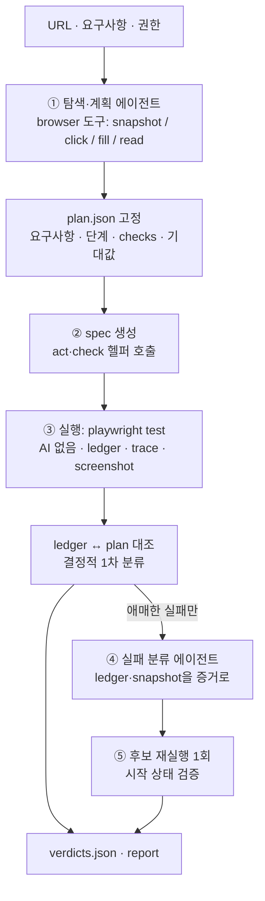

# WebTestPilot v2 설계

2026-10-15 · 초안 2 · 작성 Claude · Codex 리뷰 반영 (높음 8건, 분류 반례 6건, 유지할 보호 장치 9건)

> 목표는 바뀌지 않는다. 특정 사이트에 의존하지 않고 URL·요구사항·권한 범위에서 웹 기능을 탐색하고, 고정된 기대로 검사하며, **기대 불일치 · 자동화 실패 · 불확실**을 구분하는 범용 QA 시스템이다 ([AGENTS.md](../../AGENTS.md)). 바뀌는 것은 구조다.

## 1. 왜 다시 쓰는가

| 현재 (`integration/`) | 문제 |
|---|---|
| AI 단계 5개: 계획 · 계획 수정 · 실행 · 판정 · 판정 수정 | 단계마다 입력 view·계약·프롬프트가 따로 있어 비용과 실패 지점이 늘어난다 |
| 시스템 프롬프트 7개, 금지 규칙 위주 | 코드가 이미 검사하는 규칙을 프롬프트에도 다시 쓴다. 문제가 생길 때마다 문장이 늘어난다 |
| 버전 붙은 JSON 계약 22종, 약 9,500줄 | 작은 수정도 여러 계약을 함께 바꿔야 한다 |
| 자체 요약 view로 페이지 전달 | 예산 때문에 잘린 컨트롤의 행동 키가 사라진다 (`preprocess.py:782`). 대상은 보이는데 클릭할 수 없다 |
| 실행 AI가 매 단계를 수행 | 같은 계획도 실행마다 결과가 달라지고, 실행 실패와 앱 결함이 섞인다 |

## 2. 설계 원칙

1. **AI는 판단이 필요한 곳에만 쓴다.** 탐색·계획, 테스트 코드 작성, 실패 분류. 실행은 생성된 코드가 결정적으로 한다.
2. **규칙은 코드가 강제하고, 프롬프트는 짧게 쓴다.** 프롬프트에는 역할, 목표, 좋은 결과의 모습만 넣는다. "하지 마라" 목록은 스키마 검증·도구 권한·코드 검사로 옮긴다.
3. **이미 있는 것을 쓴다.** 페이지 표현은 Playwright 접근성 snapshot(ref 포함), 실행 결과는 Playwright JSON reporter와 trace를 그대로 쓴다. 자체 요약 포맷을 만들지 않는다.
4. **기대값은 AI가 바꿀 수 없는 곳에 둔다.** 계획 파일에 고정하고, 테스트 코드는 ID로 참조만 한다.
5. **최초 결과는 지우지 않는다.** 재실행·수정 결과는 항상 새 기록이다.

## 3. 전체 흐름



| 단계 | AI | 입력 | 출력 |
|---|---|---|---|
| ① 탐색·계획 | Opus | URL, 요구사항, 권한 | `plan.json` |
| ② spec 생성 | 없음 (안 A) / Sonnet (`custom` 단계·안 B) | plan.json | `tests/<id>.spec.ts` |
| ③ 실행 | 없음 | spec 파일 | `ledger.jsonl`, Playwright JSON report, trace |
| ④ 실패 분류 | Sonnet (애매한 건만) | 해당 ledger 행, 그 시점 snapshot·screenshot, 요구사항 | 분류 + 근거 |
| ⑤ 재현 | 없음 | 후보 시나리오 | 재실행 결과 (별도 기록) |

### 모델과 실행 환경 (결정 2026-10-15)

| 시기 | 모델 호출 | 용도 |
|---|---|---|
| 개발 중 | Claude Code(`claude -p`) 또는 Codex CLI 구독. 탐색 도구를 MCP 서버(`qa/src/mcp.ts`)로 노출하고 CLI가 루프를 돈다 | 흐름 확인·디버깅. 비용 예약·턴 한도가 우리 코드 밖이고 모델도 다를 수 있으므로 성능 수치로 쓰지 않는다 |
| 완성 후 테스트·평가 | Claude API 키. 우리 `runAgent` 루프가 비용 예약·usage 기록을 한다 | 4·5단계 비교. 모델·조건을 고정한다 |

| AI 단계 | 기본 모델 | 비용이 크면 한 단계 내림 |
|---|---|---|
| ① 탐색·계획 | Opus 5.5 (`claude-opus-5-5`) | Sonnet 5.5 |
| ② `custom` 단계 코드 · ④ 실패 분류 | Sonnet 5.5 (`claude-sonnet-5-5`) | Haiku 5.5 (`claude-haiku-5-5`) |

- 모델을 내리면 그 전후 결과를 같은 조건 비교로 묶지 않는다. 내린 모델로 다시 측정한 결과를 별도로 보고한다.
- Haiku 5.5는 거부(refusal) 시 서버 측 대체 모델이 없다. 거부는 `refusal`로 기록하고 재시도하지 않는다.

## 4. 단계별 설계

### ① 탐색·계획 에이전트

- 에이전트 루프 하나에 작은 도구 세트를 준다. agent-browser와 Playwright MCP 방식을 따른다.

| 도구 | 하는 일 |
|---|---|
| `snapshot(ref?)` | 접근성 트리를 `[ref=e12]`와 함께 텍스트로 반환. ref를 주면 그 영역만 반환 |
| `click(ref)` · `fill(ref, value)` · `press(key)` | 탐색용 행동. 쓰기 요청(POST 등)은 권한이 없으면 브라우저 route에서 차단 |
| `read(ref)` | 요소의 텍스트·값·상태 |
| `navigate(url)` | 허용된 origin만 |
| `submit_plan(plan)` | 계획 제출. 스키마·ref 검증 실패 시 오류를 돌려주고 루프 계속 |

- 요약 view를 만들지 않는다. 큰 페이지는 모델이 `snapshot(ref)`로 필요한 영역을 다시 읽는다. 우리가 잘라서 생기는 참조 누락은 없어진다. 단, Playwright도 일부 inline 요소·보이지 않는 요소에는 ref를 붙이지 않으므로 그런 대상은 한계로 기록한다.
- Playwright 1.64 공개 API를 그대로 쓴다: `ariaSnapshot({ mode: 'ai' })`가 ref를 출력하고, `page.getByRef(ref).normalize()`가 일반 locator로 바꿔 준다. 자체 변환기는 만들지 않는다.
- 모델은 계획에 ref만 적는다. 하네스가 locator로 바꾼 뒤 **변하는 값(현재 텍스트·숫자·순번)에 의존하지 않는지**와 **현재 페이지에서 유일한지**를 검사한다. 둘 중 하나라도 실패하면 거부한다. 첫 요소를 임의로 고르지 않는다.
- ref는 그 snapshot에만 유효하다. 아직 나타나지 않은 대상(행동 후 열리는 모달 등)은 탐색 중 실제로 그 상태까지 가서 ref를 얻거나, 역할·이름으로 적고 실행 시점에 유일성을 검사한다.
- 정답표·버그 주입 위치는 입력에 넣지 않는다. 입력 조립 코드에 그 경로가 없고, 실행 환경에서도 `eval/` 폴더를 읽을 수 없게 한다 (⑨ 격리).

### plan.json (계약 1)

```jsonc
{
  "app": "maison", "base_url": "...",
  "requirements": [                                        // 실행 전에 고정한 모집단
    { "id": "R1", "text": "수량을 늘리면 수량 칸이 1 증가한다" }
  ],
  "scenarios": [{
    "id": "S1", "covers": ["R1"],
    "start": { "url": "/product/arc-pendant-light", "fixture": "fresh" },
    "steps": [
      { "id": "S1.A1", "op": "click", "target": { "role": "button", "name": "수량 증가" } }
    ],
    "checks": [{
      "id": "S1.C1", "after": "S1.A1",                      // 검사 시점도 고정
      "ready": { "target_visible": true, "timeout_ms": 5000 },
      "target": { "role": "spinbutton", "name": "수량" },  // 식별 — 값과 분리
      "read": "value", "op": "equals", "expected": "2",
      "source": { "kind": "requirement", "id": "R1", "quote": "1 증가한다" }
    }]
  }],
  "unplanned": [{ "requirement": "R2", "reason": "로그인 필요 — 권한 없음" }]
}
```

- **요구사항 목록이 분모다.** 하네스는 모든 `requirements`가 어떤 시나리오의 `covers`나 `unplanned`에 정확히 한 번 이상 나오는지 검사한다. 계획 실패·생성 실패·예산 중단도 요구사항별 상태 행으로 남긴다.
- `target`(무엇을 읽는가)과 `expected`(얼마여야 하는가)를 분리한다. 값이 기대와 달라도 같은 대상을 읽는다.
- `source.kind`는 `requirement | observed | heuristic`이다. `requirement`는 실제 요구사항 ID와 그 문장 안의 인용이 있어야 통과한다. `heuristic`은 일치해도 `passed`가 아니라 `passed_heuristic`으로, 불일치해도 후보로만 센다.
- 존재·부재·개수 검사(`op: count | absent`)에서는 0개·여러 개도 정상적인 관측값이다. 이때는 유일성을 요구하지 않는다.
- 제출 후 파일 해시를 기록한다. 이후 단계에서는 이 파일을 읽기만 한다.

### ② 테스트 코드 생성

행동과 검사는 모두 plan.json을 읽는 두 헬퍼로만 실행한다.

```ts
import { test, act, check } from '../fixture';

test('S1', async ({ page }) => {
  await act(page, 'S1.A1');     // 연산·대상·값은 plan.json에서 읽는다
  await check(page, 'S1.C1');   // 대상·준비 조건·연산·기대값도 plan.json에서 읽는다
});
```

- **AI가 기대값·입력값·연산을 코드에 쓸 자리가 없다.** 수량 버튼 대신 입력칸에 `2`를 채우는 식의 우회가 불가능하다.
- **실행 기록(ledger)이 정답이다.** `act`·`check`는 실행할 때마다 시작·완료·결과·실제 값·직전 snapshot 경로를 `ledger.jsonl`에 즉시 쓴다. 테스트가 끝나면 하네스가 ledger를 plan과 대조해 순서 위반·누락·중복·미완료를 판정한다. `if (false) check(...)`, `test.skip()`, `await` 누락처럼 코드에 있어도 실행되지 않은 검사는 `not_run`으로 남는다. 정적 코드 검사는 보조 수단이다.
- `act`는 실행 여부가 불명확한 경우(클릭은 됐는데 후속 대기가 timeout)를 `uncertain_execution`으로 기록하고 그 시나리오의 이후 행동을 중단한다. 재시도하지 않는다.
- 시작 URL 이동과 fixture 호출도 헬퍼가 한다. 생성 코드에는 `page.goto`가 필요 없다.

> **결정 (2026-10-15): 안 A** — 하네스가 plan에서 spec을 템플릿으로 생성하고, AI는 `custom` 단계만 쓴다.
>
> | 안 | 내용 | 장점 | 단점 |
> |---|---|---|---|
> | **A (추천)** | 하네스가 plan에서 spec을 템플릿으로 생성한다. AI는 plan으로 표현할 수 없는 단계(드래그, 스크롤 영역 등)에만 `custom` 단계 코드를 쓴다 | 가장 단순하다. AST 검사기가 거의 필요 없다. 같은 plan이면 같은 코드 | AI 코드 생성 단계가 사실상 예외 처리로 줄어든다 |
> | B | AI가 헬퍼 호출을 포함한 spec 전체를 쓴다 | 대기·흐름을 유연하게 쓸 수 있다 | 우회 경로(`page.setContent`, `route().fulfill()`, `addScriptTag` 등)를 막는 AST 검사기가 커진다 |
>
> 두 안 모두 ledger 대조와 헬퍼 경유는 같다. A로 시작해 `custom` 단계가 자주 필요하면 B를 검토한다.

### ③ 실행

- `playwright test --reporter=json` 그대로. `trace: 'on'`, `screenshot: 'on'`, `retries: 0`.
- 시나리오마다 `start.fixture`로 시작 상태를 만든다. 앱별 초기화는 `apps/<app>/fixture.ts`에 두고 공통 코드에서 앱 이름으로 분기하지 않는다.
- 결과는 `runs/<timestamp>/`에 쓰고 덮어쓰지 않는다.

### ④ 실패 분류

먼저 ledger로 분류하고, 애매한 것만 AI에 보낸다. **실패 위치만 보고 원인을 정하지 않는다.**

| 조건 (ledger 판단) | 분류 |
|---|---|
| 준비 조건(`ready`)을 충족한 뒤 대상이 유일하게 잡혔고 값이 기대와 다름 | `mismatch` — 결함 후보 |
| 준비 조건을 기한 안에 충족하지 못함 | `not_ready` — AI 분류로 보냄 |
| `act` 대상이 0개·여러 개 (탐색 때는 유일했음) | `target_changed` — AI 분류로 보냄. 앱 회귀일 수도 자동화 문제일 수도 있다 |
| `count`·`absent` 검사의 0개·여러 개 | 정상 관측값으로 비교 → `passed` 또는 `mismatch` |
| `uncertain_execution` | 그대로 기록. healer·재시도 대상 아님 |
| 그 외 (예외, 네트워크 오류) | AI 분류로 보냄 |

- AI는 해당 check·act의 ledger 행, 그 시점의 snapshot·screenshot, 오류, 관련 요구사항을 받고 `app_defect_candidate | automation_failure | uncertain` 중 하나와 근거를 낸다.
- 근거 검증은 존재 여부만 보지 않는다. 인용한 증거가 **같은 실행·같은 시나리오·해당 행동 이후 시점**의 것인지, 주장한 값이 ledger에 기록된 실제 값과 같은지를 하네스가 검사한다. 필수 증거가 빠진 후보는 `required_evidence_incomplete`로 거부한다.
- 분류 결과는 판정이 아니라 **후보 상태**다. 확정은 ⑤ 재현과 사람 검토 뒤에 한다.

### ⑤ 재현과 healer

- `mismatch` 후보는 같은 spec을 새 시작 상태로 1회 재실행한다. 시작 상태가 최초 실행과 같은지 먼저 검증한다 (`integration/reset.py:restore_verified_start`의 보장을 유지).
  - 시작 상태 일치 + 같은 check가 같은 실제 값으로 실패 → `reproduced`
  - 시작 상태 일치 + 같은 check가 통과 → `flaky`
  - 시작 상태 불일치 또는 재실행이 그 check까지 못 감 → `reproduction_inconclusive` (flaky로 세지 않는다)
- `automation_failure`는 선택적으로 healer가 고칠 수 있다. healer는 plan의 **target 식별 근거(역할·이름)만** 고칠 수 있고, 연산·값·기대·검사 시점·단계 순서는 바꿀 수 없다. 대상의 의미가 바뀌는 수정(다른 버튼으로 교체)은 거부한다. 수정은 새 plan 버전으로 저장하고 최초 결과와 별도로 집계한다.

### verdicts.json (계약 4)

요구사항·시나리오·check별로 상태와 재현 상태, 근거 파일 경로를 기록한다. 집계는 요구사항 목록을 분모로 하고, 아래 차원을 섞지 않는다.

| 차원 | 값 |
|---|---|
| 계획 | planned / unplanned / plan_failed |
| 실행 | completed / not_run / uncertain_execution / aborted(예산·시간) |
| 비교 | passed / passed_heuristic / mismatch / not_ready / target_changed |
| 분류 | app_defect_candidate / automation_failure / uncertain |
| 재현 | reproduced / flaky / reproduction_inconclusive / not_attempted |

### ⑨ 보존과 격리

- **실행 전 고정:** 최초 실행 전에 plan.json, 생성된 spec, fixture, 요구사항, 설정, 모델 ID, 프롬프트 파일의 해시와 원본을 `runs/<id>/inputs/`에 복사한다. healer 수정 전 원본도 남는다.
- **ledger 즉시 기록:** check 결과는 예외가 나기 전에 ledger에 먼저 쓴다. 중간에 죽어도 그때까지의 결과가 남는다.
- **격리:** 생성 spec과 탐색 브라우저는 같은 권한 정책을 쓴다 — 허용 origin, 쓰기 요청 차단(브라우저 route), `eval/`·`.env` 접근 불가. 1차는 별도 작업 폴더에서 실행하고, 이후 컨테이너 실행을 검토한다.
- **비용:** 모든 모델 호출 전에 예상 비용을 예약하고, 가격·사용량을 알 수 없으면 중단한다 (`integration/cost.py:request_reserve`의 보장을 1차 범위에서도 유지).

## 5. 계약은 4개

| 계약 | 형식 |
|---|---|
| 관측 | Playwright 접근성 snapshot 텍스트 (자체 포맷 없음) |
| 계획 | `plan.json` (zod 스키마) |
| 실행 결과 | `ledger.jsonl` (act·check 실행 기록, 판정의 기준) + Playwright JSON report·trace (보조 증거) |
| 판정 | `verdicts.json` |

## 6. 프롬프트 방침

- 에이전트마다 프롬프트 파일 하나, 10~20줄. 역할 · 목표 · 좋은 결과 예시 · 끝내는 조건만 쓴다.
- 금지 규칙은 프롬프트 대신 코드에 둔다. 위반하면 도구 오류로 돌려주고, 모델은 그 오류를 보고 고친다.
- 도메인 지식(시나리오 유형, 경계값 체크리스트, 이슈 분류표)은 `skills/`의 문서로 두고 필요할 때 도구로 읽게 한다.

탐색·계획 프롬프트 예시 (전체):

```text
당신은 웹 앱의 QA 테스터입니다. 주어진 요구사항이 실제 화면에서 지켜지는지 확인할 테스트 계획을 만듭니다.

브라우저 도구로 페이지를 직접 살펴보고, 요구사항마다 시나리오를 만드세요.
각 시나리오에는 시작 위치, 사람이 따라 할 수 있는 단계, 확인할 값(check)을 적습니다.
check에는 무엇을 읽을지(대상)와 얼마여야 하는지(기대값)를 따로 적고, 기대값의 근거를 밝힙니다.

좋은 계획은 정상 흐름과 경계·오류 흐름을 함께 다루고, 각 check가 하나의 사실만 확인합니다.
확인할 수 없는 요구사항은 이유와 함께 unplanned에 적습니다.
계획이 끝나면 submit_plan을 호출하세요. 오류가 돌아오면 고쳐서 다시 제출합니다.
```

## 7. 폴더 구조 (목표 약 2,000줄)

```text
qa/
  src/
    cli.ts            실행 진입점, 예산·한도
    browser.ts        snapshot(ref) · 행동 · 쓰기 차단 · getByRef().normalize()
    agent.ts          공통 에이전트 루프 (도구 호출, 비용 집계, 중단)
    explore.ts        ① + plan 검증
    generate.ts       ② plan → spec 템플릿 (custom 단계만 AI)
    run.ts            ③ 입력 고정·playwright test 실행·ledger↔plan 대조
    triage.ts         ④ 1차 분류 + AI 분류
    report.ts         verdicts.json · 요약
  fixture.ts          act()·check() 헬퍼, ledger 기록, 시작 상태 연결
  prompts/            explore.md · generate.md · triage.md · heal.md
  skills/             시나리오 유형, 경계값, 이슈 분류표
  apps/<app>/         앱별 fixture·요구사항 (공통 코드가 import하지 않음)
eval/                 제품과 분리된 평가: 회귀 앱 · 독립 앱, 정답표는 여기만
```

## 8. 진행 순서

| 단계 | 내용 | 완료 조건 | Codex 역할 |
|---|---|---|---|
| 0 | browser 도구 골격 (CLI·모델·비용 예약은 1단계에서 처음 쓰므로 그때 만든다) | 로컬 fixture 페이지에서 snapshot·ref→locator 변환, 변하는 값 의존 거부, 유일성 검사 동작 | 테스트 작성·실행 |
| 1 | ① 탐색·계획 | 구조가 다른 fixture 3종(긴 목록, 모달, 폼)에서 유효한 plan.json | 스키마 경계 테스트 |
| 2 | ② spec 생성 + ③ 실행 + ledger | 같은 plan이면 같은 spec·같은 ledger. 실행 안 된 check는 모두 not_run | 우회 시도 (skip, await 누락, 조건문) |
| 3 | ④ 분류 + ⑤ 재현 | 정상·결함 fixture 쌍과 Codex가 찾은 반례 6종(사라진 버튼, 부재 검사, 중복 행, 로딩 중 값, 전송 후 timeout, 재실행 초기화 실패)이 맞게 분류됨 | 분류 회귀 테스트 |
| 4a | `integration/`과 고정 계획 비교 | 같은 시나리오·기대·초기 데이터를 양쪽에 주고 실행·증거·분류만 비교 | 비교 실행·집계 |
| 4b | `integration/`과 새 탐색 비교 | 같은 요구사항·모델·스킬·출력 상한·권한·예산에서 계획부터 비교. 4a와 섞어 보고하지 않음 | 비교 실행·집계 |
| 5 | 독립 앱 평가 | 개발에 쓰지 않은 앱에서 탐색·계획 성공률, 오탐·미탐 | 평가 실행 |

- 4단계 전까지 유료 API는 쓰지 않는다. 4·5단계는 예산을 사용자가 정한다.
- v2가 4a·4b를 통과하면 `AGENTS.md`의 "현재 제품 소스"를 `qa/`로 바꾼다. 그 전까지 `integration/`은 비교 기준으로 그대로 둔다.

## 9. 잃는 것과 위험

- **동적 UI:** 실행 중 화면을 보고 판단하는 AI가 없으므로, 미리 코드로 쓰기 어려운 흐름(랜덤 팝업, A/B 화면)에 약하다. 처음에는 `automation_failure`로 기록하고 healer로 보완한다.
- **ref → locator 변환:** 이름 없는 요소는 안정적인 locator를 만들기 어렵다. 이 경우 계획 단계에서 거부하고 한계로 기록한다. 0단계에서 가장 먼저 검증한다.
- **생성 코드 실행:** 안 A에서는 AI 코드가 `custom` 단계에만 있지만 여전히 로컬에서 실행된다. ⑨ 격리를 적용하고, 이후 컨테이너 실행을 검토한다.
- **현재 구현의 보호 장치:** 비용 예약, 실행 불명확 중단, 시작 상태 검증, 근거 검증, 분모 보존은 1차부터 유지한다. 과거 증거 조회(evidence_reader)와 사용자 규칙 질문(review.py)은 1차에서 빼고, 그동안 규칙이 불명확한 항목은 보류로 남긴다.

## 10. 미확인 사항

- 확인됨: Playwright 1.64 공개 API에 `ariaSnapshot({ mode: 'ai' })`, `page.getByRef()`, `locator.normalize()`가 있다 (`node_modules/playwright-core/types/types.d.ts:2119, 3176, 16517`). `normalize()`가 변하는 텍스트에 의존하는 locator를 얼마나 자주 만드는지는 0단계에서 측정한다.
- 미확인: 에이전트 루프에 Anthropic TS SDK의 tool runner를 쓸지, 직접 루프를 쓸지 (0단계에서 결정).
