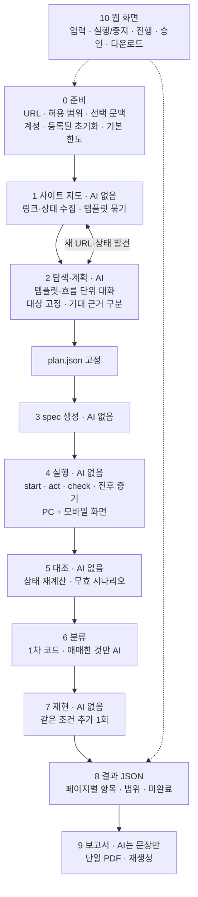

# WebTestPilot v2 설계

| 항목 | 내용 |
|---|---|
| 버전 | 3.8 (2026-10-19) — 증거 완전성·같은 탭. 3.7 (2026-10-18) — member-02 구현에서 가져온 설계. 3.6 (2026-10-16) — 중간발표 전후 순서 변경. 3.5 — 상태 칸을 코드에 맞게 갱신. 3.4 (2026-10-16) — C1~C4·Q22 결정 기록. 3.3 (2026-10-15) — 자율 탐색을 기본 동작으로, 시스템 판정 단계·일반 규칙 묶음·실행 중 질문 결정 반영 (3.2: 아키텍처 토론 합의) |
| 근거 문서 | [프로젝트 방향성 공유본](../project-alignment/WebTestPilot_프로젝트_방향성_공유본.md), [Q1~Q66 최종 입장](../project-alignment/WebTestPilot_Q1-Q66_최종_입장.md), [AGENTS.md](../../AGENTS.md), [첫 유료 실측](../reviews/V2_LIVE_MAISON_2026-10-15.md), [비교군 분석](../reviews/AGENT_COMPARISON_2026-10-15.md) |
| 위치 | 팀 전체의 제품 기준 설계. `qa/`가 `integration/`을 대체하는 것이 목표이며, 전환은 11장 M8 비교 평가를 통과한 뒤에 한다 |
| 표기 | 요구사항의 상태: **완료** = 구현·무료 검증됨, **부분** = 일부 구현, **미구현** |

> 이 문서는 설계 목표다. 구현 완료나 팀 전체 승인 완료를 뜻하지 않는다. 수치(한도·화면 크기·평가 규모)는 표시한 곳에서만 확정이고, 나머지는 측정 후 정한다.

---

## 1. 목표

### 1.1 제품 정의

WebTestPilot은 **개발·QA 단계의 승인된 웹사이트를 자동으로 탐색·검사하고, 페이지별 결함 후보의 재현 절차와 증거를 정리한 단일 PDF를 제공하는 QA 보조 도구**다.

- **시스템이 하는 일:** 검사할 기능 발견, 검사 행동 준비·실행, 문제 후보 판단, 추가 1회 재현, 증거·보고서 정리.
- **사람이 하는 일:** 결과를 실제로 검증하고, 결함 여부를 최종 확인하고, 수정에 착수한다.
- **사용자가 하지 않는 일:** 페이지별 테스트 스크립트나 클릭 순서 작성, 시간·토큰 예산 계산.

**기본 동작은 자율 탐색이다 (2026-10-15 사용자 결정).** URL과 허용 범위만으로 사이트를 탐색해 기능을 찾고 검사한다. 요구사항은 필수 입력이 아니라 **추가 입력**이다. 요구사항을 주면 그 검사를 먼저 확보하고, 남은 예산이 있으면 자율 탐색을 계속한다("요구사항 + α"). 남은 예산이 없으면 "자율 탐색 미실행(예산 소진)"으로 기록한다. 사용자가 생각하지 못한 버그를 찾는 것이 자율 탐색의 목적이다.

**시스템은 판정을 미루지 않는다.** 최종 결정은 사람이 하지만, 프로그램은 판정할 수 있는 항목마다 "버그(확신 높음·중간) / 개선 제안 / 버그 아님 / 판단 보류(업무 규칙 질문 포함)" 중 하나와 이유를 낸다. 실행·증거·재현이 끝나지 않은 항목은 판정하지 않고 미완료 사유를 남긴다(5장 6단계).

### 1.2 성공 기준

- **수집한 페이지 수나 입력 크기 감소로 판단하지 않는다.** 다음으로 판단한다.
  - 실제 검사를 수행했는가 (실행 완료와 미완료의 구분)
  - 결함 후보가 정확한가 (탐지율·오탐·미탐)
  - 제공한 조건으로 재현되는가 (자동 재현, 보고서만 보고 사람이 재현할 수 있는가)
  - 보고서가 검증에 필요한 자료를 담고 있는가
  - 시간과 API 비용
- **최종 성능은 개발에 쓰지 않은 독립 앱에서 잰다.** Maison 같은 개발 사이트의 통과율·적중률은 제품 성능이 아니다 (AGENTS.md).
- **정직성:** 계획, 실제 실행, 판정을 구분한다. skip·미계획·중단·보류를 분모에서 숨기지 않는다. 검사 통과는 실제로 완료한 범위의 결과이지 사이트 전체 정상 보장이 아니다.

### 1.3 하지 않는 것

| 구분 | 내용 |
|---|---|
| 제외 | 모든 결함 탐지 보장, 모든 브라우저·실기기 지원, 무제한 긴 업무 흐름, 장기 유지용 회귀 테스트 파일 생성, 정확한 코드 원인 진단·자동 수정, 담당자 검토 입력·이슈 관리, 공개 다중 사용자 서비스, 실결제·외부 발송·운영 데이터 삭제 |
| 조건부 확장 | 서버(AWS) 배포, 추가 사이트·기능·버그 범주, 재사용 테스트 파일, 상용 도구 비교, 경험자 작업 시간 실험. 핵심 파이프라인과 평가를 희생하면서 필수 범위에 넣지 않는다 |

---

## 2. 요구사항

### 2.1 입력과 실행 준비

| ID | 요구사항 | 근거 | 상태 |
|---|---|---|---|
| IN-1 | 기본 입력은 시작 URL과 허용 범위(origin·행동). 요구사항·사이트 설명은 선택 문맥 | Q2, Q23 | **부분** — URL·origin·쓰기 허용, 요구사항은 선택 입력(M3 1차). 사이트 설명 입력과 `run.json`은 없음 |
| IN-2 | 요구사항 없이도 자율 탐색으로 검사할 기능을 찾는다. **기본 동작**이며 요구사항이 있어도 함께 돈다 | Q11, 3.3 결정 | **부분** — 요구사항 없이 사이트 지도 → 페이지 종류마다 새 대화로 탐색(M3 2차). 기능 목록(F#)·일반 규칙 ID·질문 기록·시스템 판정, 템플릿 큐(턴 한도로 끝난 종류 1회 재시도)·동시 대화·정체 종료·흐름 단위 탐색(2026-10-17). 질문 답변 반영(`business_rule`)은 없음 |
| IN-3 | 테스트 계정 기본 자동 로그인, 어려우면 사용자가 로그인 상태를 준비하는 경로 | Q49, Q53 | **미구현** — M5 |
| IN-4 | 등록된 초기화(reset/seed) 절차만 호출·확인. 없으면 비변경 검사만 하고 나머지는 보류 | Q13, Q20, Q21 | **미구현** — M5 (지금은 시작 URL 이동만) |
| IN-5 | 실행 한도는 프로그램 기본값. 사용자가 예산을 계산해 입력하지 않는다 | Q23, Q27 | **부분** — 기본값으로 실행(2026-10-17): 예산 $10(30%는 분류·재현 몫), 탐색 시간 40분(넘으면 새 대화를 시작하지 않음), 템플릿 수 8·템플릿당 턴 25·실행 페이지 3·지도 페이지 30, 정체 종료(변화 없는 행동 5번 연속이면 재촉, 8번이면 종료). 값은 임시값이다. 행동 수 한도와 보고서 몫은 없음 |
| IN-6 | 허용 범위 밖이거나 불명확한 행동은 실행 중 승인 요청. 거절되면 의존 검사만 보류 | Q55 | **미구현** — M5 (지금은 정책 위반을 막고 기록만) |

### 2.2 탐색과 검사

| ID | 요구사항 | 근거 | 상태 |
|---|---|---|---|
| EX-1 | 관찰 → 검사 → 새 URL·상태 발견을 반복하며 범위·한도 안에서 넓게 탐색 | Q14, Q26 | **부분** — 사이트 지도(같은 origin GET, 페이지 한도)로 템플릿을 찾고 템플릿마다 새 대화(M3 2차). 탐색 중 발견한 새 URL을 지도에 추가하는 반복과 큐 순환은 없음 |
| EX-2 | 같은 URL의 다른 상태(로그인, 펼친 메뉴, 입력 결과)도 검사 대상 | 방향성 5장 | **부분** — 탐색 중 행동 후 상태에서 대상 고정 가능 |
| EX-3 | 짧은 다중 페이지 흐름(목록→상세, 작성→확인)을 상태를 유지하며 검사 | Q16 | **부분** — 시나리오가 페이지를 넘나들고, 관측 참조로 앞 페이지 값과 비교(`link-target` 등, M2~M3). 로그인·쓰기가 필요한 흐름은 M5 |
| EX-4 | 기대 근거를 구분: 요구사항 / 화면·HTML의 명시적 제약 / 관찰 / AI 추정. AI 추정만으로는 결함 확정 금지 | Q7, Q22 | **부분** — 4종과 관측 참조(M2), 일반 규칙 ID·규칙별 허용 연산과 시스템 판정(M3). AI 추정은 결정적 관계 규칙만 확신 높음, 나머지 최대 중간. `business_rule` 없음 |
| EX-5 | 네 범주: 기능, 입력 검증, 이동·라우팅, UI 표시·조작 | Q9, Q24 | **부분** — 기능, 입력 검증(`required-input`·`invalid-input-feedback`), 이동(`read: url`, `link-target`), UI 일부(품질·사용성 점검: 이름 없는 조작 요소·가려진 조작 요소·가로 넘침, 데스크톱·모바일 폭, 2026-10-17), 시각 판정(`read: visual`, 조건별 판정·이미지 재현, 2026-10-18). 실제 앱 유료 실측은 없음 |
| EX-6 | PC Chrome + 모바일 화면 크기의 반응형 UI·상호작용 추가 검사 | Q50, Q54 | **부분** — 시나리오 `viewport`(desktop 1280·mobile 390), 탐색 `viewport` 도구, 같은 크기 pin 검증(2026-10-18). 터치·모바일 UA는 켜지 않음(크기만) |
| EX-7 | 업무 규칙을 모르면 최소한의 질문으로 보완, 답이 없으면 관련 판정만 보류. **탐색 중 즉시 묻고 기다리지 않는다**(5장 2단계) | Q12, Q17, 3.3 결정 | **부분** — `ask_user`로 기다리지 않고 질문 기록, 실행당 상한 5개(넘으면 "규칙 미확인"), 판정에 `pendingQuestions`(M3). 답을 받아 `business_rule`로 반영하는 경로와 화면 응답(M7)은 없음 |

### 2.3 실행·증거·판정·재현

| ID | 요구사항 | 근거 | 상태 |
|---|---|---|---|
| RUN-1 | 계획·실제 실행·판정을 분리하고, 실행 여부가 불명확한 행동을 구분 | Q43 | **완료** — plan/ledger/verdict 분리, `uncertain_execution` |
| RUN-2 | 행동 전후 스크린샷 자동 기록. 최초·발견·재현 증거를 초기화 전에 보존. 화면 크기·스크롤 위치 기록 | Q65, Q66 | **부분** — 시작·행동 직전·직후 snapshot·스크린샷, 누른 요소 기록, 검사 재시도 기록(M3). 화면 크기·스크롤 위치 기록 없음 |
| RUN-3 | 후보는 같은 시작 조건에서 실제 행동을 추가 1회 실행. 새 AI 탐색으로 대체하지 않음 | Q10, Q28 | **부분** — 최초 실행 폴더의 plan·정책으로 재실행하고, 재실행의 선행조건 통과로 같은 시작을 판단(M2). 초기화·서버 상태 준비는 없음 |
| RUN-4 | 재현 결과와 기대 근거는 별도로 판단. 재현 실패·초기화 불가·실행 미완료를 구분 | Q10, Q28 | **부분** — 지금은 reproduced·flaky·reproduction_inconclusive 한 축뿐. 결과와 사유(초기화 불가·실행 미완료·시작 상태 다름)를 나눈 두 축은 M5 |
| RUN-5 | 이미지 저장과 모델 전달을 분리. 기능·입력·라우팅은 구조 관찰, UI는 이미지와 함께 판단 | Q25 | **부분** — 저장만. 분류 모델에는 텍스트 증거(snapshot·행동 기록)만 전달, 이미지 전달 없음 |
| RUN-6 | 중지·한도 도달 시 완료된 검사와 증거를 보존하고 부분 결과 제공 | Q56 | **부분** — 단계별 저장·덮어쓰기 금지. 사용자 중지 없음 |

### 2.4 결과와 사용자 화면

| ID | 요구사항 | 근거 | 상태 |
|---|---|---|---|
| OUT-1 | JSON이 사실 원본. 페이지가 다르면 별도 항목, 같은 조건의 반복 발견은 새 결함이 아님 | Q29, Q60, Q62 | **부분** — `report.json`(report/1, 2026-10-17): 판정 항목은 페이지 × 검사 단위이고 다른 페이지 실행(복제)은 별도 항목이다. 재현은 그 항목에 합친다. 오류 신호는 종류·내용·경로로 묶는다. 같은 페이지의 같은 문제를 여러 검사가 잡았을 때 한 항목으로 합치지는 않는다 |
| OUT-2 | 실행 전체의 단일 PDF: 범위·종료 이유·미완료, 페이지별 문제, 기대/실제, 재현 절차, 주요 증거 | Q29, Q63 | **부분** — HTML을 Playwright로 PDF로 만든다. 실행 범위·종료·범위 밖(쓰기·로그인·초기화), 구역별 항목, 기대/실제·근거, 재현 절차, 실패 시점 스크린샷이 들어간다. 독립 재현 시험(다른 사람이 PDF만 보고 재현)은 하지 않음 |
| OUT-3 | 보고서 AI는 문장·요약·레이아웃만. JSON에 없는 사실·원인·재현 성공을 추가하지 않음 | Q33 | **미구현** — 보고서 AI 없음. 모든 문장은 JSON 값을 옮긴 틀이다 |
| OUT-4 | PDF 실패 시 JSON·증거 보존, 저장된 결과로 보고서만 재생성 | Q39 | **완료** — PDF가 실패해도 JSON·HTML을 남긴다. `node src/report.ts <폴더>`로 저장된 결과에서 보고서만 다시 만든다 |
| OUT-5 | 웹 화면: 입력, 실행·중지, 진행 상태, 승인·준비 안내, JSON·PDF·증거 다운로드, 보고서 재생성 | Q48 | **미구현** — M7 |

### 2.5 비기능

| ID | 요구사항 | 상태 |
|---|---|---|
| NF-1 | 승인된 테스트 환경·가상 데이터 전제. 허용 origin 밖·권한 없는 쓰기 요청 차단 | **부분** — 직접 요청은 차단. 외부로의 리다이렉트는 요청이 이미 나간 뒤 위반으로 기록하고 시나리오를 무효로 할 뿐 차단하지 못함. 결과에서 차단한 요청과 발생한 위반을 구분해 보고 |
| NF-2 | 비밀번호·API 키·세션은 모델 입력·공유 결과에 넣지 않음. 텍스트 마스킹만으로 이미지 속 비밀값이 사라진다고 가정하지 않음 | **부분** — 실행 코드에 키 환경변수 미전달. 로그인 비밀값·증거(스크린샷·snapshot·trace) 속 비밀값 처리 없음 (Q51) |
| NF-3 | 웹페이지 문구는 데이터일 뿐 지시가 아님 | **부분** — 권한·범위·기대값 변경은 코드가 막음(강제됨). 페이지 문구가 모델의 검사 목표 선택에 주는 영향은 검증하지 않음 |
| NF-4 | 자유로운 생성 코드를 제한 없이 실행하지 않음 | **완료** — spec은 템플릿, AI 코드 없음 |
| NF-5 | 모든 모델 호출 전 비용 예약, 가격·사용량을 모르면 중단. 보고서 생성 몫을 남김 | **부분** — 모든 호출 전 비용 예약, 동시 호출은 다른 호출이 끝날 때까지 대기. 분류·재현 몫 30%를 탐색에서 남김. 보고서 AI가 없어 보고서 몫은 아직 필요 없음 |
| NF-6 | 평가 정답(버그 위치·라벨)은 모델 입력에 넣지 않음 | **완료** — `eval/`에만 둠 |
| NF-7 | 한 실행 환경에서 한 작업만 활성 실행, 여러 사이트는 순차 | **미구현** — M7 |

---

## 3. 설계 원칙

1. **AI는 판단이 필요한 곳에만 쓴다.** 탐색·계획, 애매한 실패 분류, 보고서 문장 정리. 실행·대조·재현은 코드가 한다.
2. **규칙은 코드가 강제하고 프롬프트는 짧게 쓴다.** 프롬프트에는 역할·목표·좋은 결과의 모습만 넣는다. 금지 규칙은 스키마 검증·도구 권한·대조 규칙으로 옮긴다.
3. **이미 있는 것을 쓴다.** 페이지 표현은 Playwright 접근성 snapshot(ref), 실행은 Playwright Test, 증거는 trace·스크린샷.
4. **기대값은 AI가 바꿀 수 없는 곳에 둔다.** `plan.json`에 고정하고 spec은 ID만 참조한다.
5. **기록(ledger)을 믿지 않고 다시 계산한다.** 판정은 고정된 기대와 기록된 실제 값으로 프로그램이 계산한다.
6. **최초 결과는 지우지 않는다.** 재실행·재판정·보고서 재생성은 새 기록이다.
7. **사용자에게 스크립트를 쓰게 하지 않는다.** 추가 정보는 정확도를 높이는 문맥이지 시나리오가 아니다.

---

## 4. 전체 파이프라인

| 단계 | AI | 하는 일 | 산출물 | 상태 |
|---|---|---|---|---|
| 0 준비 | 없음 | 입력 검증, 로그인, 초기화 등록 확인, 기본 한도 | `run.json` | 부분 (입력 검증·비용 장부만. `run.json`·로그인·초기화 없음) |
| 1 사이트 지도 | 없음 | 같은 origin 링크·상태 수집, 같은 템플릿 묶기 | `explore.json`의 `sitemap` | 부분 (GET 수집·URL 모양 묶기·페이지별 품질·사용성 점검과 재점검 완료. 화면 구조 묶기·탐색 중 추가 없음) |
| 2 탐색·계획 | Opus | 템플릿·흐름마다 새 대화로 탐색, 대상 고정, 계획 제출 | `plan.json` | 부분 (페이지 종류별 대화·F#·일반 규칙·질문 기록·C4·흐름 단위·큐 재시도·동시 대화·정체 종료 완료. 질문 답변 반영·입력 세 묶음 없음) |
| 3 spec 생성 | 없음 | plan → 템플릿 spec | `specs/*.spec.ts` | 완료 |
| 4 실행 | 없음 | 헬퍼로 행동·검사, ledger·증거 기록 | `ledger.jsonl`, `evidence/` | 완료 (행동 전후 증거, 콘솔·요청 오류 신호, 화면 크기, 시각 검사 촬영 포함) |
| 5 대조 | 없음 | ledger ↔ plan, 무효 판정, 요구사항 집계 | `results.json` | 완료 |
| 6 분류 | Sonnet (애매한 것만) | 결함 후보 / 자동화 실패 / 불확실, 그 위에 시스템 판정(M3) | `verdicts.json` | 부분 (1차·AI 분류·시스템 판정, 품질·사용성 점검의 UI 결함·개선 제안, 시각 판정 완료. `business_rule` 없음) |
| 7 재현 | 없음 | 후보를 같은 조건으로 1회 재실행 | 재현 실행 폴더 | 부분 (초기화 미연동, 결과·사유 한 축. 시각 후보는 같은 크기·스크롤에서 이미지 두 장 비교) |
| 8 결과 JSON | 없음 | 페이지별 항목, 실행 범위·미완료 정리 | `report.json` | 부분 (report/1. 같은 문제 합치기 없음) |
| 9 보고서 | Sonnet (문장만, 미구현) | JSON·증거 → 문서 → PDF | `report.pdf` | 부분 (틀 기반 HTML → PDF. 보고서 AI 없음) |
| 10 웹 화면 | 없음 | 실행 관리와 결과 제공 | — | 미구현 |

---

## 5. 단계별 설계

### 0 준비

- **입력 (`run.json`):** 시작 URL, 허용 origin, 허용 행동(쓰기 여부), 선택 문맥(사이트 설명·요구사항 파일), 계정 참조, 초기화 절차 참조.
- **계정:** 비밀값은 실행 환경 변수나 별도 파일에 두고, 모델에는 `{{account:tester}}` 같은 자리표시자만 보인다. 로그인은 프로그램이 앱별 로그인 절차로 수행한다. 실패하면 "로그인 이후 기능 미검사"로 기록한다.
- **초기화:** `apps/<app>/reset.ts` 같은 등록된 절차만 호출하고, 결과를 확인한다(예: 확인용 GET이 기대 상태를 돌려주는지). AI는 등록된 절차 중에서 필요한 것을 고를 수만 있다.
- **기본 한도:** 전체 비용·시간·모델 호출 수, **행동 수**(탐색·실행·재현의 브라우저 행동을 모두 셈. 한 응답의 여러 도구 호출도 각각 셈), 템플릿당 탐색 턴, 변화 없는 반복 횟수. 사용자는 고급 설정에서만 바꾼다. **보고서 생성 몫은 처음부터 따로 떼어 둔다.** 한도에 닿으면 새 탐색을 멈추고 남은 검사는 미완료로 표시한다. 기본값은 M3 실측 후 정한다.
- **비밀값과 증거:** 로컬 원본 증거(스크린샷·snapshot·trace·로그)와 모델 입력·공유 결과(PDF)를 구분한다. 비밀번호 입력칸 등은 스크린샷에서 가린다(Playwright `mask`). 모델 입력과 PDF에는 가린 사본만 쓴다. 텍스트 마스킹만으로 이미지 속 비밀값이 사라졌다고 가정하지 않는다(Q51). — M5

### 1 사이트 지도 (AI 없음)

- 시작 URL에서 같은 origin 링크를 너비 우선으로 모은다. 쓰기 없이 GET만, 한도 안에서.
- **템플릿 묶기:** URL 패턴(`/product/:slug`)과 페이지 구조 지문(접근성 트리의 역할 구성)이 같으면 한 템플릿으로 묶는다. 묶기는 대화를 나누고 보고서의 범위를 표시하는 단위다.
- **기준 실행 (Q14):** 범위·한도 안에서 방문한 **독립 페이지·기능 상태는 모두** AI가 검토한다. 같은 템플릿의 페이지는 한 대화 안에서 요약으로 함께 검토한다. 같은 템플릿의 일부 페이지를 AI 검토에서 건너뛰는 "선택적 호출"은 기준 실행과 비교해 비용 감소와 미탐 증가를 함께 잰 뒤에만 켠다. 결과에는 페이지마다 "AI 검토함 / 건너뜀(사유)"을 남긴다. **C4 승인(2026-10-16):** AI 탐색·계획은 템플릿마다 한 번, 같은 템플릿의 다른 페이지에는 고정 계획만 실행한다. 원안(전부 AI 검토)은 평가에서 한 번 비교 대상으로 쓴다.
- 탐색 중 새 URL·상태가 발견되면 지도에 추가한다(관찰 → 검사 → 새 발견의 반복).
- 방문 범위를 "사이트 전체"라고 표현하지 않는다. 보고서에는 방문한 템플릿·페이지와 방문하지 못한 링크를 함께 남긴다.

### 2 탐색·계획 (AI, 구현 일부 완료)

**대화 단위.** 템플릿(또는 짧은 흐름) 하나당 새 대화를 연다. 이전 페이지 원본을 누적하지 않고 요약과 증거 참조만 넘긴다.

**모드 (3.3 결정, M3).** 자율 탐색이 기본이고 요구사항은 추가 입력이다. 요구사항 검사를 확보한 뒤 잔여 예산이 있으면 자율 탐색을 한다(잔여 0이면 "자율 탐색 미실행(예산 소진)" 기록).
- **기능 목록:** 탐색 에이전트는 템플릿마다 찾은 기능에 `F1: 카테고리 필터`처럼 ID를 붙인다. ID는 실행 전체에서 유일하며 `plan.json`의 `features`에 템플릿·이름·관련 요구사항(R#)과 함께 저장한다. 요구사항에 없는 기능도 목록에 남긴다. 시나리오의 `covers`는 R# 또는 F#다.
- **근거 제한:** F#만 다루는 검사(자율 검사)는 `inferred`(일반 규칙 목록의 규칙 ID 인용)·`constraint`·`business_rule`(업무 규칙 답변)·관측 참조만 근거로 쓴다. 요구사항 인용은 R#에만 쓴다.
- **우선순위 (예산 배분):** 요구사항이 있으면 요구사항 검사를 먼저 계획하고, 남은 예산으로 자율 탐색을 한다. 요구사항 검사와 자율 검사는 결과·분모를 따로 집계한다.
- **관계 비교 우선:** 요구사항이 없을 때는 앱 자체 모순(관측 참조로 표현되는 관계)을 우선 찾게 한다. 다만 관측 참조는 비교할 값의 출처일 뿐이므로, 관계가 성립해야 하는 이유(규칙 ID와 적용 조건)를 따로 적는다. 예: 상단 "7개 상품"과 목록 수는 문구가 전체 개수인지 현재 페이지 개수인지 확인된 경우에만 비교한다.

**탐색 범위 단위: 템플릿과 페이지 (3.3 결정, C4 승인 2026-10-16).**
- **페이지**는 URL 하나(`/product/orb-table-lamp`), **템플릿**은 같은 구조·기능을 공유하는 페이지 종류(상품 상세)다.
- **계획 확정은 템플릿마다 한 번** 한다(비싼 부분). 템플릿 큐 재방문은 아직 계획을 확정하지 않은 템플릿의 탐색을 이어 가는 데만 쓴다. 고정된 계획은 **같은 템플릿의 페이지 여러 개(대표 포함 기본 3개)에서 그대로 실행**한다. 추가 페이지에는 계획 비용이 없지만, 불일치가 나오면 분류 비용이 페이지마다 든다. 분류 비용은 따로 예약·측정하고, 같은 템플릿·같은 검사의 불일치는 묶어 한 번 분류하는 방안을 검토한다. 한 페이지에만 있는 데이터 결함을 잡는 것이 목적이다.
- 한도는 "템플릿 수 + 템플릿당 실행 페이지 수"(+ 전역 비용·행동·시간)로 둔다.
- **적용 범위 표시:** 검사·대상마다 "템플릿 공용" / "이 페이지 전용"을 계획에 표시하고 하네스가 검증한다. 대상·범위·선행조건·고정 기대값에 페이지별 텍스트(상품명·가격 등)가 들어 있으면 전용이다. 관측 참조는 페이지마다 새로 읽으므로 공용으로 쓸 수 있다. 다른 페이지에서 쓸 수 없는 검사는 "이 페이지에 적용 불가"로 기록하고 분모에 남긴다. **다른 페이지의 현재 값을 읽어 새 정답으로 삼는 재결합은 금지한다.**
- **템플릿 묶기는 잠정이다.** 실행 전에 계획이 쓰는 대상·컨트롤이 그 페이지에 있는지 확인한다. 없으면 통과나 조용한 생략으로 처리하지 않고 재분류하거나 "대상 없음(결함일 수 있음)"으로 기록한다. 검증 fixture에 정상적인 기능 차이(예: 기프트카드에만 있는 입력칸)와 요소 누락 결함을 둘 다 넣는다.

**실행 중 업무 규칙 질문 (3.3 결정, M3).** Claude Code처럼 탐색 에이전트에 `ask_user` 도구를 준다.
- 정답이 업무 규칙에 달려 있고 화면만으로 알 수 없을 때만 묻는다. 화면에서 알 수 있는 것은 묻지 않는다. 선택지 형식으로 묻는다(예: ① 해제된다 ② 유지된다 ③ 모르겠다).
- **탐색 중 즉시 묻고, 기다리지 않는다.** 질문을 남기고 다른 기능을 계속 탐색한다. 답이 오면 그 앱의 업무 규칙(앱 설정, 엔진 아님)으로 저장하고 이후 계획에 반영한다. 실행이 끝날 때까지 답이 없으면 그 질문에 걸린 항목만 "판단 보류 + 질문"으로 보고서에 남긴다.
- 실행당 질문 수 상한을 둔다(기본 5, 실측 후 조정). 상한을 넘은 미확인 규칙은 질문 없이 "판단 보류(규칙 미확인)"로 남긴다.
- **답의 저장:** 답은 근거 종류 `business_rule`로, 질문 ID·적용 범위(앱·템플릿)·답한 시각과 함께 앱 설정에 저장한다. 계획 확정 전에 온 답은 그 계획의 근거로 쓰고, 계획과 함께 고정해 재실행도 같은 답 기준으로 판정한다. 확정 뒤에 온 답은 고정 계획을 바꾸지 않고 다음 계획이나 별도 재판정 기록에 적용한다.
- 평가에서는 저장된 답도 입력 조건으로 고정한다. 답이 있는 실행과 없는 실행을 섞어 비교하지 않는다.

**탐색 배분 (합의 #4, M3).** 우선순위 엔진 없이 단순하게 나눈다.
- **전역 한도 하나**(비용·행동·시간·호출)만 둔다. 실제 호출 전에는 실행·재현·보고서 몫을 뺀 잔액을 확인한다.
- **템플릿 큐 순환:** 템플릿마다 짧은 턴 묶음을 배정한다. 묶음이 끝났는데 미검사 페이지·상태가 남으면 그 템플릿을 큐 뒤에 다시 넣는다. 탐색 중 새 템플릿이 발견되면 큐에 추가한다. 묶음 크기는 "남은 예산 ÷ 남은 템플릿 수"로 임시 배분하고 실측 후 조정한다.
- **정체 종료:** 대화 안에서 화면 변화 없는 행동이 N번 반복되면 그 묶음을 끝낸다. 정체 종료는 완료가 아니라 **미완료 사유**로 남긴다. N은 실측 후 정한다.
- **기록 보존:** 모델 문맥에서 뺀 대화도 원본 관측·행동·관찰한 이상·고정한 계획은 저장하고, 다음 대화로 넘기는 요약에 그 참조를 남긴다.
- **분모:** 템플릿을 검토했다고 해서 그 템플릿의 모든 페이지·상태를 검사한 것으로 세지 않는다. 페이지·상태별 검사 이력을 따로 남긴다.

**AI 입력 세 묶음 (Q42).** 대화를 새로 열 때와 흐름을 이어 갈 때 다음을 넘긴다.

| 묶음 | 필드 | 상태 |
|---|---|---|
| 사이트 공통 문맥 | 사용자 설명·요구사항(있으면), 사이트 지도 요약(발견한 템플릿·기능), 허용 행동·origin, 등록된 초기화 절차 목록 | 허용 행동·요구사항만 있음 |
| 현재 페이지 관찰 | URL, 접근성 snapshot(ref), 오류(콘솔·네트워크 실패), 증거 참조, UI 검사에 필요한 이미지 | URL·snapshot만 |
| 현재 검사 흐름 | 목표, 시작 조건, 이전 행동과 결과 요약, 기대 근거, 이미 고정한 대상, 관찰한 이상 | 대화 안에서만 유지(대화를 넘는 인계 없음) |

사용자 제공 정보, 관찰 사실, AI 추정은 필드로 구분한다. — M3에서 세 묶음을 계약으로 고정한다.

**도구** (구현됨): `snapshot(ref?)`, `navigate`, `click`, `fill`, `select`, `press`, `pin`, `ask_user`, `submit_plan`. 개발 중에는 같은 도구를 MCP 서버(`qa/src/mcp.ts`)로 노출해 Codex·Claude Code 구독으로 돌린다.

**대상 고정(pin).** ref를 그 자리에서 Target으로 바꾼다. 문자열을 코드로 실행하지 않고 데이터로 저장한다.

| 대상 종류 | 식별 방법 | 상태 |
|---|---|---|
| 이름 있는 컨트롤 | 역할 + 이름(숫자는 패턴) | 완료 |
| 같은 이름이 여럿 | 가까운 이름 있는 상위 요소로 범위 좁히기 | 완료 |
| 같은 이름·같은 주소의 링크 여럿 (머리말·꼬리말의 같은 메뉴, 로고와 "Home") | 이름 없는 랜드마크(머리말·꼬리말·본문·메뉴 등)도 범위로 쓴다. 그래도 좁히지 못하면 주소(href)까지 같은 링크끼리를 동등한 대상으로 보고 그 안의 순서로 고정한다. 어느 것을 눌러도 같은 곳으로 가기 때문이다. 이름이 같아도 주소가 다른 링크는 섞지 않는다. 실행 때 같은 주소 링크 수가 다르면 대상이 바뀐 것으로 본다 | 완료 — 2026-10-18 (member-02 실행 대상 검증의 "같은 목적지 링크 허용"에서 가져온 설계) |
| ref 없는 텍스트(가격·개수) | 텍스트를 담은 요소 ref + 텍스트 | 완료 |
| 개수 세기 | 그룹(같은 부모의 같은 역할) | 완료 |
| 이름 없는 아이콘 버튼, 숫자만 있는 표시 | **유일한 라벨(anchor) 영역 안의 역할 + 순서** (예: "Quantity" 영역의 버튼 2개 중 두 번째). 라벨 유일성과 구성원 수를 pin·실행 때 검증 | 완료 — M2. ref 없는 비활성 버튼은 미지원(M3) |
| 동적 영역(로드마다 바뀜) | pin 때 다시 불러와 대상이 남는지 확인하고, 바뀌면 위치 기반 대상(`position`, 예: "관련 상품의 첫 카드")만 허용 | 완료 — M2 |
| 목록 컨테이너를 그룹으로 고름 | 그 안의 같은 역할 항목들을 그룹으로 | 완료 — M2 |

**계획 계약 (`plan.json`).** 요구사항 목록(있으면), 시나리오(시작 URL·화면 크기·행동·검사), 미계획 항목과 사유, 고정된 대상, 탐색 중 관찰한 이상(`observations`).

| 검사 필드 | 내용 | 상태 |
|---|---|---|
| `read` | text, value, checked, visible, count, **url**, **items** — 구현됨. 추가(합의 #2, 최소 집합만): **scroll**(scrollY), **overflow**(가로 넘침 = scrollWidth > 화면 폭), **visual**(UI, 이미지 판단). `enabled`는 M3 검토 | url·items 완료(M2). `value`는 선택 상자에서 선택된 옵션 라벨을 읽음(다중 선택은 JSON 배열, M3). visual 완료(op `satisfies`, 번호 조건 1~6개, 2026-10-18). overflow는 ③ 점검이 계산하므로 계획 읽기로 두지 않음. scroll 미구현 |
| `op` | equals, not_equals, contains, less, greater, same_number(첫 숫자끼리), all_equal, all_contain, any_equal, any_contain, sorted_asc·sorted_desc(`expected`는 정렬 기준 `number`·`text`, 기준을 정하지 못하면 "값 못 읽음"). `record`는 C4 복제 전용 내부 연산. 일반 규칙마다 허용 연산이 정해져 있음 | 완료 — M2, same_number·sorted·규칙별 허용 연산 M3 |
| 비교 값 | `expected`(고정 기대값) 또는 `expected_from`(관측 참조, 아래) | 완료 — M2 |
| `source` | **비교 규칙의 근거.** `requirement`(요구사항 인용) / `constraint`(화면 안내 인용, 탐색 중 모델에게 보여 준 텍스트만) / `observed`(시작 시점만) / `inferred`(일반 규칙) / `business_rule`(업무 규칙 질문의 답). M3에서 `inferred`는 일반 규칙 목록의 규칙 ID를 인용하게 바꾼다 | 4종 완료 — M2. 규칙 ID 완료(M3, `rules.ts`). `business_rule` 미구현 |
| `precondition` | 이 검사가 뒤 행동의 **선행조건**인지 표시(합의 #5). 실패하면 시나리오를 멈추고 "준비 실패"로 남긴다(결함 아님). 기능 검사를 숨기지 못하게 시작 시점·요구사항 근거가 아닌 검사에만 허용 | 완료 — M2 |
| `ready` | 시작 증거 전 화면 안정 대기(`settle`)와 그 결과 기록. 검사별 준비 조건은 선행조건과 검사 재시도로 대신함 | 부분 — M2 |
| `viewport` | desktop / mobile 화면 조건. 대상은 시나리오와 같은 크기에서 pin해야 함 | 완료 — 2026-10-18 |

**기대 근거와 관측 참조 (합의 #1, M1~M2).** 비교에 쓰는 **값의 출처**와 **비교 규칙의 근거**를 분리한다. 탐색 에이전트는 결함이 있을 수 있는 현재 앱을 보고 계획을 만들기 때문에, 화면에서 본 값을 그대로 정답으로 쓰면 결함 동작을 정상으로 고정해 놓치게 된다.

- **관측 참조(`expected_from`):** 실행 중 앞선 검사가 기록한 실제 값을 참조한다. 예: `S1.C1`(클릭 전 카드 이름 읽기)의 값 = 상세 제목. 참조에는 대상·읽기 방식·시점(어느 행동 뒤인지)·증거 ID가 고정된다. 같은 검사 자신이나 순환 참조는 거부한다. 참조할 값은 비교보다 앞선 시점에 먼저 기록돼야 한다.
- **비교 규칙의 근거(`source`):** "카드 이름과 상세 제목이 같아야 한다", "필터 해제 후 목록 수는 처음과 같아야 한다", "증가 버튼은 수량을 1 늘린다" 같은 규칙에는 요구사항·화면 제약·AI 추정 중 하나의 근거를 둔다. AI 추정 근거의 불일치는 검토 후보를 만들 뿐 결함 확정이 아니다.
- **금지:** 탐색 때 본 값을 고정 기대값으로 그대로 쓰는 검사(예: 행동 뒤 값이 탐색 때 본 그대로여야 한다). 관측값은 선행조건(`precondition`)·대상 식별·관측 참조로만 쓴다.
- **대상과 값 분리:** 기대값 텍스트로 대상을 찾지 않는다. 잘못 표시된 실제 값도 같은 대상에서 읽어야 한다.

**계획 검증** (코드): 모양 검사, 요구사항 분모(요구사항이 있을 때), 출처 인용, 항상 참인 검사 거부, 시작 상태 대상의 pin 페이지 — **구현됨**. 관측값 그대로 정답 금지·관측 참조의 시점·순환·항상 참 검사 — 완료(M2). 화면 크기 일치 검사 — 완료(2026-10-18). **기능(F#)을 다루는 자율 시나리오**를 허용하되 규칙 근거는 `constraint`·일반 규칙·관측 참조만 쓰고, 집계를 요구사항 기반 결과와 나눈다 — M3. 행동 뒤 검사가 다른 페이지에서 pin한 대상을 쓰는 경우 경고 — M3(M2 실측 S5.C3).

### 3 spec 생성 (완료)

plan에서 시나리오마다 spec을 템플릿으로 만든다. 순서는 `start` → 시작 시점 검사 → (`act` → 그 행동 뒤 검사)…. spec에는 ID만 JSON 문자열로 들어간다. 같은 plan이면 같은 코드다.

### 4 실행 (완료)

- **헬퍼:** `start`(시작 URL 이동, 화면이 멈출 때까지 기다린 뒤 시작 증거. 시작 상태 확인은 선행조건 검사가 함 — M2), `act`(사전 확인 후 실행. 대상 사라짐·행동 불가는 `not_executed`, 실행 중 오류는 `uncertain_execution`으로 멈춤), `check`(기한까지 다시 읽기, 첫 읽기 값 보존). 모든 결과는 예외 전에 ledger에 쓴다.
- **텍스트 읽기 기준:** 탐색 때 모델이 본 것과 같은 기준(접근성 텍스트)으로 읽는다. 표시 텍스트(CSS 대소문자 변환)와 섞지 않는다. — M1 수정
- **증거:** 행동 전후 현재 화면 스크린샷을 자동 기록한다(완료). 시작 기록에 화면 크기, 시각 검사 촬영에 화면 크기·스크롤 위치·대상 위치를 남긴다(2026-10-18).
- **증거 완전성:** 촬영·snapshot 실패는 이미 ledger에 `captureErrors`로 남지만 대조 결과로 전달되지 않는다. 대조 결과에 증거 완전성을 별도 상태로 넘기고, 촬영 실패를 사이트 결함으로 보지 않는다. 이미지가 필요한 판단(UI 시각 검사)에 이미지가 없으면 판정하지 않고 "증거 부족"으로 남긴다(Q66). — **완료 (2026-10-19)**: 시작·행동·검사의 `captureErrors`를 대조 결과·판정 항목·보고서(`evidenceGaps`, 항목별 표시)로 옮긴다. 시작 snapshot 실패도 시작 기록을 지우지 않는다. 실패 시점 snapshot이 없는 항목의 AI 결함 분류는 증거로 확인할 수 없어 "증거 부족"(미완료)이다. 스크린샷만 빠진 것은 판정을 막지 않는다(읽은 값과 snapshot이 근거). 분류 입력에 빠진 증거를 알린다
- **UI 시각 검사 경로 (`read: visual`):** 실행 단계는 판단하지 않고 현재 화면 스크린샷과 대상 위치(접근성 snapshot `boxes`)만 저장한다. 판정은 6단계의 시각 판정(Sonnet, 이미지 입력)이 계획에 고정된 기대 설명과 근거(요구사항·화면 제약·관찰)를 기준으로 한다. 이미지 토큰을 포함해 비용을 예약하고, 결과는 다른 검사와 따로 집계한다(Q25). — **완료 (2026-10-18)**: `fixture.ts visual`(촬영), `visual.ts`(판정·재현), 일반 규칙 `content-readable`(③), 보고서 "시각 판정" 구역. 대상 위치는 접근성 `boxes` 대신 locator `boundingBox`. 실제 앱 유료 실측은 아직 없다
- **시각 판정 응답 구조 (member-02 판정 모듈에서 가져온 설계, M4).** 시각 판정은 기계 비교가 아니라 AI가 판정하므로 "일부 조건만 보고 통과"를 막는 장치가 필요하다.
  - 계획의 기대 설명은 조건 여러 개면 번호를 붙여 고정한다.
  - 판정 AI는 조건마다 met / unmet / unknown과 근거(이미지·증거 ID)를 낸다. 응답 형식은 strict 도구 스키마로 고정한다.
  - 코드가 판정을 정한다: 모든 조건이 met이고 근거를 인용했을 때만 통과. unknown이 하나라도 있으면 "증거 부족"(미완료 구역). 근거 있는 unmet이 있을 때만 UI 결함 후보. 근거 없는 unmet은 증거 부족으로 낮춘다. 코드는 판정을 올리지 않고 낮추기만 한다.
  - 모델의 원래 응답과 낮춘 사유를 함께 남긴다.
  - 한계: 조건 분해와 met 판단도 모델이 한다. 조건을 빠뜨리는 의미 오류는 코드가 막지 못한다.
- **시각 후보의 재현 (member-02 UI 이미지 재현에서 가져온 설계, M4).** 재실행에서 같은 화면 크기·스크롤 위치·선행조건이 확인될 때만 원본과 재현 이미지를 함께 판정 AI에 보내 "같은 위반이 다시 보이는가"를 묻는다. 화면 크기나 스크롤이 다르면 재현 판단 불가로 남긴다. 기능 검사의 재현(값 비교)과 같은 결과·사유 두 축을 쓴다.
- **화면 크기:** 시나리오에 `viewport`(desktop/mobile)를 둔다. 모바일은 PC 기능 검사를 반복하지 않고, 메뉴·모달·버튼 접근·가림·잘림을 추가 검사한다. 대표 크기 목록은 미정(14장).
- **정책:** 러너 컨텍스트에도 탐색 때와 같은 origin·쓰기 정책을 건다.
- **행동 실행 결과의 원인별 집계 (적응 실행 대신):** 계획된 행동마다 계획·시도·완료·미실행(`not_executed`, 사유별)·실행 여부 불명확을 집계한다. **행동 실행 실패율**과 **요구사항 검사 범위**(미계획·후속 중단 포함)를 따로 보고해, 분모에서 미계획이 숨지 않게 한다. 평균 아래 숨은 특정 흐름의 반복 실패도 따로 본다. — **완료 (2026-10-18)**: `report.json actions`(실패율은 시도 기준, 시도 못 한 행동은 원인별, 무효 시나리오는 따로, 같은 대상에서 두 번 이상 실패한 행동 목록). 실행 중 AI가 대상을 다시 찾는 적응 실행은 보류한다(6.2).
- **콘솔·네트워크 신호:** trace에 이미 담긴 콘솔 오류·실패한 요청을 구조화해 추출하고, 해당 행동·페이지의 증거와 검토 대상으로 연결한다. 기대값 없이도 잡히는 신호지만 정상적인 거절(401·403·422 등 검사 의도대로의 응답)과 정책 차단은 결함으로 세지 않는다. — M4

### 5 대조 (완료)

- 고정된 기대값과 기록된 실제 값으로 상태를 다시 계산한다.
- 순서 위반·중복·정책 기록 누락이나 위반·시작 실패 뒤 기록이 있으면 시나리오를 **무효**로 하고 통과 집계에서 뺀다.
- 실행되지 않은 검사는 `not_run`, 깨진 ledger 줄은 문제로 남긴다.

### 6 분류 (부분) · 7 재현 (부분)

**현재 구현 (M2).**
- 1차 분류(코드): passed / passed_inferred / passed_observed / mismatch / precondition_failed / not_run(원인 연결) / invalid / uncertain_execution / needs_triage.
- AI 분류: needs_triage와 mismatch를 보낸다. 비교 기록(기대·관측 참조·실제·읽기 방식·시점·시작 화면 준비 여부)을 필드로 넘기고, 실패 시점 증거를 원문 그대로 인용해야 통과한다. 분류는 원래 불일치 위에 덧붙인다.
- 재현: 최초 실행 폴더의 plan·정책으로 1회. 실행 코드가 다르거나 재실행에서 선행조건이 통과하지 못하면 `reproduction_inconclusive`. 관측 참조 검사는 값이 아니라 같은 규칙이 다시 깨졌는지로 비교한다. 결과는 reproduced / flaky / reproduction_inconclusive 한 축이다.

**시스템 판정 (3.3 결정, M3).** 단계별 결과(비교·AI 분류·재현)는 그대로 남기고, 그 위에 시스템 판정을 하나 붙인다. 판정할 수 있는 항목은 "검토 필요"로 미루지 않고 판정과 이유를 낸다.

**먼저 판정할 수 있는 상태인지 본다.**
1. 실행·증거·재현이 끝나지 않은 항목(증거 부족, 재현 판단 불가, 분류 미완료, 실행 여부 불명확)은 판정하지 않는다. 사유와 함께 "자동화 실패·미완료" 구역으로 보낸다. 기술적 불확실을 억지 판정으로 바꾸지 않는다.
2. 끝났는데 정답이 업무 규칙에 달려 있으면 질문을 붙여 판단 보류한다(질문 상한을 넘으면 "규칙 미확인").
3. 나머지는 아래 판정 중 하나를 반드시 낸다.

| 시스템 판정 | 조건 (실행·재현이 끝난 항목) |
|---|---|
| **버그 — 확신 높음** | 요구사항·업무 규칙 답변 위반, 또는 **결정적 관계 규칙**(`link-target`·`count-matches-list`: 다른 대상·시점에서 읽은 값과 equals·same_number로 비교) 위반(Q22 제한 승인). 재현되고, AI 분류가 증거 인용으로 자동화 실패가 아님을 보여야 한다. 재현만으로 적용 조건 확인을 대신하지 않는다 |
| **버그 — 확신 중간** | 화면 제약(`constraint`) 근거 위반(인용이 기대를 뒷받침하는지 기계적으로 확인할 수 없어서, 2026-10-16), 일반 규칙 ② 위반, 또는 적용 조건을 확인하지 못한 ① 위반. 같은 템플릿의 다른 페이지와 다르게 동작했다는 사실은 이유에 적되 등급을 올리지 않는다. 사용자가 업무 규칙으로 확인하면 `business_rule` 근거로 바뀌어 확신 높음이 될 수 있다 |
| **UI 결함** | 일반 규칙 ③ 위반이 실제 정보 확인이나 조작을 막음(예: 가로 넘침이 결제 버튼을 가림). 근거 강도에 따라 확신 높음·중간을 붙인다 |
| **개선 제안** | 조작을 막지 않는 일반 규칙 ③ 위반. 버그 집계와 따로 센다 |
| **버그 아님** | 통과, 또는 자동화 실패로 판명(원래 불일치 기록은 보존) |
| **판단 보류** | 업무 규칙에 따라 정답이 갈리는 경우만. 질문을 붙인다 |

- **판단 순서:** 명시 근거(요구사항·화면 제약·업무 규칙) 위반 → 실제 정보·조작 방해 → 일반 권고.
- **Q22 제한 승인 (2026-10-16):** 팀 결정 Q22는 "AI 추정만으로 결함을 확정하지 않는다"이다. **결정적 검사기로 확인되는 관계 규칙**(`link-target`, `count-matches-list`: 화면에서 읽은 두 값을 하네스가 직접 비교)의 위반만 "버그 — 확신 높음"을 허용한다. AI는 비교 규칙을 고를 뿐이고 판정은 읽은 값끼리의 비교가 정한다. 나머지 일반 규칙은 최대 확신 중간이다. 요청 응답 코드를 기록하게 되면 `no-error-page`를 같은 기준으로 추가 검토한다. 최종 확정은 여전히 사람이 한다.
- **평가:** 보류 비율은 결단력 지표지만 오탐·미탐과 함께 해석한다. 등급별 오탐·미탐, 미계획, 보류, 미완료를 모두 남긴다. 일반 규칙별 오탐률은 개발 앱 정답지로 사후에 재고, 규칙 등급을 바꾸면 **바꾸기 전후 같은 사례가 어느 등급으로 옮겨 갔는지** 기록한다. 등급 하향만으로 정확도가 좋아졌다고 보고하지 않는다. 이 조정은 개발 앱에서만 하고 미사용 독립 앱에서는 측정만 한다.

**일반 규칙 목록 (3.3 결정, M3에서 규칙 ID로 고정).** `inferred` 근거는 이 목록의 규칙 ID를 인용한다. 목록은 공통 엔진의 데이터이며 사이트별 규칙을 넣지 않는다. 앱 고유 규칙은 업무 규칙 질문의 답(`business_rule`)으로 앱 설정에 저장한다. **규칙마다 적용 조건·관측 범위·대기 조건·정상 예외를 데이터로 붙인다.** M3는 적용 조건이 분명한 소수 규칙으로 시작하고 실측으로 늘린다.

| 묶음 | 성격 | 예 (적용 조건 / 정상 예외) | 최대 판정 |
|---|---|---|---|
| ① 거의 예외 없음 | 적용 조건을 확인하면 사실상 버그 | 링크 이동 결과가 5xx 또는 같은 origin의 404 (예외: 401·403 권한 거절, 422 검증 응답). 링크·카드에 적힌 대상과 열린 대상이 다름. 활성 상태의 행동 버튼을 눌렀는데 화면·URL·요청 변화가 없음 (예외: 이미 선택된 탭·같은 값 저장). 클릭 직후 같은 origin 스크립트의 JS 예외 (예외: 외부 도메인 스크립트). 비활성 컨트롤이 동작함 | 결정적 관계 규칙(`link-target`·`count-matches-list`)만 확신 높음, 나머지는 중간 (Q22 제한 승인) |
| ② 대부분 맞지만 앱마다 다름 | 앱의 의도일 수 있음 | 필터 결과는 조건에 맞는 항목만, 초기화하면 처음 상태, 새로고침 후 상태 유지, 뒤로 가기로 이전 상태, 수량은 0·음수 불가, 잘못된 입력에 오류 안내, 같은 상태에서 같은 동작의 결과가 같음 (예외: 추천·무작위 기능), 실패한 제출 뒤 입력값 유지 (예외: 비밀번호 칸) | 확신 중간 |
| ③ 품질·사용성 | 조작을 막으면 UI 결함, 아니면 개선 제안 | 컨트롤의 접근 가능한 이름 없음, 가로 넘침, 로딩 표시 없음, 느린 응답(3초 이상) | UI 결함 또는 개선 제안 |

**③ 묶음 구현 (2026-10-17): 페이지 품질·사용성 점검.** AI 추정이 아니라 브라우저가 계산한 사실로 찾는다(`browser.ts auditPage`, 사이트 지도 수집 중 페이지마다 데스크톱 1280px·모바일 390px).
- **일반적인 실패 원인:** 시각·사용성 결함은 기대값을 고정한 기능 검사로는 잡히지 않는다(예비 비교에서 dogfood만 찾은 범주).
- **수정 책임:** 공통 엔진에서 처리한다. 사이트·상품별 분기는 없다.
- **일반화 근거:** 접근성 트리의 이름 유무, `elementFromPoint`로 확인한 실제 클릭 대상, 문서 폭은 어느 DOM에서나 같은 의미다. 다음은 정상 예외로 뺀다: 클릭이 통과하는 장식(`pointer-events:none`), 투명 요소, 자기 라벨 클릭, 열린 모달.
- **판정:** 가려진 조작 요소는 클릭이 다른 요소로 가므로 조작을 막는다고 보고 **UI 결함**으로, 이름 없는 요소와 가로 넘침은 **개선 제안**으로 둔다. 버그 집계와 따로 센다.
- **확인됨:** 발견이 있는 페이지는 새로 열어 다시 점검한다. 화면이 두 번 다 안정됐고 같은 대상(측정값 제외)이 다시 나와야 "확인됨"이다. 확인되지 않은 것은 결함 건수에 넣지 않고 따로 보인다.
- **검증:**
  - 개발 fixture `audit.html`: 걸려야 할 것 3종이 걸리고, 걸리면 안 될 것 2종(꾸민 체크박스, 통과 장식)은 걸리지 않았다.
  - 정상 게시판 5페이지: 발견 0건.
  - Maison(참고용): dogfood가 찾은 필터 칩 가림·아이콘 이름 없음을 찾았다. 고정 헤더 아래 breadcrumb 가림과 모바일 폭 1280px 넘침도 찾았고, 화면으로 확인했다.
  - 독립 앱 검증은 없다.
- **한계(shortcut):**
  - 페이지를 맨 위에서 연 상태만 본다. 스크롤 중 겹침이나 행동 뒤 상태는 보지 않는다.
  - iframe·shadow DOM 안은 점검하지 않는다.
  - 색 대비·글자 크기·로딩 표시·느린 응답은 없다.
  - 점검 시점의 스크린샷 증거가 없다.

참고: agent-browser의 `dogfood` 스킬(이슈 범주 목록)을 출발점으로 삼되, 그 스킬은 LLM의 판단을 그대로 결과로 쓴다. 우리는 규칙 ID·적용 조건·근거·재현·분류를 분리해 기록한다.

**목표 (변경 예정).**
- **분류 입력 구조화와 원래 결과 보존 (합의 #3) — M1~M4.**
  - mismatch도 AI 분류에 보낸다(M1). 결정적인 자동화 오류도 재현되므로 `reproduced`는 결함 확정이 아니다(첫 실측의 오탐 4건).
  - 분류 입력에 기대값·실제 값·읽기 방식·대상·시점·증거 완전성을 **필드로** 넣는다. 지금은 텍스트 증거 파일과 요약 문자열만 보낸다.
  - 분류는 원래 비교 결과 **위에 덧붙인다.** 자동화 실패로 분류돼도 최초 불일치 기록은 지우거나 통과로 바꾸지 않는다.
- **재현을 두 축으로 나눈다 — M5 (Q10·Q28).**
  - 결과: 재현됨 / 재현 안 됨 / 판단 불가
  - 사유(판단 불가일 때): 초기화 불가 · 시작 상태 다름 · 실행 미완료(도구·로그인 실패) · 실행 코드 다름
- **같은 시작 상태의 판단 (합의 #5) — M2~M5.** 전체 화면 해시 비교를 없앤다(추천 목록·시간 표시 때문에 정상 실행도 판단 불가가 된다). 대신 선행조건(`precondition`) 검사·대상 신원·확인된 초기화 결과가 최초와 같을 때만 같은 시작으로 본다. 모든 값의 동일성은 요구하지 않는다. 숨은 서버 상태를 확인하지 못했으면 "판단 불가"다.
- 등록된 초기화 절차가 있으면 재현 전에 호출하고 결과를 확인한다. 없으면 "초기화 불가"로 남긴다 — M5.

### 8 결과 JSON (미구현, M6)

판정 항목을 **페이지 × 문제** 단위로 묶는다. 같은 페이지·같은 조건의 반복 발견과 재현은 한 항목의 증거로 합치고, 다른 페이지는 별도 항목이다. 화면 크기가 다른 같은 문제는 한 항목에 조건별 증거로 붙인다.

| 보고 구역 | 들어가는 상태 |
|---|---|
| 버그 (확신 높음·중간)·UI 결함 | 6단계 시스템 판정. 요구사항 검사와 자율 검사를 나눠 표시 |
| 판단 보류 (업무 규칙) | 업무 규칙 질문에 답이 없어 보류한 항목과 그 질문, 질문 상한을 넘은 규칙 미확인 항목. 재현 안 됨(flaky)도 여기 |
| 개선 제안 | 일반 규칙 ③ 위반 |
| 탐색 중 관찰한 이상 | `observations`. 검사로 만들지 못한 의심 사항 |
| 자동화 실패·미완료 | 자동화 실패(분류 결과와 함께 원래 불일치 표시), 실행 여부 불명확, 준비 미완료(not_ready), 선행조건 실패, 미실행, 정체 종료, 증거 부족, 로그인·초기화 실패·승인 거절로 보류된 검사, 실행 미완료로 재현을 판단하지 못한 항목 |
| 오류 신호 | 콘솔 오류·실패한 요청 중 정상 거절·정책 차단이 아닌 것. 기대값 없이 잡힌 신호라 검토 대상 |
| 통과한 검사 범위 | 실제로 완료한 검사만. "사이트 정상" 표현 금지 |
| 실행 범위 | 방문한 템플릿·페이지, 방문 못 한 링크, 종료 이유(완료·한도·중지), 비용·시간 |

### 9 보고서 (미구현, M6)

- 보고서 AI는 `report.json`과 증거 목록을 받아 문장·요약·레이아웃만 만든다. 수치·판정·재현 결과는 JSON에서 그대로 옮기고, 생성 후 프로그램이 PDF의 핵심 값과 JSON을 대조한다.
- HTML로 만든 뒤 Playwright로 PDF를 렌더링한다(이미 쓰는 도구). 주요 스크린샷과 오류 발췌를 PDF 안에 넣는다.
- 실패하면 JSON·증거를 보존하고, 저장된 결과로 보고서만 다시 만든다. 새 검사를 시작하지 않는다.

### 10 웹 화면 (미구현, M7)

입력(URL·범위·문맥·계정 참조), 실행·중지, 진행 상태(현재 템플릿, 소요 비용·시간), 승인·준비 안내(새 권한 요청, 로그인 실패), JSON·PDF·증거 다운로드, 보고서 재생성. 한 번에 한 실행만 활성. 담당자 검토 입력·이슈 관리는 넣지 않는다.

**실행 제어 상태 (Q12·Q17·Q55·Q56).** 엔진(M5)이 상태를 정하고 화면(M7)은 보여 주고 응답만 받는다.

| 요청 종류 | 흐름 |
|---|---|
| 권한 승인 (새 권한·불명확한 행동) | 요청 → 대기 → 승인이면 그 행동부터 재개 / 거절·시간 초과면 그 행동에 의존하는 검사만 "보류(승인 거절)"로 두고 독립 검사를 계속 |
| 업무 규칙 질문 (기대 동작을 모름) | 권한 승인과 구분한다. 질문을 남기고 **기다리지 않고** 다른 탐색을 계속한다. 답이 오면 `business_rule`로 기록(5장 2단계) / 끝까지 답이 없으면 관련 판정만 "판단 보류 + 질문"으로 둔다. 보고서 생성 전에 답을 강제하지 않는다 |
| 사용자 중지 | 진행 중인 행동은 끝나면 기록하고, 끝나지 않으면 `uncertain_execution`으로 남긴다. 새 행동을 시작하지 않는다. 완료된 검사·증거로 부분 `report.json`을 만들고, 보고서 몫 예산 안에서 PDF를 만든다. 종료 이유는 "사용자 중지" |
| 한도 도달 | 중지와 같다. 종료 이유는 "한도 도달(종류)" |

프로그램이 꺼진 뒤 중간 지점에서 자동 복구하는 기능은 초기 범위에서 제외한다.

---

## 6. 결정 기록

### 6.1 실행 구조 변경 네 가지 (Q14·Q15·Q19 변경, 2026-10-16 승인)

**원래 결정 (그대로 인용).**
- Q19: "공식 Playwright MCP를 실행 도구 기반으로 채택한다. 기존 전처리기와 같은 브라우저·탭을 사용하고 증거·권한·사용량 기록이 연결되는지 검증한다. 채택을 이유로 Python 전처리기 전체를 미리 재작성하지 않는다."
- Q15: "AI는 검사 목표·행동·기대 조건·다음 행동·결과 해석을 선택한다. 프로그램은 허용 여부·요소·한도를 확인하고 MCP 도구로 실제 조작과 관찰·기록을 수행한다."

**추가 배경 (2026-10-15 사용자 설명).** MCP를 고른 이유는 정해진 스크립트로는 동적인 화면의 시나리오를 다 실행하지 못할 수 있다는 걱정이었다. 라이브러리 방식으로 그 걱정이 해소된다면 MCP를 고집할 필요는 없다.

| # | 변경 | 원래 결정 | v2 | 이유 |
|---|---|---|---|---|
| C1 | 실행 도구 | 공식 Playwright MCP | Playwright 라이브러리 위의 자체 도구. 개발·비교용으로 같은 도구를 자체 MCP 서버(`qa/src/mcp.ts`)로 노출 | MCP와 라이브러리의 브라우저 조작 능력은 같고, 자체 도구가 대상 고정·정책·증거 기록을 직접 강제할 수 있다 |
| C2 | 실행 중 AI 역할 (Q15) | AI가 실행 중에도 다음 행동·결과 해석을 선택 | AI는 탐색 중에 행동을 해 보고 계획을 고정한다. 실행은 결정적 spec이고 실행 중 AI는 없다. 결과 해석은 6단계 분류가 한다. (실행 중 AI가 대상을 다시 찾는 "적응 실행"은 토론 합의로 보류 — 6.2) | 재현성·비용, 그리고 AI가 실행 중에 기대를 바꾸는 문제를 막기 위해서다. 첫 실측(Maison)에서 계획된 행동 12개, fixture에서 행동 전부가 고정 spec으로 실행됐다 |
| C3 | 전처리기 재사용 | Python 전처리기를 미리 재작성하지 않음 | `integration/preprocessor`를 쓰지 않고 TypeScript로 새로 씀 (`browser.ts`, 사이트 지도는 M3) | 접근성 snapshot·ref를 그대로 쓰면서 자체 요약 view에서 생기던 참조 손실을 없애기 위해서다. 기존 전처리기의 URL 큐·범위 규칙은 M3에서 참고한다 |
| C4 | 같은 템플릿 페이지의 AI 검토 (Q14) | 방문한 독립 페이지·기능 상태는 모두 AI가 검토(같은 템플릿은 한 대화에서 요약으로) | AI 탐색·계획은 템플릿마다 한 번, 같은 템플릿의 다른 페이지(대표 포함 3개)에는 고정 계획을 실행만 한다. 페이지마다 "AI 검토함 / 계획 실행만 함"을 기록 (3.3, 사용자 결정) | 계획 비용을 템플릿 수에 비례하게 하고(분류 비용은 불일치 수에 비례), 한 페이지에만 있는 데이터 결함을 잡기 위해서다. 실행만 한 페이지에서 계획에 없는 결함을 놓칠 수 있으므로, 기준 실행(전부 AI 검토)과 비용·미탐을 비교해 확인한다 |

- **같은 브라우저·탭 (Q19·Q41).** 탐색은 템플릿 대화마다 브라우저 컨텍스트 하나·탭 하나를 쓰고, 그 안에서 행동과 증거가 같은 탭에 묶인다. 실행은 시나리오마다 새 컨텍스트에서 시작한다(Q18의 "독립 검사 시작 시 초기 상태 준비"와 같은 경계). ledger에 컨텍스트·페이지 식별자를 남겨 행동과 증거의 연결을 검증할 수 있게 한다 — **실행 쪽 완료 (2026-10-19)**: 실행 기록마다 탭 식별자(`tab`)를 남기고, 한 시나리오에 탭이 둘 이상이면 무효다. 행동이 새 탭·창을 열면 그 단계와 주소를 남겨 분류 입력과 보고서에 보인다(검사는 원래 탭을 읽는다). 탐색 쪽은 대화마다 한 탭이라 따로 기록하지 않는다.
- **다시 정할 조건.** 평가(M8)에서 계획된 행동 중 고정 실행이 실패하는 비율이 **20%를 넘으면** 실행 중 AI 조작의 범위를 넓히는 안을 다시 검토한다. 이 비율은 결과 JSON에 항상 남긴다.

### 6.2 그 밖의 결정

| 결정 | 내용 |
|---|---|
| spec 생성 방식 | 안 A — plan에서 템플릿 생성. AI가 테스트 코드를 쓰지 않는다 |
| 기대값 고정 | spec은 ID만, 헬퍼가 plan.json에서 읽음 |
| 판정 기준 | ledger를 다시 계산한 대조 결과 |
| 모델 | 계획 Opus 5.5, 분류·보고서 Sonnet 5.5. 비용이 크면 각각 한 단계 내림(Sonnet 5.5 · Haiku 5.5). 내린 결과는 따로 측정·보고 |
| 개발·평가 환경 | 개발 중 실행은 CLI 구독(MCP 서버), 테스트·평가는 Claude API |
| 서버 측 대체 모델 | 켜지 않음. 대체 모델 비용을 장부에 정확히 나눌 수 없어서. 거부는 `refusal`로 기록 |
| 적응 실행 보류 (토론 합의) | 실행 중 AI가 대상을 다시 찾는 기능을 만들지 않는다. 대신 행동 실행 결과를 원인별로 집계한다(4단계). 지금까지 고정 실행 실패는 0건이지만 이는 개발 사례의 계획된 행동에 대한 기록일 뿐, 독립 앱의 실행 가능성을 입증하지 않는다. 6.1의 20% 기준은 재검토 신호로만 쓴다 |
| 계산 검사는 최소 집합만 (토론 합의) | url·items·scroll·overflow, 수 비교, 목록 조건까지. 임의 CSS 속성·겹침 판정 같은 범용 표현 언어는 만들지 않는다. UI 문제는 이 사실들과 시각 판정(M4)을 함께 쓴다 |
| 개발 언어 (2026-10-15 사용자 결정) | **TypeScript로 통일**한다(엔진·보고서·웹 화면·평가 스크립트). 이유: 결정적 실행이 기대는 Playwright 테스트 러너(trace·soft assertion·보고서)가 Node 전용이고, Playwright 신기능(ref snapshot·`getByRef`)이 가장 먼저 들어오며, 계약 타입(`plan.json`~`report.json`)을 한 곳에서 공유할 수 있다. 팀이 AI로 코드를 작성하므로 언어 친숙도는 기준에서 뺐다. 기존 Python `integration/`은 M8 비교가 끝날 때까지 비교 기준으로 둔다. 런타임 검증이 늘어나면 zod 도입을 검토한다 |
| 자율 탐색 기본 (2026-10-15 사용자 결정) | 요구사항 없이 URL만으로 동작하는 것이 기본. 요구사항은 추가 입력이며 그 검사를 먼저 확보한 뒤 남은 예산으로 자율 탐색("요구사항 + α") |
| 시스템 판정·일반 규칙 묶음 (2026-10-15 사용자 결정) | 6단계 표. 판정 가능 여부를 먼저 보고, 결정적 관계 규칙(`link-target`·`count-matches-list`)만 확신 높음(Q22 제한 승인), ②는 최대 확신 중간, ③은 조작을 막으면 UI 결함·아니면 개선 제안 |
| 업무 규칙 질문 방식 (2026-10-15 사용자 결정) | 탐색 중 즉시 묻고 기다리지 않음. 끝까지 답이 없으면 관련 항목만 판단 보류 + 질문 |
| 대상 식별 실험 (토론 합의) | Playwright `normalize()`가 만든 locator를 후보로 쓰는 방식을 M1~M2 사이에 작게 실험한다. locator 코드 문자열을 실행하지 않고 데이터형 Target으로 저장한다는 계약은 유지한다 |
| 동시 실행 (2026-10-17) | 탐색 대화·분류·실행 시나리오를 동시에 돌릴 수 있게 했다(`--concurrency`·`--workers`, 기본 1). 흐름은 한 대화·한 시나리오 안에서 끝나므로 나눠도 끊기지 않는다. 쓰기 허용 실행은 서버 상태를 공유하므로 워커 1로 고정한다. 순차와 판정이 같은지 저장 계획으로 확인했다 |
| 팀원 Python 구현에서 가져올 것 (2026-10-18) | member-02의 `teams/member-02/ai-inspector/integration`(예전 Python 통합본 확장)을 검토했다. 코드는 옮기지 않고 설계만 TS로 다시 구현한다: 같은 목적지 링크 동등 처리(2단계 대상 고정), 조건별 판정 검토와 UI 이미지 재현(4단계 시각 판정). 가져오지 않는 것: 실행 중 대상을 고르는 실행 AI(적응 실행 보류와 같은 이유), 실행 간 기록 공유(템플릿 중복 제거가 같은 일을 함), 특정 사이트 증상을 나열한 계획 지침(AGENTS.md 위반). 그쪽의 Maison 결과 수치는 정답을 본 뒤 지침을 맞춘 것이라 비교에 쓰지 않는다 |
| 비교 실행 환경 (2026-10-17) | 예비 비교는 같은 모델로 맞춘다: Codex 경로(세 도구 모두 Codex CLI)와 Claude API 경로(세 도구 모두 Opus 5.5, Claude Code CLI 2.1.302 `--bare`). 비교 대상에는 우리 프로젝트 지침을 주지 않는다 |

---

## 7. 데이터 계약

| 파일 | 만드는 단계 | 내용 | 상태 |
|---|---|---|---|
| `run.json` | 0 | 입력·허용 범위·한도·계정/초기화 참조(비밀값 제외) | 미구현 (지금은 CLI 인자와 `summary.json`) |
| `sitemap.json` | 1 | 방문 URL, 템플릿 묶음, 미방문 링크 | 부분 — 별도 파일 없이 `explore.json`의 `sitemap`(방문·실패 URL, 템플릿, 미방문 링크)으로 저장 |
| `explore.json` | 2 | 템플릿별 대화 결과(계획 여부·기능), 탐색 완료 여부, 탐색 방문 URL, 차단·위반 | 완료 (M3) |
| `plan.json` | 2 | 요구사항, 기능 목록(F#, M3), 시나리오, 대상, 미계획, 관찰한 이상, 검사·대상의 적용 범위(M3) | 관찰·관계 필드 완료(M2). 기능 목록(F#)·질문·`variants`(C4 복제)·`textRead` 완료(M3). 검사별 "템플릿 공용/이 페이지 전용" 표시는 없음(이름 기반 대상을 복제 페이지에서 못 찾으면 "적용 불가"로 분류). 시나리오 `viewport`·대상 `viewport`·`href`, 검사 `read: visual` 완료(2026-10-18) |
| `manifest.json` | 4 | 입력·실행 헬퍼 해시, 버전, 한도 | 완료 |
| `ledger.jsonl` | 4 | start·act·check·policy 기록, 증거 경로 | 완료 |
| `results.json` | 5 | 재계산한 상태, 무효 사유, 요구사항 집계 | 완료 |
| `verdicts.json` | 6·7 | 분류·재현, 분류 대화 기록 경로, 시스템 판정, 기능·미답 질문·복제 정보 | 완료 |
| `report.json` | 8 | 페이지별 항목, 보고 구역, 실행 범위, 행동 실행 집계, 오류 신호 | 부분 — report/1(`src/report.ts`): 실행 범위·범위 밖, 구역(버그·보류·질문·관찰·오류 신호·미완료·통과 범위), 페이지 종류별 대화, 요구사항·기능. 행동 실행 집계는 없음 |
| `report.pdf` | 9 | 단일 PDF | 부분 — 틀 기반, 버그 항목에 실패 시점 스크린샷 |

---

## 8. 평가 설계

- **사이트 분리:** 개발용·검증용·최종 평가용을 사이트·템플릿 계열 단위로 나눈다. 같은 사이트의 정상·결함 버전과 파생 화면을 다른 용도에 섞지 않는다. 실패를 보고 고친 사이트는 이후 "미사용"으로 쓰지 않는다.
  - 개발용: `qa/test/fixtures`, `eval/variants/*`, Maison(정답지 17개: `docs/reviews/qa-skill-maison-2026-10-12/ground-truth.json`).
  - 검증용·최종 평가용: 미확보 (테스트·벤치마크 파트, 14장).
- **정답 격리:** 모델은 매 실행 사이트 한 버전과 허용된 문맥만 본다. 정답·라벨·주입 위치는 `eval/`에만 두고 채점에만 쓴다. 정상 버전도 독립 실행해 오탐을 잰다.
- **지표 (평가 전에 고정):** 페이지별 결함 사례의 탐지율·보고 정확도, 오탐, 미탐, 자동 재현 결과, 보고서만으로 사람이 재현할 수 있는가, 완료·미완료 범위, 고정 실행 실패 비율, 시간·토큰·비용. 반복 발견은 중복 성공으로 세지 않는다.
- **비교:**
  - **필수:** 같은 모델·권한·사전 정보·자원 한도에서 "기본 Claude + Playwright 도구 자율 탐색"(충분한 지침과 관찰 도구 제공)과 전체 시스템 비교 (Q31). 그리고 `integration/` 대비 비교.
  - **조건부:** Playwright Test Agents, agent-browser 같은 상용·공개 에이전트 비교. 같은 범위·지시·모델로 맞추고, 쓰기 차단처럼 맞출 수 없는 조건은 기록한다.
- **입력 조건:** 최소 실행 정보(URL·범위·계정·초기화)와 짧은 설명·요구사항 추가 조건을 따로 평가한다. 어느 조건에도 정답 힌트를 주지 않는다.
- **실무 시간 비교:** 경험자 참여 여건이 있을 때만. 내부 팀원 실험으로 산업 현장 절감률을 주장하지 않는다.

---

## 9. 모델·비용

- 계획 Opus 5.5($4/$20 per 1M 토큰), 분류·보고서 Sonnet 5.5($2/$10). 비용이 크면 한 단계씩 내린다.
- 테스트 Claude API 예산은 팀 기준 약 140만 원이다. 개발 중 확인은 CLI 구독으로 해서 API 예산을 평가에 남긴다.
- 첫 실측(Maison, 한 시작 페이지): **$0.78, 호출 34회, 5분.** 사이트 전체 탐색의 기본 한도는 M3 실측 후 템플릿당 비용으로 정한다.

---

## 10. 팀 역할 (3파트, 6명)

| 파트 | v2에서 맡는 모듈 | 공동 규격 |
|---|---|---|
| 전처리 | 사이트 지도(1), 브라우저 수명주기·정책(`browser.ts`), snapshot·대상 고정, 증거 수집(헬퍼의 캡처), 화면 크기 | 같은 브라우저 컨텍스트에서 행동과 증거를 연결하는 규칙(ledger 형식) |
| AI | 탐색·계획 루프(`explore.ts`, `agent.ts`, `mcp.ts`), 계획 계약(`plan.ts`), 분류·재현 연계(`triage.ts`), 결과 JSON·보고서 AI | 계획·결과 JSON 계약, 비용 장부 |
| 테스트 사이트·벤치마크 | 앱별 초기화·계정 절차(`apps/<app>/`), 개발·검증·최종 평가 사이트와 정답지(`eval/`), 평가 실행(`eval/run.mts`), 독립 재현 시험 | 정답 격리 규칙, 지표·집계 규칙 |

웹 화면·서버 배포 담당은 별도로 정한다(14장). 개발 방식: 설계·코드 작성은 Claude, 테스트 실행·코드 리뷰는 Codex, 인수인계는 [docs/HANDOFF.md](../HANDOFF.md).

---

## 11. 완성까지의 단계

통과 기준으로 진행하고, 날짜는 권장 기준선이다. 방향성 문서 11장의 순서(첫 연결 → 범위 확대 → PDF·웹 → 검증 사이트로 개선·비교 준비 → 설정 고정 후 최종 평가)를 따른다. 최종 제출은 12월 첫째 주, 필수 기능 안정화 기준선은 **11월 중순(11/19)** 이다.

**모든 단계의 공통 완료 원칙.**
- **저장 계획 회귀와 새 탐색을 구분한다.** 저장한 계획을 다시 돌려 통과하는 것은 회귀일 뿐이고, 새 탐색 능력의 근거가 아니다.
- **원인을 고친 단계는 다른 구조·데이터의 정상·결함 사례로도 확인한다.** Maison 한 곳의 결과만으로 통과시키지 않는다(AGENTS.md).
- **무료 검증을 먼저 한다.** 원인 재현·회귀를 무료 테스트로 고정한 뒤에만 유료 재실측을 한다.

| 단계 | 내용 | 완료 조건 | 권장 시점 |
|---|---|---|---|
| **M0** 기반 | 0~3단계 구조, 실행·대조·분류·재현, 개발 평가 틀 | 달성: 무료 테스트 53개, 저장 계획으로 fixture 버그 변형 탐지·재현(회귀), Maison 새 탐색 1회. **미달성:** Q47의 "정상·결함 버전을 각각 새로 탐색해 판정·재현·JSON까지" | 부분 완료 (10/15) |
| **M1** 첫 연결 완성 + 실측 버그 수정 | snapshot 파서(`[cursor=pointer]` 줄), 텍스트 읽기 기준, mismatch도 AI 분류(원래 불일치 보존), 관찰값 그대로 정답 금지 규칙(합의 #1의 금지 부분), 최소 `report.json` 계약 초안(#7), 독립 평가 앱 후보 조사 시작(#8) | 무료: 두 원인을 재현하는 fixture 회귀. 그 뒤 **정상·결함 버전을 각각 새로 탐색**(Q47)해 결함 버전에서만 후보가 나오고 정상 버전에서 오탐 0. Maison 재실측에서 오탐 4건이 사라짐 | 10/20 |
| **M2** 표현력 | 관측 참조(`expected_from`)·규칙 근거 분리(#1), 수 비교·목록 조건·`read: url·items`(#2), `precondition`과 시작 상태 판단 변경(#5), 그룹 안 순서 식별, 동적 영역 확인, `ready`, `observations`, `constraint`, 분류 입력 구조화(#3), 용어 정리(`inferred`), `normalize()` 대상 식별 실험 | 구조가 다른 fixture 2종 이상(아이콘 버튼 수량 그룹, 무작위 목록, 필터 해제)의 정상·결함 쌍에서 새 탐색으로 해당 결함이 계획·탐지됨. 결함 버전 탐색이 결함 동작을 기대값으로 고정하지 않음 | **달성 (10/15)** — Q47: 정상 후보 0, bug-2 3종 탐지·재현. Maison 재실측에서 R3 첫 계획·관련 상품 결함 후보 판정. `normalize()`는 실험 후 기각(nth-child·값 의존 locator) |
| **중간발표** | M3 핵심 경로 우선 구현: 요구사항 없이 URL만으로 탐색 → 기능 목록 → 계획 → 실행 → 시스템 판정 → 결과. 기존 에이전트와 **예비 비교**: agent-browser `dogfood`, Playwright Test Agents planner를 Maison과 개발 fixture에 같은 모델·예산으로(맞출 수 없는 조건은 기록) | 우리 시스템과 비교 대상의 결과를 같은 표(발견 항목·근거·재현·오탐·비용·시간)로 정리. 예비 비교이며 최종 성능 주장이 아님을 명시. Maison 정답지 대조는 사후 스크립트로만 | **10/28** |
| **M3** 자율 탐색 (기본 모드) | **요구사항 선택화(URL만으로 실행)**, 기능 목록(F#)과 자율 시나리오, 일반 규칙 목록(규칙 ID)과 시스템 판정 단계, 업무 규칙 질문(`ask_user`, 기다리지 않음), 요구사항 우선 예산 배분, 사이트 지도·템플릿 묶기, 템플릿당 계획 1회 + 같은 템플릿 여러 페이지 실행(C4), 템플릿 큐 순환 배분·정체 종료·기록 보존(#4), AI 입력 세 묶음 계약, 기본 한도(행동 수 포함), 결과 합치기, `report.json` 최소 계약 고정(#7), 검증·최종 평가 앱 확보(#8). M2 실측에서 나온 것: ref 없는 비활성 컨트롤, 행동 뒤 검사의 pin 페이지 경고 | **요구사항 없이** URL과 범위만으로 여러 페이지 fixture(정상·결함 쌍)와 Maison을 끝까지 돌림. 결함 버전에서 심은 버그를 자율 검사로 찾고 정상 버전 확신 높음 오탐 0. 페이지·상태마다 검사 이력·AI 검토 여부·범위·비용이 남고 정체 종료가 미완료로 집계됨. 같은 조건의 기존 에이전트 비교(중간발표 예비 비교를 확장) | 11/3 |
| **M4** 증거·범주 확대 | 행동 전후 자동 스크린샷, 증거 완전성, `read: scroll·overflow`(#2), UI 시각 판정, 모바일 화면 크기, 콘솔·네트워크 신호(#6), 행동 실행 원인별 집계, 같은 탭 식별 기록 | 네 범주 검사가 각각 정상·결함 쌍에서 계획·실행됨, 모바일 전용 문제를 따로 보고, 정상 거절은 오류 신호로 세지 않음 | 11/9 |
| **M5** 상태·제어 | 계정 로그인(비밀값·증거 가림), 등록된 초기화, 쓰기 허용 실행, 승인 요청·업무 규칙 질문·중지, 재현 두 축, 실행 코드 격리 | 로그인 이후 기능과 쓰기 흐름(예: 장바구니)을 초기화와 함께 검사·재현. 중지 시 부분 결과가 남음 | 11/14 |
| **M6** 보고 | `report.json`(페이지별 항목·구역), 보고서 AI, PDF 렌더링, 재생성 | PDF만 보고 다른 사람이 후보를 재현할 수 있음(독립 재현 시험 1회). PDF 실패 시 재생성 | 11/17 |
| **M7** 웹 화면 | 입력·실행/중지·진행·승인·다운로드·재생성 | 화면에서 실행부터 PDF 다운로드까지 끝남 | **11/19 (안정화 기준선)** |
| **M8** 검증 사이트 개선·비교 | 검증용 사이트로 정확도·비용 개선, 기본 Claude+도구 비교군, `integration/` 비교, (조건부) Playwright Agents·agent-browser | 같은 조건 비교표와 고정 실행 실패 비율. 통과하면 AGENTS.md의 제품 소스를 `qa/`로 전환 | 11/26 |
| **M9** 설정 고정 → 최종 평가·발표 | 프롬프트·한도·모델 설정 동결(이후 수정 금지) → 미사용 독립 앱 평가 → 안정화·데모 | 동결한 설정으로 독립 앱의 탐지·오탐·미탐·재현·비용 보고서 | 동결 11/27, 평가·발표 12월 첫째 주 |

날짜는 진행 순서의 기준선이다. **일정 때문에 범위를 줄이지 않는다**(2026-10-15 사용자 결정: AI로 개발하므로 범위를 유지). 계획·실행·판정 분리와 평가 정직성은 어떤 경우에도 줄이지 않는다. 서버 배포는 조건부 확장으로, 핵심 단계를 희생하지 않는 범위에서 M7 이후에 검토한다.

**중간발표 전후 순서 변경 (2026-10-16 사용자 결정).** 범위를 줄이지 않고 순서만 바꾼다. 중간발표 전에는 공개 페이지·쓰기 없는 동작에서 페이지 자체의 오류를 찾고 결과를 보고하는 경로를 완성한다.
- **중간발표 전 (1~6 완료, 2026-10-17):**
  1. 흐름 단위 탐색 — 범위 지시를 "이 종류에서 시작하는 기능, 결과가 다른 페이지에 나타나면 이어서 확인"으로 바꾼다. 쇼핑이 아닌 개발 fixture의 정상·결함 쌍으로 확인한다.
  2. 템플릿 큐 + 병렬화 — 큐 순환과 탐색·분류 병렬화를 한 스케줄러로 만든다. 실행 병렬은 선택 옵션. 같은 계획을 순차·병렬로 돌려 판정이 같은지 먼저 비교한다.
  3. M3 나머지 — 정체 종료, 기본 한도.
  4. M4 중 콘솔·네트워크 오류 신호(밀리면 발표 뒤로).
  5. M6 보고 — `report.json`·PDF.
  6. 기존 에이전트와의 예비 비교.
  - 흐름을 한 대화 안에 담는 것을 병렬화보다 먼저 한다. 병렬 대화는 서로 상태를 공유하지 않는다.
- **중간발표 뒤:** M4의 나머지(모바일·시각 판정·행동 실행 집계), M5 상태·제어(로그인·초기화·쓰기 흐름·승인·중지), M7 웹 화면. 발표에서는 웹 화면 대신 CLI 실행과 PDF를 보여 준다.
- **M5를 나중에 붙이기 위해 먼저 둘 것:**
  - `report.json`에 미완료 사유 칸("로그인 필요", "초기화 없음", "쓰기 차단")을 둔다.
  - 재현 결과는 처음부터 결과·사유 두 축으로 둔다.
  - 보고서에 "로그인 이후 기능과 쓰기 흐름은 이번 범위 밖"이라고 실행 범위를 밝힌다.
- **평가 앱:** 독립 평가 앱 후보에 로그인 없이 검사할 수 있는 앱을 1곳 이상 넣도록 테스트 파트에 요청한다.

---

## 12. 현재 구현 현황 (`qa/`)

| 파일 | 역할 |
|---|---|
| `src/browser.ts` | snapshot, 대상 고정(역할·이름·텍스트·그룹·라벨 영역 안 순서·위치), 접근성 텍스트 읽기(이름 + 내용), 화면 안정 대기, 정책 강제 |
| `src/sitemap.ts` | 사이트 지도(같은 origin GET 수집, URL 모양 템플릿 묶기) |
| `src/agent.ts` | 비용 예약·정산이 있는 에이전트 루프 |
| `src/explore.ts`, `prompts/explore.md` | 탐색 도구와 프롬프트, 템플릿별 새 대화, 계획 합치기·C4 복제 |
| `src/rules.ts` | 일반 규칙 목록(규칙 ID·적용 조건·비교 형태·허용 연산·결정적 여부) |
| `src/mcp.ts` | 개발용 MCP 서버 (Codex·Claude Code 구독) |
| `src/plan.ts` | 계획 계약 검증·고정, 비교 연산, 계획 합치기·복제 |
| `src/generate.ts` | plan → spec |
| `src/fixture.ts` | start·act·check 헬퍼, ledger, 증거 |
| `src/run.ts` | 입력·실행 코드 고정, playwright test 실행 |
| `src/reconcile.ts` | ledger ↔ plan 대조 |
| `src/triage.ts`, `prompts/triage.md` | 1차·AI 분류, 재현, 시스템 판정 |
| `src/visual.ts`, `prompts/visual.md` | 시각 판정(조건별 met·unmet·unknown, 코드가 판정), 시각 후보의 이미지 재현 |
| `src/report.ts` | 저장된 결과로 `report.json`·HTML·PDF 생성(다시 만들기 가능) |
| `src/cli.ts` | Claude API로 끝까지 실행(지도·템플릿 수·턴·페이지 수 옵션) |
| `test/fixtures/` | 개발 fixture(쇼핑 목록·상세·필터와 사내 게시판 회원가입·게시글·구성원) |
| `eval/` | 고정 계획, 버그 변형(bug-1~3)·정답지, 평가 실행 |

---

## 13. 첫 실측에서 배운 것 (설계에 반영함)

[V2_LIVE_MAISON_2026-10-15](../reviews/V2_LIVE_MAISON_2026-10-15.md) 요약:

- 클릭 가능한 요소의 snapshot 줄 형태를 파서가 읽지 못해 대상 고정 실패의 대부분이 생겼다 → M1.
- 탐색(접근성 텍스트)과 실행(표시 텍스트)의 읽기 기준이 달라 오탐 4건이 재현까지 됐다 → M1, "재현 ≠ 확정"을 분류 설계에 반영.
- 아이콘 버튼·숫자 표시를 식별하지 못해 탐색 중 본 결함 의심(수량이 늘지 않음)을 계획에 담지 못했다 → M2 그룹 안 순서 식별, `observations`.
- "누른 카드 = 열린 상세" 같은 관계형 요구사항과 로드마다 바뀌는 영역을 표현하지 못했다 → M2 `expected_from`, 동적 영역 확인.
- 한 시작 페이지·한 대화 구조로는 "모든 페이지 탐색"을 받을 수 없다 → M3.

[M1 재실측](../reviews/V2_LIVE_MAISON_M1_2026-10-15.md)·[M2 재실측](../reviews/V2_LIVE_MAISON_M2_2026-10-15.md) 요약:

- 오탐 4건은 M1에서 사라졌다. M1에서는 시작 증거가 로딩 화면이라 진짜 결함 후보도 "판단 불가"였다 → M2 화면 안정 대기 후 시작 증거, M2 재실측에서 "앱 결함 후보"로 판정됨.
- M2에서 수량 증가(R3)를 처음 계획했다(라벨 영역 안 순서 식별). 감소(R4)는 ref 없는 비활성 버튼 때문에 여전히 미계획 → M3.
- 모든 실측이 사람이 준 요구사항 4개 기준이었다. 프로젝트 핵심 능력(요구사항 없는 탐색)은 아직 측정되지 않았다 → M3 최우선.

---

## 14. 열린 결정 사항

| 항목 | 정할 사람 | 시점 |
|---|---|---|
| ~~C1~C4 팀 확인~~ | — | **결정됨 (2026-10-16): C1~C3 그대로 승인, C4 승인(템플릿당 대표 포함 3페이지 실행)** |
| ~~Q22 변경안 팀 확인~~ | — | **결정됨 (2026-10-16): 결정적 관계 규칙만 확신 높음 허용** |
| 템플릿당 실행 페이지 수, 질문 수 상한, 일반 규칙 목록의 최종 항목 | AI 파트 | M3 실측 후 |
| 대표 화면 크기 목록(PC·모바일) | 전처리 + 테스트 파트 | M4 전 |
| 기본 한도 값(비용·시간·템플릿당 턴·보고서 몫) | AI 파트 | M3 실측 후 |
| 결과 JSON·PDF 최종 스키마 | AI 파트 + 팀 합의 | M6 전 |
| 웹 화면·서버 배포 담당 | 팀 전체 | M5 전 |
| 검증용·최종 평가용 사이트 확보와 정답 구조 | 테스트·벤치마크 파트 | M3에서 착수, 늦어도 M6 전 확정 |
| 평가 데이터 규모·수치 목표·집계 규칙 | 팀 전체 | M8 전 (평가 전에 고정) |

---

## 변경 이력

| 버전 | 날짜 | 내용 |
|---|---|---|
| 1 | 2026-10-15 | v2 초안: AI는 탐색·계획·분류, 실행은 결정적 |
| 2 | 2026-10-15 | Codex 리뷰 반영(ledger, check(id), 요구사항 분모, 재현 조건), 안 A 결정, 모델·실행 환경 |
| 3.8 | 2026-10-19 | M4: 증거 완전성(대조·판정·보고서), 같은 탭 식별 기록과 새 탭 감지 |
| 3.7 | 2026-10-18 | member-02 Python 구현 검토 반영: 같은 목적지 링크 동등 처리(구현), 시각 판정의 조건별 검토·이미지 재현 설계(M4), 가져오지 않는 것과 이유(6.2). M4 구현: 행동 실행 원인별 집계, 화면 크기 시나리오, 시각 판정 |
| 3.6 | 2026-10-16 | 중간발표 전후 순서 변경(사용자 결정): 발표 전 흐름 단위 탐색·템플릿 큐와 병렬화·M3 나머지·오류 신호·보고·예비 비교, M5·M7·M4 나머지는 발표 뒤. M5를 나중에 붙이기 위한 계약 자리 |
| 3.5 | 2026-10-16 | 상태 칸을 코드에 맞게 갱신: 사이트 지도·템플릿별 대화(M3 2차), 질문 상한, 행동 전후 증거, 일반 규칙·허용 연산, same_number·sorted 연산, 선택 상자 라벨 읽기, `explore.json`, `report.ts` 초안, 12장 파일 목록 |
| 3.4 | 2026-10-16 | C1~C3 승인, C4 승인(템플릿당 계획 1회 + 대표 포함 3페이지 실행), Q22 제한 승인(결정적 관계 규칙 `link-target`·`count-matches-list`만 확신 높음) |
| 3.3 | 2026-10-15 | 사용자 결정 반영: 자율 탐색을 기본 동작으로(요구사항은 추가 입력, 요구사항 우선 배분), 기능 목록(F#), 템플릿·페이지 범위 단위와 C4, 시스템 판정 단계(확신 높음·중간·개선 제안·버그 아님·질문 붙은 판단 보류), 일반 규칙 3묶음, 탐색 중 즉시 질문(기다리지 않음). M2 달성 상태와 실측 교훈 갱신. Codex 리뷰 반영: 판정 가능 여부 먼저 판단, 관계 비교에 규칙·적용 조건 요구, 일반 규칙의 적용 조건·정상 예외, UI 결함 판정, `business_rule` 근거, C4 적용 범위·템플릿 잠정 묶기·분류 비용, 등급 이동 기록, Q22 변경안 팀 확인. 일정 때문에 범위를 줄이지 않음, 중간발표(10/28) 예비 비교 |
| 3.2 | 2026-10-15 | Claude·Codex 아키텍처 토론 합의 반영([기록](../reviews/v2-architecture-discussion-2026-10-15/05_consensus.md)): 기대 근거와 관측 참조 분리(관찰값 그대로 정답 금지), 최소 계산 검사(url·items·scroll·overflow, 수 비교, 목록 조건), 분류 입력 구조화와 원래 불일치 보존, 탐색 배분(전역 한도·템플릿 큐 순환·정체 종료), 선행조건으로 시작 상태 판단, 콘솔·네트워크 신호, `report.json` 최소 계약 조기 고정, 독립 평가 앱 조기 확보. 단순화: 적응 실행 보류, `normalize()` 대상 식별 실험 |
| 3.1 | 2026-10-15 | Codex 대조 리뷰 16건 반영: Q19 원문 인용과 변경 C1~C3(전처리기 재작성 포함) 기록, Q14 기준 실행, 같은 탭 경계, AI 입력 세 묶음, 실행 제어 상태, 행동 수 한도, 증거 속 비밀값·증거 완전성, 시각 판정 경로, 재현 두 축, 상태 과대 표시 정정(RUN-3·NF-1·NF-3), 현재 구현과 목표 분리, 완료 조건 강화(새 탐색·다른 구조), 일정 재산정 |
| 3 | 2026-10-15 | 팀 방향성(Q1~Q66) 반영: 사이트 탐색, 네 범주·모바일, 로그인·초기화·승인, 결과 JSON·PDF·웹 화면, 평가 설계, 팀 역할, 완성 단계(M0~M9). Q19 변경 기록. 첫 실측 교훈 반영 |
