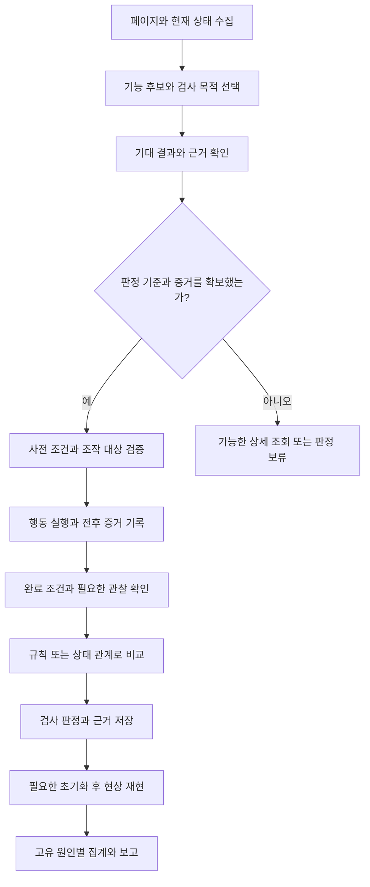

# 영어 원문 없이 읽는 WebTestPilot 논문·적용 가이드

작성일: 2026-10-08

이 가이드는 논문을 읽기 위한 한국어 설명과, 현재 프로젝트에 맞춘 설계 제안이다. **각 논문의 ‘원문에서 확인한 방법’과 ‘프로젝트를 위한 해설·제안’을 구분했다.** 설명용 테스트 페이지와 수치 예시는 직접 구성한 것이며 논문의 실험 사례나 우리 프로젝트의 실제 결과가 아니다. 발표 정보와 저자 보고 성능은 [기존 논문 목록](RELATED_PAPERS.md)에 있다.

## 1. 각 논문을 어디에 연결하면 되는가

프로젝트에서는 다음 질문을 순서대로 해결해야 한다.

```text
어떤 페이지와 상태에 도달할 것인가?       ← ATUSA / WebExplor
그곳에 어떤 기능이 있는가?               ← AutoE2E
무슨 동작을 하고 어떤 결과를 확인할까?   ← AutoE2E / WebTestPilot
기대 결과가 옳다는 근거는 무엇인가?      ← Oracle Survey
전후 결과·다른 실행을 어떻게 비교할까?   ← WebTestPilot / Metamorphic Testing
확인한 결과를 어떻게 평가·보고할까?      ← 현재 프로젝트의 증거·벤치마크 계약
```

아래 연결은 논문들의 방법과 프로젝트 계약을 바탕으로 구성한 제안이다. 여섯 연구를 전부 구현해야 한다는 의미는 아니다.

| 한국어 상세 문서 | 읽으면서 답을 얻을 질문 | 적용할 첫 기능 |
|---|---|---|
| [1. WebTestPilot](papers/01_WEBTESTPILOT_KO.md) | ‘클릭했다’에서 ‘기능이 맞게 동작했다’로 어떻게 넘어갈까? | 기대 결과와 전후 상태를 연결한 검사 |
| [2. 테스트 오라클 서베이](papers/02_TEST_ORACLE_KO.md) | AI가 기대 결과를 만들어도 되는가? 근거가 없으면 어떻게 할까? | 기대 결과의 출처와 판정 불가 사유 기록 |
| [3. AutoE2E](papers/03_AUTOE2E_KO.md) | 화면에서 기능을 발견하고 여러 행동을 하나의 테스트로 묶으려면? | 기능 후보와 단계별 실행 흐름 연결 |
| [4. ATUSA](papers/04_ATUSA_KO.md) | 같은 URL 안에서 화면이 바뀌면 어떻게 탐색·검사할까? | UI 상태와 행동 연결 기록 |
| [5. WebExplor](papers/05_WEBEXPLOR_KO.md) | 반복 클릭을 줄이고 깊은 기능에 도달하려면? | 상태별 미실행 행동과 경로 기록 |
| [6. 메타모픽 테스팅](papers/06_METAMORPHIC_TESTING_KO.md) | 정확한 정답을 몰라도 잘못된 동작을 찾을 수 있을까? | 조건을 검증한 두 실행의 관계 비교 |

각 상세 문서는 **논문 방법 → 한국어 사례 → 중요하게 이해할 지점 → 현재 연결점 → 최소 적용 순서 → 검증 방법과 한계**로 읽을 수 있다.

## 2. 먼저 알아두면 이해가 쉬운 말

| 용어 | 이 문서에서 사용하는 쉬운 뜻 |
|---|---|
| 테스트 오라클 | 실행 결과가 올바른지 판단하는 기준·절차 |
| 요구사항·명세 | 서비스가 어떻게 동작해야 하는지 적은 설명 |
| 상태 | 특정 순간의 화면·조작 가능 요소·중요 데이터·로그인 상태 |
| 스냅샷 | 실제 관찰한 한 순간의 상태를 저장한 자료 |
| 상태 전이 | 입력·클릭 등 행동으로 상태가 바뀌는 것 |
| 사전 조건 | 테스트 행동을 수행하기 전에 충족돼야 할 조건 |
| 사후 조건 | 테스트 행동 이후에 충족돼야 할 조건 |
| 단언·assertion | ‘이 조건이 참이어야 한다’고 명시해서 검사하는 것 |
| 불변식 | 정해진 적용 범위에서 계속 유지돼야 하는 성질 |
| 기호화·symbolization | 필요한 데이터에 이름을 붙여 구조화하는 것 |
| DSL | 특정 검사 목적에 맞춰 표현 범위를 정한 작은 언어 |
| 커버리지 | 정해진 평가 대상 중 실제로 도달하거나 실행한 범위 |
| 정밀도·precision | 보고한 결함 중 실제 결함의 비율 |
| 재현율·recall | 평가 대상 실제 결함 중 찾아낸 비율 |
| 재현 성공률 | 같은 조건·절차로 결함 현상을 다시 확인한 비율. recall과 다르다. |
| 오탐 / 미탐 | 정상 동작을 결함으로 보고함 / 실제 결함을 놓침 |
| 메타모픽 관계 | 여러 실행의 입력·출력 사이에 성립해야 하는 관계 |

이후 문서에서는 가능한 한 한국어 표현을 사용한다. 실제 코드와 연결해야 하는 필드·함수 이름은 그대로 쓴다.

## 3. 현재 프로젝트에서 활용할 수 있는 기반

아래는 [통합 가이드](../INTEGRATION_GUIDE.md), [AI 입력 계약](../../integration/docs/AI_INPUT_CONTRACT.md), 현재 전처리기 소스를 확인한 내용이다. 설계 목표와 현재 구현을 혼동하지 않도록 이 기준을 적용한다.

| 기반 | 현재 사용할 수 있는 것 | 추가로 구현·합의할 것 |
|---|---|---|
| URL 순회 | 같은 출처 URL 큐·그래프와 페이지 콜백 | 의미 있는 UI 상태별 탐색 전략 |
| 상태 관찰 | 상세 snapshot, 요약 `ai_input/1` | 기능별 업무 데이터 추출·비교 |
| 요소 조작 | 검증된 locator, `controls[].key` | 검사 계획을 검증하고 순서대로 실행하는 로직 |
| 증거 연결 | `evidence.action()`의 전후 snapshot·diff·이벤트 | 그 증거를 기대 결과와 연결하는 판정 |
| 결과 상태 | `passed`, `failed`, `not_run` 반환 | 상세 검사 결과·보고서 별도 저장 |
| 불확실성 | `quality`, `readiness`, `omitted`, 잘림·실패 기록 | 정보를 더 얻거나 판정을 보류하는 규칙 |

**현재 `feature_candidates`는 관찰 단서이며 기능 전체를 검증한 결과가 아니다.** `diff`도 관찰 차이이며 그 자체가 결함 판정은 아니다. 별도의 일반 업무 데이터 추출 API나 논문식 오라클 실행기가 이미 있다고 가정하면 안 된다.

입력 요약은 길이 제한이 있다. 입력 컨트롤의 실제 값은 기본적으로 값 존재 여부·길이 등으로 표현되며, 전체 업무 데이터가 자동으로 AI에 전달되는 구조도 아니다. 따라서 ‘저장 전 이름과 저장 후 이름 비교’ 기능을 구현하려면, 허용된 테스트 데이터와 필요한 화면 증거를 별도로 연결해야 한다.

`get_element()`는 알고 있는 요소 key의 상세를 조회하는 API다. 임의의 기능·상품·행을 자연어로 찾아주는 API가 아니다. 요약에서 빠진 정보가 필요하면 현재 제공되는 상세 범위부터 확인하고, 추가 수집이 필요할 때 생산자·소비자 계약을 합의한다.

## 4. 여섯 논문을 연결한 권장 검사 흐름

다음은 현재 API를 유지하면서 AI 검사 팀이 추가할 수 있는 흐름이다.



예를 들어 AI가 ‘제출 버튼이 있다’고 발견했다면, 곧바로 ‘누르고 오류가 없으면 통과’로 끝내지 않는다. 해당 폼이 어떤 기능인지, 검사 목적이 무엇인지, 기대 결과의 근거가 무엇인지, 결과를 어디서 관찰할지를 먼저 정한다. 이후 실제 행동과 관찰을 기록해 비교한다.

기대 결과를 확인하지 못했지만 기능을 탐색하기 위한 행동은 실행할 수 있다. 다만 그 행동 완료를 기능 검증 성공으로 집계하지 않는다. 검사 계획·실행·판정 상태를 각각 기록하면 이 차이가 드러난다.

## 5. 구현 순서: 한 기능의 판정부터 완성하기

### 첫 단계: 정상과 결함을 구분할 수 있는 작은 로컬 페이지

필수 입력 폼 하나로 시작한다. 벤치마크 담당자가 정상 모드와 결함 모드, 기대 동작, 초기화 방법을 제공한다. 검사 AI에는 테스트 목적과 공개된 요구사항은 제공할 수 있지만, 정답 결함 ID·주입 위치·현재 정상/결함 모드 표시는 숨긴다.

이 단계에서 완성할 것은 ‘검사 목적 → 기대 결과 근거 → 행동 → 관찰 → 판정 → 보고서 증거’의 한 묶음이다. 모델 없이 정해진 계획을 넣어도 흐름을 확인할 수 있어야 한다. 여러 사이트를 크롤링하는 양보다 판정 한 건이 설명 가능한지가 먼저다.

### 두 번째 단계: 앞선 상태가 필요한 기능

테스트 전용 환경에서 즐겨찾기 추가처럼 이전 상태와 새 상태를 비교해야 하는 기능을 넣는다. 기존 항목이 유지되는지, 추가한 항목이 나타나는지, 다른 항목을 잘못 바꾸지 않았는지 검사한다. 필요한 값이 요약에 없으면 해당 검사를 위한 증거 조회·수집을 연결한다.

### 세 번째 단계: 기능 발견과 다단계 계획

검색·목록·상세·편집처럼 여러 화면을 연결하는 기능을 발견한다. 앞선 행동의 목적을 다음 화면에 전달하고, 새 상태에서 조작 가능 요소를 다시 확인한다. 최초 화면의 계획과 locator만 끝까지 사용하지 않는다.

### 네 번째 단계: 상태 탐색과 반복 억제

URL 큐와 별도로 현재 페이지 안에서 어떤 행동을 시도했고 어디에 도달했는지 기록한다. 탐색용으로 비슷한 화면을 묶더라도 실제 관찰 증거는 유지한다. 같은 UI의 데이터가 달라졌다는 이유로 검사할 중요한 값을 지우지 않는다.

### 다섯 번째 단계: 관계 검사와 입력 압축 실험

조건이 명확한 정렬·필터 같은 기능에 두 실행의 관계 검사를 적용한다. 이후 같은 저장 증거를 사용해 상세 입력, compact 입력, compact 입력과 필요 상세 조회를 비교한다. 단순 바이트 감소와 모델 토큰·요금 감소는 따로 측정한다.

강화학습, 벡터 DB, 논문 전체 DSL은 초기 판정을 위해 반드시 필요한 구성은 아니다. 먼저 작은 기준 구현으로 성능·비용을 측정하고, 현재 문제가 분명한 부분부터 추가한다.

## 6. 평가를 잘못 해석하지 않기

아래 수치는 이해를 위한 가상 예시다.

| 상황 | 무엇을 보여주는가? | 무엇까지 뜻하지는 않는가? |
|---|---|---|
| 실제 기능 10개 중 8개 수행 | 기능 커버리지 80% | 기능 8개가 모두 정확하다는 뜻은 아님 |
| 결함 보고 10개 중 7개가 실제 결함 | 정밀도 70% | 전체 결함의 70%를 찾았다는 뜻은 아님 |
| 정답 결함 20개 중 7개 발견 | 재현율 35% | 결함 재현 실행이 35% 성공했다는 뜻은 아님 |
| 판정 가능 5건 모두 통과, 나머지 15건 보류 | 수행한 5건에서 실패를 확인하지 못함 | 전체 검사 통과율 100%라고 보고하면 안 됨 |
| 모델 입력 바이트가 절반으로 감소 | 직렬화한 입력 크기가 줄어듦 | 토큰·비용도 정확히 절반이라는 뜻은 아님 |

발견부터 보고까지는 ‘후보 발견 수, 계획 수, 행동 실행 수, 판정 가능 수, 확인 결함 수’를 각각 센다. 정확도가 좋아 보여도 대부분 판정을 보류했다면 그 비율을 함께 보여준다. 같은 오류가 여러 URL에서 보일 때는 고유 원인 집계와 관찰 건수 집계를 구분한다.

반복 실험에서는 브라우저·초기 데이터·시간·행동·모델 호출 예산을 맞춘다. 실패를 보고한 뒤 초기 상태를 되돌려 다시 실행하는 것과, 같은 실패 자료를 AI에게 다시 보여주는 것은 다른 실험이다.

## 7. 팀별 읽기 순서

| 담당 | 먼저 읽을 문서 | 작업으로 연결할 결과 |
|---|---|---|
| 전처리·크롤링 | ATUSA → WebExplor → WebTestPilot | 상태·행동·증거 연결과 필요한 상세 수집 범위 |
| AI 검사·보고서 | Oracle Survey → WebTestPilot → AutoE2E → 메타모픽 | 기대 결과 출처, 계획, 비교 규칙, 판정 보류와 보고서 |
| 테스트 페이지·평가 | WebTestPilot → AutoE2E → 메타모픽 | 정상·결함 쌍, 기능 목록, 관계 검사 전제, 독립 정답 목록 |
| 프로젝트 전체 이해 | Oracle Survey → WebTestPilot → AutoE2E | 판정 기준, 실행 검증, 기능 발견의 차이 |

논문 이름을 외우는 것보다 다음 네 질문에 답할 수 있으면 된다. **어떤 기능을 검사했는가? 왜 그 결과가 기대되는가? 실제로 무엇을 관찰했는가? 근거가 부족한 경우를 어떻게 처리했는가?** 상세 문서의 사례는 이 질문을 따라가도록 구성했다.
