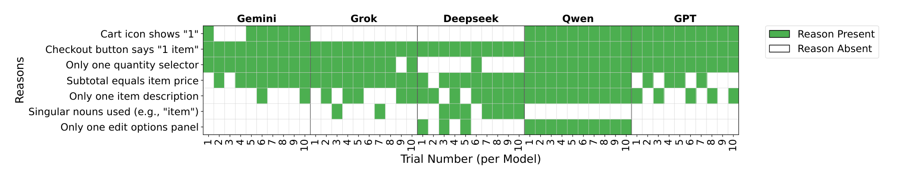
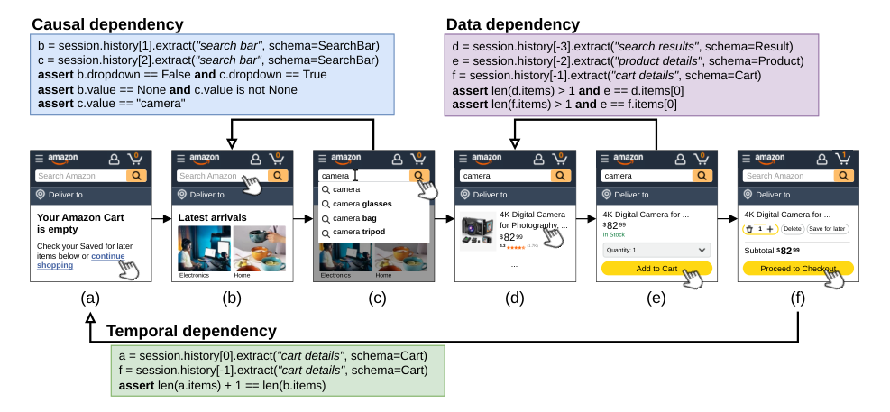
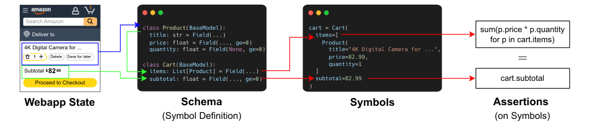
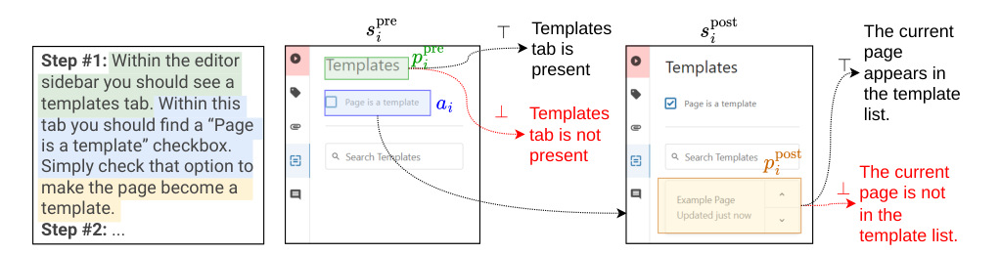
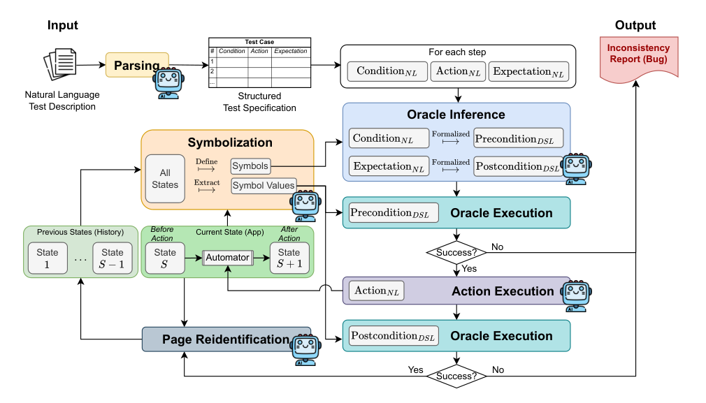
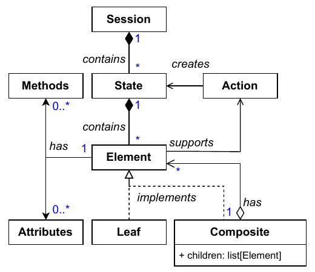
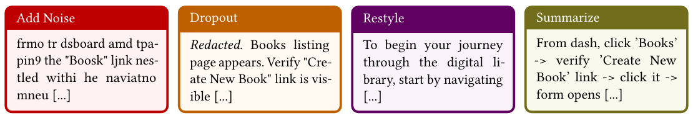
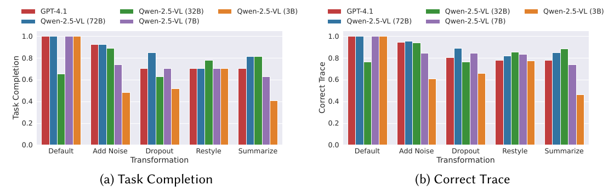

# WebTestPilot 논문 한국어 직역본과 주요 용어표

## 출처와 번역 기준

- **원문 제목:** WebTestPilot: Agentic End-to-End Web Testing against Natural Language Specification by Inferring Oracles with Symbolized GUI Elements
- **제목 번역:** WebTestPilot: 기호화된 GUI 요소를 사용해 오라클을 추론함으로써 자연어 명세에 대해 수행하는 에이전트 기반 종단 간 웹 테스팅
- **저자:** Xiwen Teoh, Yun Lin, Duc-Minh Nguyen, Ruofei Ren, Wenjie Zhang, Jin Song Dong.
- **소속:** 싱가포르 국립대학교 및 중국 상하이 자오퉁대학교. 교신저자: Yun Lin.
- **출판:** Proceedings of the ACM on Software Engineering, Vol. 3, FSE, Article FSE087, July 2026, 24 pages.
- **번역 대상:** arXiv:2602.11724v3, 2026-04-23 수정본. [HTML 원문](https://arxiv.org/html/2602.11724v3) · [PDF 원문](https://arxiv.org/pdf/2602.11724v3) · [DOI](https://doi.org/10.1145/3797115).
- **원문 이용허락:** PDF 1쪽에 명시된 [Creative Commons Attribution 4.0 International, CC BY 4.0](https://creativecommons.org/licenses/by/4.0/). © 2026 저작권은 소유자/저자에게 있다.
- **번역·편집:** Codex, 2026-10-08. 이 문서는 한국어 번역이라는 변경을 적용한 비공식 파생물이다. 원저자의 검토·승인을 받은 공식 번역본은 아니다.

문단 순서와 절·하위 절 번호를 유지하고, 본문의 주장·조건·수치·수식은 원문에 가깝게 옮겼다. 저자의 ‘우리’는 원 논문의 연구진을 가리킨다. 코드의 식별자·호출·검사식은 유지하며 주석과 설명은 한국어로 옮긴다. 그림은 원문 이미지를 함께 저장하거나 PDF에서 추출하고 한국어 캡션을 제공한다. 그림 내부의 영어 표기는 원본을 유지하며 주요 표기는 부록에서 설명한다. 참고문헌의 서지 정보·고유 제목은 검색을 위해 원문을 유지한다. 원문의 부정확하거나 모순되는 표기는 임의로 수정하지 않고 필요한 곳에 **[번역자 주]**를 구분한다. 마지막 용어표와 읽기 보조 설명은 번역 본문이 아닌 별도 편집 내용이다.

## 목차

- [초록](#abstract)
- [1. 서론](#section-1)
- [2. 동기를 설명하는 예시](#section-2)
- [3. 문제 정의](#section-3)
- [4. 접근 방법](#section-4)
- [5. 실험](#section-5)
- [6. 사례 연구](#section-6)
- [7. 논의](#section-7)
- [8. 관련 연구](#section-8)
- [9. 결론](#section-9)
- [데이터 이용 가능성·감사의 글·참고문헌](#back-matter)
- [부록 A. 주요 용어 정리표](#glossary)
- [부록 B. 처음 읽을 때 구분할 표현](#reading-notes)

<a id="abstract"></a>
## 초록 — Abstract

<!-- source: abstract -->
시각 언어 모델(VLM) 에이전트는 자연어로 작성된 요구사항에 대해 그래픽 사용자 인터페이스(GUI) 테스팅을 자동화하는 데 큰 가능성을 보여 준다. 그러나 언어 모델의 확률적 특성에는 본질적인 환각이 있을 수 있다. 따라서 요구사항과 웹 애플리케이션 사이의 불일치가 발견되었을 때, 그 불일치가 환각에서 비롯된 것인지 실제 애플리케이션 버그에서 비롯된 것인지 구분하기 어렵다. 이 문제를 해결하는 데에는 두 가지 핵심 기술적 과제가 있다. (1) 암묵적 테스트 오라클을 도출하는 능력과 정확성의 한계로, 에이전트가 안내 없이 애플리케이션의 동작이 올바른지 암묵적으로 결정하기 위해 자기 자신의 오라클로 작동해야 한다는 점, 그리고 (2) 확률적 추론으로 인한 신뢰성의 한계로, LLM의 일관되지 않은 추론이 오라클로서의 신뢰도를 훼손한다는 점이다.

우리는 기호화를 통해 두 과제를 해결하는 뉴로심볼릭 LLM 기반 접근 방법인 WebTestPilot을 소개한다. WebTestPilot은 웹 애플리케이션의 중요한 GUI 요소를 탐지하고 기호 변수로 추상화한다. 이 설계는 단언 생성을 명시적으로 정의된 기호에 근거한 연산으로 제한하여, 제약이 없거나 일관되지 않은 추론을 줄임으로써 신뢰성을 높인다. 동시에 애플리케이션 상태와 그 관계를 구조화된 기호 형식으로 표현하여 에이전트가 상태 간 데이터·인과·시간 의존성을 인식할 가능성을 높임으로써 정확성을 개선한다. 이 능력들은 함께, 테스트 요구사항에서 도출된 의미 있는 암묵적 기대를 포착하는 신뢰할 수 있고 정확한 테스트 오라클을 WebTestPilot이 생성할 수 있게 한다.

이 분야의 연구를 진전시키기 위해, 우리는 자연어에서 E2E 테스팅으로의 변환을 평가하기 위한 버그 주입 웹 애플리케이션 벤치마크를 구축한다. 결과는 WebTestPilot이 99%의 작업 완료율과 버그 탐지에서 96%의 정밀도 및 96%의 재현율을 달성하여, 가장 좋은 기준 방법을 능가함을 보여 준다(정밀도 +70, 재현율 +27). 에이전트는 다양한 자연어 입력, 즉 오타·문법 오류·불필요한 문장·문체 변경·약어가 포함된 입력과 모델 규모(3B–72B)에 걸쳐 일반화된다. 노코드 플랫폼에서의 실제 배포에서 WebTestPilot은 개발 중 데이터 바인딩·UI·탐색 문제를 포함한 8개의 버그를 발견했다.

**CCS 개념:** 소프트웨어 및 그 공학 → 소프트웨어 테스팅과 디버깅; 도메인 특화 언어; 일관성.

**추가 핵심어와 구:** 종단 간 테스팅, 자연어 명세, LLM 에이전트.

<a id="section-1"></a>
## 1. 서론 — Introduction

<!-- source: S1.p1 -->
전 세계 프로그레시브 웹 애플리케이션 시장은 2030년까지 94억 미국 달러에 이를 것으로 예상된다(Progressive Web Apps Market Size, Share & Trends Analysis Report, 2024–2030, 2024). 웹 애플리케이션의 규모와 복잡성이 증가함에 따라, 기업들은 최종 사용자를 위한 신뢰성을 보호하기 위해 종단 간(E2E) 테스팅에 의존한다. 이 테스팅에서 테스터는 요구사항을 실행 가능한 스크립트, 예를 들어 Selenium·Playwright·Cypress로 변환하여 사용자 상호작용을 모사하고 애플리케이션이 최종 사용자 인터페이스를 통해 의도대로 동작하는지 검증한다. 이러한 보호 장치가 없으면 검사되지 않은 버그가 실패로 확대될 수 있으며, 이는 널리 알려진 시스템 장애를 일으켜 왔다(The Failed Launch Of www.HealthCare.gov, 2016; The Payroll System That Cost Queensland Health AU1.25 Billion, 연도 없음).

<!-- source: S1.p2 -->
E2E 테스팅에는 두 가지 주요 갈래가 있다. 탐색 기반 테스팅은 커버리지를 최대화하기 위해 웹 애플리케이션의 가능한 모든 상태를 탐색한다. 명세 기반 테스팅(Peldszus 외, 2023)은 웹 애플리케이션이 업무 요구사항과 일관되게 동작하는지 검증한다. 대부분의 선행 연구는 전자를 대상으로 하며, 무작위 탐색(Monkey, 2023; gremlin.js, 2014), 모델 기반 테스팅(Mesbah 외, 2008; Mesbah 외, 2011), 검색 기반 테스팅(Biagiola 외, 2019; Biagiola 외, 2017; Fard와 Mesbah, 2013; Yu 외, 2024a; Mao 외, 2016; Dong 외, 2020), 기호 실행(Artzi 외, 2008), 강화학습(Mariani 외, 2011; Zheng 외, 2021; Chang 외, 2023; Gu 외, 2025a; Yu 외, 2022; Yu 외, 2024b) 같은 기법을 사용한다. 취약점과 경계 사례를 찾는 데 효과적이기는 하지만, 이 방법들은 개발 중 작성된 문서를 무시하므로 의미 있는 사용자 행동을 포착하지 못한다.

<!-- source: S1.p3 -->
이 연구에서 우리는 후자의 갈래를 살펴본다. 우리는 어떤 출처에서든 얻은 자연어 요구사항, 즉 UX/UI 명세·제품 요구사항·기술 설계·품질 보증 계획·API 문서를 실행 가능한 테스트 행동으로 변환한다. 산업계의 기존 접근 방법인 Cucumber(Cucumber, 2014), RSpec(RSpec, 2007), Squish(https://www.qt.io/quality-assurance/squish, 2003)와 학계의 GUIPilot(Liu 외, 2025b), Appflow(Hu 외, 2018)도 요구사항을 살펴보지만, 각 파서와 호환되는 경직된 입력 형식, 예를 들어 Sketch 파일·Gherkin에 의존한다. 이와 대조적으로 우리는 어떤 자연어 발췌문에서든 검증 가능한 오라클을 갖춘 테스트를 생성하는 유연한 프레임워크를 제안한다. 이 프레임워크는 (1) 업무 요구사항에 대해 애플리케이션을 직접 검증하고, (2) 지속적 통합과 배포를 위한 테스팅을 가속하며, (3) 요구사항이 변경될 때 테스트를 다시 생성함으로써 유지보수를 줄인다.

<!-- source: S1.p4 -->
멀티모달 추론을 수행하는 대규모 언어 모델(LLM) 에이전트의 최근 발전은 명세 기반 GUI 테스팅에 새로운 가능성을 연다. 2024년 소프트웨어 품질 현황 보고서(State of Software Quality Report, 2024)에 따르면 응답자의 58% 이상이 자동화 테스팅에서 LLM 기반 도구를 사용하지만, 도입은 여전히 능력 격차(44%)와 신뢰성에 대한 우려(30%)로 제한된다. 에이전트가 불일치를 표시할 때, 문제가 에이전트 자체의 환각에서 비롯된 것인지 웹 애플리케이션의 실제 버그에서 비롯된 것인지 명확하지 않다. 효과적인 자동화 테스팅은 이 원인들을 구별해야 하며, 여기서 우리의 두 가지 핵심 기술적 과제가 발생한다.

<!-- source: S1.p5 -->
**테스트 오라클 도출 능력과 정확성의 한계.** 자동화된 E2E 테스팅에는 에이전트가 자기 자신의 오라클로 작동해야 하는데, 이는 간단하지 않다(Baral 외, 2024). 효과적인 테스트 오라클은 기저의 테스트 요구사항을 추론하고 암묵적 기대를 구체적인 단언으로 변환해야 한다. 이러한 단언은 하나 이상의 상태에 걸친 데이터 의존성(값이 이전 입력과 계산을 반영함), 인과 의존성(상태 전이가 의도한 행동에서 비롯됨), 시간 의존성(시간에 따라 같은 페이지를 가리키는 상태의 변화)에 근거할 때에만 의미가 있다. 예를 들어 ‘상품이 장바구니에 추가되었다’를 검증하려면 새로 추가된 항목을 검사할 뿐 아니라 장바구니의 기존 항목, 즉 상품 종류·수량·소계와의 일관성도 보장해야 한다. NaviQAte(Shahbandeh 외, 2024)와 LaVague(LaVague, 2024) 같은 기존 연구에는 오라클 능력이 없다. 이들은 단언을 생성하지 않고 테스트 요구사항을 직접 행동으로 변환한다. PinATA(Chevrot 외, 2025)는 단언을 생성하지만, (1) 미리 계산되고, (2) 비구조적이며, (3) 용량이 제한된 전역 기억에 의존한다.

<!-- source: S1.p6 -->
쇼핑 시나리오를 생각해 보자. 장바구니 페이지에서 PinATA는 장바구니 항목을 자유 형식 자연어로 미리 저장하고, 예를 들어 ‘장바구니 내용: 노트북 – 1,200달러, 마우스 – 25달러’라는 텍스트 요약을 테스트 실행 내내 전달한다. 이 설계는 세 가지 한계를 낳는다.

<!-- source: S1.I1.i1.p1 -->
1. **미리 계산된 기억으로 인한 복구 가능성의 상실.** 관찰 시점에 명시적으로 기록된 정보만 보존된다. 에이전트가 나중에 결제 단계에 도달했는데 소계나 적용된 할인 같은 중간 값이 저장되지 않았다면, 최종 합계가 어떻게 도출됐는지 재구성할 수 없다. 이러한 변환 연결이 없으면 합계가 올바른지 검증할 수 없다.

<!-- source: S1.I1.i2.p1 -->
2. **비구조적 기억으로 인한 의존성의 상실.** 과거 정보는 상태 간 기호 식별자 없이 느슨하게 구성된 자연어 조각으로 누적된다. ‘결제 합계는 상품 가격의 합에서 할인을 뺀 값과 같다’를 검증하려면 에이전트는 잡음이 있는 텍스트에서 조각들을 찾아야 한다. 장바구니 → 배송 → 결제라는 구조화된 참조가 없으면 항목을 혼동하거나 갱신을 놓쳐 의존성 추론이 취약해질 수 있다.

<!-- source: S1.I1.i3.p1 -->
3. **용량이 제한된 기억으로 인한 시간에 따른 변화의 상실.** 실행이 길어질수록 이전 상태가 요약되거나 잘린다. 예를 들어 사용자가 10% 할인을 적용한 뒤 상품 하나를 제거하면, 명세는 할인을 다시 계산하도록 요구한다. 최종 합계만 유지되면 에이전트는 제거 후 재계산이 이루어졌는지 검증할 수 없다.

<!-- source: S1.p8 -->
**확률적 추론으로 인한 신뢰성의 한계.** 설계상 LLM은 확률적이다. 동일한 프롬프트도 모델 설정을 고정했을 때조차 서로 다른 응답을 낼 수 있다. 테스팅 중 상태 검증을 맡기면 이 무작위성이 일관되지 않은 추론을 낳을 수 있다. 이를 설명하기 위해 우리는 실증 연구를 수행했다(그림 1). 다섯 가지 주류 LLM인 GPT·Gemini·Grok·Deepseek·Qwen에 같은 페이지 스크린샷과 ‘장바구니에는 항목이 하나만 들어 있는가?’라는 질문을 각각 10번 제시했다. 시행 전체에서 모델들은 일곱 가지 서로 다른 답을 생성했고, 추론은 모델 간뿐 아니라 같은 모델 내부에서도 달랐다. 이러한 변동성은 여러 단계의 테스트에서 눈에 보이는 결과를 낳는다. 순차적인 $n$개 단계로 이루어지고 각 단계가 LLM의 올바른 추론에 의존하는 테스트를 생각해 보자. 한 단계가 올바를 확률 $p$가 높더라도, 단계마다 오류가 누적되므로 모델의 확률적 특성 때문에 전체 궤적을 성공적으로 완료할 가능성은 낮아진다($p^n$). 개별 단계의 일관되지 않은 출력은 불안정한 종단 간 판정을 만들며, 모델의 자연어 추론을 해석하는 일은 추가적인 수작업 부담을 낳아 자동화 테스팅에서 안정적인 테스트 오라클이라는 가정을 깨뜨린다.

<!-- source: S1.F1 -->


**그림 1.** 테스트 상태 검증에서 여러 번 시행했을 때 나타나는 서로 다른 LLM의 일관되지 않은 추론.

<!-- source: S1.p9 -->
한편으로 효과적인 테스트 오라클은 테스트 요구사항을 만족하는 암묵적 기대를 추론하기 위해 상태 간 데이터·인과·시간 의존성을 확립해야 한다. 다른 한편으로 확률적인 LLM을 사용한 자유 형식 추론과 검증은 본질적으로 불안정하다. 이 과제들을 해결하기 위해 우리는 자기 자신의 정확하고 신뢰할 수 있는 테스트 오라클로 작동할 수 있는 뉴로심볼릭 접근 방법인 WebTestPilot을 제안한다. WebTestPilot은 기호화를 사용해 오라클의 정확성과 신뢰성을 함께 개선한다. 상태에서 기호를 추출하는 효과적인 지각 모델의 성공(Lu 외, 2024)을 바탕으로 우리의 접근 방법은 두 가지 핵심 통찰을 따른다. (1) 기호화는 테스트 오라클 생성을 연속 공간에서 유한한 경계를 갖는 이산 공간으로 변환함으로써 신뢰성을 높인다. 명시적인 기호를 정의하면 가능한 단언의 집합이 제한되어 불확실성이 줄고, 에이전트가 의미적으로 유효하고 일관된 단언으로 유도된다. 또한 WebTestPilot은 단언을 생성할 때 다시 시도해 환각을 줄이고 안정성을 유지할 수 있다. (2) 단언을 기호에 근거시키면 정확성이 높아진다. 상태와 그 관계를 구조화된 기호로 표현하면 에이전트는 UI 요소가 상태들에 걸쳐 어떻게 변하는지 명시적으로 추적할 수 있다. 에이전트는 상태 간 데이터·인과·시간 의존성을 더 잘 인식하게 된다. 이렇게 구조적으로 드러내는 것은 생성된 단언이 암묵적 기대를 포착하고 애플리케이션의 의도된 동작을 충실히 반영할 가능성을 높인다. 그러나 이 접근 방법을 설계하는 데에는 두 가지 기술적 과제가 있다.

<!-- source: S1.p10 -->
**기호를 단언과 어떻게 연결할 것인가?** 기호를 추출한 뒤 에이전트는 이를 올바르고 실행 가능한 단언으로 구성해야 한다. 과제는 표현력과 단순성의 균형을 맞추는 도메인 특화 언어(DSL)를 설계하는 것이다. 이 언어는 애플리케이션 동작을 포착할 만큼 풍부해야 하지만, 환각이나 재학습을 피할 만큼 단순해야 한다. 우리는 기존 프로그래밍 언어를 확장하여 익숙한 구문과 데이터 처리용 기본 라이브러리를 사용하면서, 관계 술어와 합성 술어 같은 기호에 대한 사전 정의 연산자 집합을 제공함으로써 이를 해결한다.

<!-- source: S1.p11 -->
**효과적이고 효율적인 기호화를 어떻게 달성할 것인가?** 순진한 접근 방법은 보이는 모든 UI 요소를 기호화하고 모든 기호의 의존성을 추적하는 것이다. 이는 조합 폭발과 PinATA의 전역 기억과 같은 한계를 낳는다. 우리는 대신 페이지 재식별을 제안한다. 이 방법은 논리적으로 동등한 페이지, 예를 들어 장바구니 페이지를 가리키는 두 개 이상의 상태에 일관된 식별자를 부여하고, 상태들의 구조화된 Session 이력을 유지한다. 기호를 미리 모두 만들기보다 같은 페이지 식별자를 가진 상태들을 찾아 필요한 요소만 추출하여 기호를 필요할 때 도출한다. 이는 더 적은 기호에 집중하면서 더 많은 상태로 확장 가능한 추론을 가능하게 한다.

<!-- source: S1.p12 -->
구체적으로 자연어 테스트 요구사항이 주어지면 WebTestPilot은 이를 $n$개의 (조건, 행동, 기대) 단계로 분해한다. 각 단계에서 WebTestPilot은 조건과 기대를 사전·사후 조건 단언으로 변환한다. 그런 다음 기호화를 적용해 관련 UI 구성 요소를 기호로 추출하고, DSL을 통해 이 기호들을 구성하여 지정된 제약을 만족하는 실행 가능한 단언을 만든다. 상태 간 추론을 지원하기 위해 WebTestPilot은 페이지 재식별을 사용해 다시 방문한 페이지를 탐지하고 테스트 상태의 구조화된 이력을 유지한다.

<!-- source: S1.p13 -->
우리는 버그가 주입된 네 웹 애플리케이션으로 새로 구축한 벤치마크에서 WebTestPilot을 평가하고, 세 가지 LLM 기반 GUI 테스팅 기준 방법인 NaviQAte(Shahbandeh 외, 2024), LaVague(LaVague, 2024), PinATA(Chevrot 외, 2025)와 성능을 비교한다. 우리의 결과는 WebTestPilot이 테스트 완료율 99%, 버그 탐지 정밀도 96%, 재현율 96%를 달성하여 가장 강력한 기준 방법을 정밀도 +70, 재현율 +27만큼 능가함을 보여 준다. WebTestPilot은 오타·문법 오류·불필요한 문장·문체 변경·약어가 있는 다양한 자연어 입력과, 매개변수 3B에서 72B까지의 모델 규모에 걸쳐 견고하다. 협력 파트너인 노코드 플랫폼의 실제 배포에서 WebTestPilot은 개발 중 8개의 버그를 발견한다.

<!-- source: S1.p14 -->
요약하면 우리의 기여는 다음과 같다.

<!-- source: S1.I2.i1.p1 -->
- **방법론:** 우리는 최초의 뉴로심볼릭 GUI 테스팅 접근 방법을 제안한다. 신경망 구성 요소는 애플리케이션 상태에서 기호를 추출하여 의존성을 포착한다. 기호적 구성 요소는 이 기호들의 속성·값·관계에 대한 단언을 구성하여 테스트 요구사항의 암묵적 기대가 만족되도록 한다.

<!-- source: S1.I2.i2.p1 -->
- **구현:** 우리는 접근 방법을 실현하는 프레임워크인 WebTestPilot을 제시하며, 이는 산업 협력사인 China Mobile에 성공적으로 도입되었다.

<!-- source: S1.I2.i3.p1 -->
- **실험:** 우리는 100개의 주입 버그를 포함한 네 개의 오픈소스 실제 웹 애플리케이션 벤치마크를 구축한다. 이 벤치마크와 실제 환경, 즉 산업 협력 및 GitHub 이슈에서 WebTestPilot을 LLM 기준 방법과 비교 평가하여, 버그 탐지에서 최신 방법들을 능가함을 보여 준다.

<!-- source: S1.p16 -->
WebTestPilot의 소스 코드와 벤치마크는 [공식 저장소](https://github.com/code-philia/WebTestPilot)에서 이용할 수 있다.

<a id="section-2"></a>
## 2. 동기를 설명하는 예시 — Motivating Example

<!-- source: S2.F2 -->


**그림 2.** 전자상거래 플랫폼 amazon.com에서 검색·쇼핑·결제를 나타내는 테스트 흐름.

<!-- source: S2.p1 -->
그림 2는 대표적인 전자상거래 시나리오인 amazon.com의 테스트 흐름을 보여 준다. 흐름은 장바구니가 비어 있는 장바구니 페이지, 즉 상태 2(a)에서 시작한다. 사용자는 ‘쇼핑 계속하기’를 클릭하여 홈페이지인 상태 2(b)로 이동하고, 검색창에 ‘camera’라는 질의를 입력하여 추천 드롭다운인 상태 2(c)를 발생시키며, 질의를 제출해 결과 페이지인 상태 2(d)에 도달한다. 그런 다음 첫 번째 상품을 클릭해 상세 정보인 상태 2(e)를 보고 이를 장바구니에 추가하여 테스트 흐름을 완료한다.

<!-- source: S2.p2 -->
이러한 흐름을 검증하는 데 LLM 에이전트를 적용하는 것은 어렵다. 의미 있는 테스트 오라클은 개별 단계의 정확성뿐 아니라 상태 간 의존성에 대해 추론해야 하기 때문이다. NaviQAte(Shahbandeh 외, 2024)와 LaVague(LaVague, 2024) 같은 선행 연구는 중간 상태를 검증하지 않고 끝에 도달하는 것을 성공으로 간주한다. 위 시나리오를 사용하면 상태 (a)에서 (f)로 성공적으로 이동했을 때 테스트 사례는 통과한다.

PinATA(Chevrot 외, 2025)는 정보를 저장하고 기대 결과와 비교하기 위한 기억을 유지하지만, 일반적이고 비구조적인 설계 때문에 단언 구성에 필요한 작업 관련 문맥을 찾는 능력이 제한된다. 예를 들어 장바구니 소계가 새로 추가된 상품의 가격만큼 정확히 증가하는지 검증하려 할 때, 상태 (a)와 (f)가 같은 논리적 페이지에 해당함을 인식하지 못하여 일관되지 않은 증분 변화, 즉 소계 차이 (f) − (a)가 새 상품의 가격과 같아야 한다는 관계를 탐지하지 못할 수 있다. 마찬가지로 선택한 모든 검색 속성, 예를 들어 가격 범위가 수백 개의 상품을 포함할 수 있는 검색 결과 (d) 전체에서 유지되는지 검증할 때, 비구조적 기억은 단일 속성을 누락하여 불완전한 검증을 낳을 수 있다. 많은 실제 버그가 이러한 불일치에서 발생한다. 이를 잡으려면 상태 사이의 암묵적인 인과·데이터·시간 의존성에 대해 추론해야 하며, 그 의존성은 아래와 같다.

<!-- source: S2.I1.i1.p1 -->
- **인과 의존성:** 이전 상태에서 행동을 실행한 직접적인 효과로 현재 상태의 UI 요소가 생성·갱신·삭제될 때 성립하는 인접 상태 간 관계다. 예를 들어 상태 (c)의 자동 완성 추천 드롭다운과 값이 채워진 검색 입력은 상태 (b)의 타이핑 행동에 의존한다.

<!-- source: S2.I1.i2.p1 -->
- **데이터 의존성:** 한 상태에서 추출한 정보가 다른 상태로 전달되어 재사용되어 실행 궤적 전체에 데이터 흐름을 형성할 때 성립하는 상태 간 관계다. 예를 들어 (e)의 상품 상세 정보는 검색 결과 (d)에서 선택한 항목에 의존하고, (f)의 장바구니 항목은 (e)의 상품 상세 정보에 의존한다.

<!-- source: S2.I1.i3.p1 -->
- **시간 의존성:** 시간에 따른 증분 변화를 탐지하기 위해 나중 상태를 앞선 상태와 관련지어 해석해야 할 때 성립하는, 같은 논리적 페이지에 해당하는 상태 간 관계다. 예를 들어 장바구니 내용이 사용자 행동 후 어떻게 변했는지 결정하기 위해, 장바구니 페이지를 나타내는 상태 (f)는 같은 페이지를 나타내는 상태 (a)에 의존한다.

<!-- source: S2.p4 -->
암묵적 기대에 대한 견고한 상태 간 검증을 가능하게 하기 위해 WebTestPilot은 선언적 스키마를 지원한다. 스키마는 구조화된 UI 데이터를 나타내는 기호 틀, 즉 ‘변수’로 작동한다. 스키마는 추출된 내용의 파싱·정규화·검증을 자동화할 수 있는 강한 타입의 모델로 구현된다. 이 모델은 기대 데이터 구조뿐 아니라 타입 수준 제약, 예를 들어 지원되는 문자열, 필드 수준 요구사항, 예를 들어 필수와 선택 필드, 도메인 특화 규칙, 예를 들어 음수가 아닌 가격도 정의한다.

<!-- source: S2.p5 -->
구체적으로 ‘장바구니에 추가 클릭’ 행동을 실행한 뒤 대응하는 기대가 ‘이제 상품이 장바구니에 있다’인 테스트 단계를 생각해 보자. 이 사후 조건의 테스트 오라클로 작동하기 위해 WebTestPilot은 먼저 기호화를 적용하여 관련 기호를 정의한다(그림 3).

<!-- source: S2.F3 -->
```python
class Product(BaseModel):
    title: str = Field(...)
    price: float = Field(..., ge=0)
    quantity: Optional[int] = Field(None, gt=0)

class Cart(BaseModel):
    items: List[Product] = Field(...)
```

**그림 3.** Pydantic 스키마로 표현한 Product와 Cart 기호의 정의.

<!-- source: S2.p6 -->
그런 다음 WebTestPilot은 현재 상태와 이전 상태에서 추출한 값으로 이 스키마들을 인스턴스화한다. 페이지 재식별을 참조하여 상태 (a)와 (f)가 Cart 페이지에 해당함을 인식하고 그 배치의 상위 수준 개요, 예를 들어 장바구니에는 항목 목록이 있고 각 항목이 특정 정보를 표시한다는 내용을 알아내어 Cart 기호를 적용할 수 있게 한다. 마찬가지로 Product 기호와 관련된 상태 (e)를 상품 상세 페이지로 식별한다. 이 정보를 과거 행동과 결합함으로써 에이전트는 상태 (a) → 상태 (e) → 상태 (f)의 전이를 통해 상품을 장바구니에 추가하는 의미적 연결을 확립한다. 그림 4를 보라.

<!-- source: S2.F4 -->
```python
# 상태 (a): 초기 상태에서 이전 장바구니 요약을 추출한다.
prior = session.history[0].extract("Get cart summary", schema=Cart).items

# 상태 (e): 상품 상세 페이지에서 추가한 상품을 추출한다.
added = session.history[-2].extract("Get product detail", schema=Product)

# 상태 (f): 가장 최근 상태에서 현재 장바구니 요약을 추출한다.
current = session.history[-1].extract("Get cart summary", schema=Cart).items
```

**그림 4.** 상품 페이지에서 추가한 상품을 추출하고 현재 장바구니 상세 정보와 이전 상세 정보를 비교하기.

<!-- source: S2.p7 -->
DSL을 사용해 에이전트는 이 기호들에 대한 형식적인 단언을 구성하여 행동 후 상태가 명시적 기대, 즉 상품이 장바구니에 있다는 기대와, 이전 상태에서 도출한 암묵적 기대, 즉 장바구니에는 이전과 같은 항목들과 새 상품이 들어 있고 상품 종류는 (e)에서 앞서 본 항목과 일치하며 수량은 1이라는 기대를 모두 만족하는지 검증한다. 그림 5를 보라. 이를 통해 WebTestPilot은 암묵적이거나 상태 간에 걸친 인과·데이터·시간 관계의 위반에서 발생하는 버그, 예를 들어 항목 누락·중복, 잘못된 수량·가격, UI 불일치를 탐지할 수 있다.

<!-- source: S2.F5 -->
```python
# 모든 상품 속성(제목·수량·가격)이 이전 항목 및 추가 항목과 일치한다.
for prod in prior + [added]:
    match = next((p for p in current if p.title == prod.title), None)
    assert match is not None, f"Product {prod.title} missing in current cart"
    assert match.quantity == prod.quantity, f"Quantity mismatch for {prod.title}"
    assert match.price == prod.price, f"Price mismatch for {prod.title}"

# 장바구니 소계는 새 상품의 추가를 올바르게 반영한다.
prior_subtotal = sum(p.price * p.quantity for p in prior)
added_total = added.price * added.quantity
current_subtotal = sum(p.price * p.quantity for p in current)
assert current_subtotal == prior_subtotal + added_total, "Cart subtotal mismatch"
```

**그림 5.** WebTestPilot이 생성한 단언.

<!-- source: S2.F6 -->


**그림 6.** 동기를 설명하는 시나리오의 예: WebTestPilot은 애플리케이션 상태에 대한 단언을 만들기 위해 GUI 요소에 대응하는 선언된 스키마를 통해 기호를 추출한다.

<a id="section-3"></a>
## 3. 문제 정의 — Problem Statement

<!-- source: S3.p1 -->
**예비 정의.** 우리는 웹 애플리케이션 $\mathcal{W}$를 상태 $s\in\mathcal{S}$의 그래프로 모델링한다. 각 상태는 튜플 $s=(\text{screenshot},\text{DOM})$로 정의된다. 여기서 screenshot은 페이지의 시각적 외관을 나타내고 DOM은 UI 요소 $e$로 구성된 루트가 있고 순서가 있는 트리다. 각 요소는 그 종류, 즉 버튼·입력, 관련 속성, 예를 들어 이름·값·활성/비활성, 자식 요소를 나타낸다.

사용자는 행동 $a=\langle t,e,p\rangle$를 실행하여 $\mathcal{W}$와 상호작용한다. $t$는 행동 종류, 예를 들어 click·type이고, $e$는 대상 UI 요소이며, $p$는 입력할 텍스트 같은 선택적인 매개변수다. 상태 전이 함수 $\mathcal{T}:\mathcal{S}\times\mathcal{A}\to\mathcal{S}$는 상태와 행동을 후속 상태 $s'=\mathcal{T}(s,a)$로 대응시킨다.

마지막으로 초기 상태 $s_0$에서 행동의 순서열 $A=\langle a_1,a_2,\dots,a_n\rangle$을 실행하면 실행 궤적 $\tau=s_0\xrightarrow{a_1}s_1\xrightarrow{a_2}\cdots\xrightarrow{a_n}s_n$, 또는 $s_0\xrightarrow{A}s_n$이 생성된다.

<!-- source: S3.p2 -->
**목표.** 자연어 테스트 요구사항 $D$가 주어지면 자동화 테스터 $T$는 $D$를 단계의 순서열 $\langle\text{step}_1,\dots,\text{step}_n\rangle$로 파싱한다. $D=\text{step}_1\oplus\cdots\oplus\text{step}_n$이며, 각 단계를 출력 $o_i=T(\text{step}_i)$로 대응시킨다. 입력과 출력의 세부 내용은 다음과 같다.

<!-- source: S3.p3 -->
**입력.** 자연어 테스트 요구사항을 텍스트 토큰의 순서열 $D=(w_1,\dots,w_m)$이라고 하자. 우리는 $D$가 순서가 있는 실행 가능한 단계의 순서열 $\langle\text{step}_1,\dots,\text{step}_n\rangle$에 대응될 수 있다고 가정한다. 각 $\text{step}_i$는 $D$의 연속된 토큰 순서열에서 도출된다. 이 순서열은 다음을 만족한다.

<!-- source: S3.I1.i1.p1 -->
1. **서로 겹치지 않음.** 단계에 대응하는 연속 토큰 순서열들은 쌍마다 서로 겹치지 않는다. 즉 $D$의 어떤 토큰도 둘 이상의 $\text{step}_i$에 기여하지 않는다.

<!-- source: S3.I1.i2.p1 -->
2. **단조성.** 단계들은 $D$의 왼쪽에서 오른쪽으로의 순서를 보존한다. $\text{step}_i$가 $\text{step}_j$의 토큰들보다 앞선 토큰들에서 도출되면 $i<j$이다.

<!-- source: S3.I1.i3.p1 -->
3. **의미적 완결성.** 각 $\text{step}_i$는 (i) 입력 상태에 대한 술어 집합, (ii) 실행할 행동, (iii) 출력 상태에 대한 술어 집합을 나타낸다.

<!-- source: S3.p5 -->
**출력.** 우리는 술어 $p_i$를 애플리케이션 상태에 대한 성질 $p_i:\mathcal{S}\to\{\top,\bot\}$로 정의한다. 상태 $s_i$가 $p_i$를 만족하면, 즉 $p_i(s_i)=\top$이면 $s_i\models p_i$라고 쓴다. $s_i\not\models p_i$ 또는 $p_i(s_i)=\bot$일 때 버그가 발생한다. 이는 $T$가 해당 상태를 $\text{step}_i$에 명시된 요구사항과 일치하지 않는 것으로 보고한다는 뜻이다. 실행 중 $D$에서 파싱한 각 $\text{step}_i$에 대해 $T$는 세 개의 산출물 $o_i=T(\text{step}_i)=(p_i^{\text{pre}},a_i,p_i^{\text{post}})$를 생성하며, 그 내용은 다음과 같다.

<!-- source: S3.I2.i1.p1 -->
1. 행동 전의 상태 $s_i^{\text{pre}}$에서 평가되는 술어 $p_i^{\text{pre}}$.

<!-- source: S3.I2.i2.p1 -->
2. $s_i^{\text{pre}}$에 적용되어 $\mathcal{W}$를 새로운 상태 $s_i^{\text{post}}$로 전이시키는 행동 $a_i$.

<!-- source: S3.I2.i3.p1 -->
3. 행동 후의 상태 $s_i^{\text{post}}$에서 평가되는 술어 $p_i^{\text{post}}$.

<!-- source: S3.p7 -->
단언 능력이 없는 $T$에 대해서는 $p_i^{\text{pre}}$와 $p_i^{\text{post}}$가 항상 $\top$으로 평가된다.

<!-- source: S3.F7 -->


**그림 7.** 문제 정의의 입력과 출력을 시각화한 그림. $D$는 단계들로 파싱된다. 색상 표시 영역은 상태 스크린샷의 관심 영역을 강조한다. 초록색은 $p_i^{\text{pre}}$가 평가하는 부분, 파란색은 행동 $a_i$, 노란색은 $p_i^{\text{post}}$가 평가하는 부분을 나타낸다. 각 술어에 대해 상태가 요구사항 $D$와 일치하거나 일치하지 않는 조건을 보여 준다.

<a id="section-4"></a>
## 4. 접근 방법 — Approach

<!-- source: S4.p1 -->
**개요.** 그림 8은 WebTestPilot의 전체 접근 방법을 보여 준다. 핵심적인 새로움은 능력 있고 신뢰할 수 있는 테스트 오라클로 작동하여 테스트 요구사항의 암묵적 기대를 검증하는 술어 $p_i$를 생성하는 데 있다. 이 절은 다음과 같이 구성된다.

<!-- source: S4.I1.i1.p1 -->
- **입력 파싱(4.1절).** WebTestPilot은 자연어 요구사항을 단계의 구조화된 순서열 $\langle\text{step}_1,\dots,\text{step}_n\rangle$로 파싱한다. 각 단계는 행동 전 상태 $\text{condition}_{\text{NL}}$, 행동 자체 $\text{action}_{\text{NL}}$, 행동 후 상태 $\text{expectation}_{\text{NL}}$을 명시한다.

<!-- source: S4.I1.i2.p1 -->
- **오라클 추론(4.2절).** 각 단계에서 WebTestPilot은 명시적 요구사항인 $\text{condition}_{\text{NL}}$과 $\text{expectation}_{\text{NL}}$을 분석한다. 실행 궤적 $\tau$를 조사하여 시간·데이터·인과 의존성을 식별하고, 이를 사용해 암묵적 요구사항을 추론한다. 그런 다음 관련 상태를 추상화하는 기호를 정의하고 기대 내용의 스키마를 설정한다. 마지막으로 요구사항에서 추론한 암묵적 기대를 기호에 대한 술어 단언으로 형식화하는 데 DSL을 사용하여 $\text{precondition}_{\text{DSL}}$과 $\text{postcondition}_{\text{DSL}}$을 생성한다.

<!-- source: S4.I1.i3.p1 -->
- **오라클 실행(4.3절).** 단언이 준비되면 WebTestPilot은 $\text{action}_{\text{NL}}$을 웹 애플리케이션에서 실행 가능한 행동에 대응시킨다. 행동 전에는 현재 상태가 단계의 조건을 만족하는지 확인하기 위해 $\text{precondition}_{\text{DSL}}$을 평가한다. 행동 후에는 결과 상태가 기대 결과를 만족하는지 검증하기 위해 $\text{postcondition}_{\text{DSL}}$을 평가한다. 어떤 단언이든 실패하면 WebTestPilot은 최대 $n$번 행동을 다시 시도한다. 모든 재시도가 실패하면 버그를 보고한다.

<!-- source: S4.F8 -->


**그림 8.** WebTestPilot의 개요. WebTestPilot은 자연어 요구사항을 조건·행동·기대를 각각 명시하는 구조화된 단계로 파싱한다(입력 파싱). 각 단계에 대해 오라클 추론을 수행하여 명시적·암묵적 요구사항을 포착하는 기호에 대한 술어 단언을 생성한다. 오라클 실행 중에는 사전 조건 검사, 행동 실행, 사후 조건 검사를 수행한다. 실패한 단언은 재시도를 발생시키며, 계속되는 실패는 버그로 기록된다. AI 아이콘은 해당 과정이 LLM에 프롬프트를 제시함을 의미한다.

### 4.1. 입력 파싱 — Input Parsing

<!-- source: S4.SS1.p1 -->
입력 요구사항은 형식적인 출처, 즉 PRD·사용자 스토리부터 비형식적인 출처, 즉 회의 기록·메시지·이메일까지 다양한 형태로 제공된다. WebTestPilot은 이를 단계의 순서열 $\langle\text{step}_1,\dots,\text{step}_n\rangle$로 정규화한다. 각 단계는 자연어로 행동이 언제 어디서 발생하는지, 어떻게 수행되는지, 기대 결과가 무엇인지 명시하는 3-튜플 $(\text{condition}_{\text{NL}},\text{action}_{\text{NL}},\text{expectation}_{\text{NL}})$이다. 이 구조를 추출하기 위해 WebTestPilot은 원시 입력을 LLM에 제시하고 JSON 출력을 파싱한다. 누락된 단계를 추론하여 채우도록 설정할 수 있다.

### 4.2. 오라클 추론 — Oracle Inference

<!-- source: S4.SS2.p1 -->
각 단계 $\text{step}_i=(\text{condition}_{\text{NL}},\text{action}_{\text{NL}},\text{expectation}_{\text{NL}})$에 대해 WebTestPilot은 두 단계로 LLM에 프롬프트를 제시한다. 먼저 LLM은 명시적 요구사항 $(\text{condition}_{\text{NL}},\text{expectation}_{\text{NL}})$과 텍스트 형태의 실행 궤적 $\text{string}(\tau)=[\text{string}(s_0),\dots,\text{string}(s_n)]$을 받는다. 세부 사항은 4.3.2절을 보라. 이를 통해 인과·시간·데이터 의존성을 식별하여 암묵적 요구사항을 추론한다. 다음으로 LLM은 명시적·암묵적 요구사항과 함께 $\text{string}(\tau)$를 사용하여 관련 개념의 사용자 정의 기호, 예를 들어 Cart·Product를 정의한다(4.2.1절). 그런 다음 DSL(4.2.2절)을 적용해 이 기호들에 대한 형식적인 술어 단언을 생성한다. 이 과정은 $\text{condition}_{\text{NL}}\mapsto\text{precondition}_{\text{DSL}}$과 $\text{expectation}_{\text{NL}}\mapsto\text{postcondition}_{\text{DSL}}$이라는 대응을 만든다. 사전·사후 조건은 각각 한 단계의 시작 상태 $s$와 종료 상태 $s'$에 대한 술어 단언이다.

<!-- source: S4.F10.fig1 -->
```text
Φ      ::= assert Pred                         최상위 단언
Pred   ::= Pred and Pred
         | Pred or Pred
         | not Pred
         | (Pred)
         | Expr comp Expr                      불리언 논리와 비교
Expr   ::= value
         | var
         | var.attr
         | var.method(args)                    값·변수·필드/메서드 접근
comp   ::= == | != | > | >= | < | <= | in | not in
                                                비교 연산자
args   ::= Expr (',' Expr)*                     쉼표로 구분한 인자 목록
var    ::= identifier                          Python의 유효한 변수 이름
attr   ::= id | text | children | ...          Session·State·Element 객체의 속성
method ::= extract() | find() | ...            Session·State·Element 객체의 메서드
```

**그림 9.** 테스트 단언을 작성하는 DSL의 BNF 구문.

<!-- source: S4.F10.fig2 -->


**그림 10.** 내장 기호의 클래스 다이어그램. 원본 도식은 [PDF 10쪽](https://arxiv.org/pdf/2602.11724v3#page=10)에 있다.

#### 4.2.1. 상태 기호화 — State Symbolization

<!-- source: S4.SS2.SSS1.p1 -->
WebTestPilot이 효과적으로 추론하고 의존성을 식별하도록 하기 위해, 모든 상태에서 사용자 정의 기호, 예를 들어 Cart·Product를 통해 도메인 특화 개념을 추상화할 수 있다. 타입 제약·설명·기본값을 갖는 기호를 Pydantic으로 정의한다. 이 기호들은 술어 단언 안에서 참조될 수 있으며, 실제 값은 실행 시점에 인스턴스화된다. 술어 단언은 인스턴스화된 기호에 대해 평가된다(4.3절 참조).

#### 4.2.2. 도메인 특화 언어 — Domain Specific Language

<!-- source: S4.SS2.SSS2.p1 -->
기호에 대한 술어 단언을 구성하고 조작하기 위해 우리는 Python을 확장한 도메인 특화 언어(DSL)를 설계한다. 그 BNF 구문은 그림 9에 제시되어 있다.

> **[번역자 주]** HTML 본문에는 이 위치의 BNF 구문 참조가 ‘Figure 10’으로 표시되지만, PDF 본문은 ‘Figure 9’로 표시한다. 여기서는 PDF의 그림 번호를 따른다. 그림 10은 클래스 다이어그램이다.

<!-- source: S4.SS2.SSS2.p2 -->
**내장 기호.** 사용자 정의 기호 외에 DSL은 모든 단계에서 항상 이용할 수 있는 범용 기호 집합을 제공한다. 그림 10은 그 클래스 구조를 나타낸다. 최상위에서 Session은 상태의 순서열을 저장하고 과거와 현재 상태에 대한 전역 접근을 제공한다. 각 Session은 여러 State 객체를 포함하며, 각 객체는 Elements의 트리로 표현되는 페이지 메타데이터와 배치 정보를 이용해 특정 테스트 단계를 모델링한다. State 클래스는 사용자 정의 기호 값을 추출하거나 요소에 직접 접근하는 메서드를 제공한다. 표 1은 이 기호의 모든 메서드와 속성을 나열한다.

<!-- source: S4.SS2.SSS2.p3 -->
**표현 가능성.** 사용자 정의 기호와 내장 기호를 결합함으로써 DSL은 WebTestPilot이 인과·데이터·시간 의존성에 대해 추론할 수 있게 한다. 다섯 가지 유형의 단언을 지원한다.

<!-- source: S4.I2.i1.p1 -->
- **존재.** 데이터의 존재 또는 부재를 검증한다. 예: `state.find("profile") is not None`.

<!-- source: S4.I2.i2.p1 -->
- **관계.** 공간적·구조적·논리적 관계를 검증한다. 예: `state.find("checkout button")[0].ymin > state.find("cart icon")[0].ymax`.

<!-- source: S4.I2.i3.p1 -->
- **시간.** 사건이 특정 순서로 발생하도록 보장한다. 예: `all(a.extract(Banner).countdown >= b.extract(Banner).countdown for a, b in zip(states, states[1:]))`.

<!-- source: S4.I2.i4.p1 -->
- **인과.** 원인·결과 관계를 검사한다. 예: `len(session.history[0].extract(Cart).items) - len(session.history[-1].extract(Cart).items) == 1`.

<!-- source: S4.I2.i5.p1 -->
- **데이터 무결성.** 추출하거나 계산한 데이터가 기대와 일치하는지 검증한다. 예: `subtotal == sum(item.price for item in cart.items)`.

<!-- source: S4.SS2.SSS2.p5 -->
**합성 가능성.** DSL 술어는 단일 1차 논리 절이거나, 논리 연산자 `and`, `or`, `not`으로 연결하고 괄호로 묶은 여러 절의 조합일 수 있다. 술어는 여러 줄의 단언에 걸쳐 작성될 수도 있다.

<!-- source: S4.SS2.SSS2.p6 -->
**조작 가능성.** Python을 확장함으로써 WebTestPilot은 LLM이 이미 갖고 있는 Python 지식의 이점을 얻는다. 그 DSL은 함수형 프로그래밍을 위한 Python 표준 라이브러리 기능, 예를 들어 `itertools`, `functools`, `operator`, 텍스트 처리 `re`, 내장 함수 `all()`, `any()`, `filter()`, `map()`, `len()`, `min()`, `max()` 등과 데이터 타입 `datetime`, `enum`을 지원한다. WebTestPilot은 조건문과 반복문으로 실행을 제어할 수도 있다.

<!-- source: S4.T1 -->
**표 1. 내장 DSL 기호와 그 속성·메서드.**

| 타입 | 메서드 / 속성 | 반환 타입 | 설명 |
|---|---|---|---|
| Session | `history` | `list[State]` | 모든 상태를 시간 순서로 나열한 목록. |
| Session | `state` | `State` | 현재 브라우저 페이지. |
| State | `page_id` | `string` | 여러 상태에서 공유하는 논리적 페이지 식별자. |
| State | `elements` | `set[Element]` | 모든 상태 요소를 평탄화한 집합. |
| State | `find(description: str, top_k: int)` | `list[Element]` | 설명과 일치하는 상위 K개 요소. 비어 있을 수 있다. |
| State | `extract(instruction: str, schema: BaseModel)` | `BaseModel` | 상태에서 스키마를 따르는 기호를 추출한다. |
| Element | `xmin, ymin, xmax, ymax` | `int` | 경계 상자 좌표. |
| Element | `parent` | `Element` | 부모 요소. |
| Element | `children` | `list[Element]` | 자식 요소. |
| Element | `extract(instruction: str, schema: BaseModel)` | `BaseModel` | 요소에서 스키마를 따르는 기호를 추출한다. |

### 4.3. 오라클 실행 — Oracle Execution

<!-- source: S4.SS3.p1 -->
WebTestPilot이 술어 단언 $\text{Precondition}_{\text{DSL}}$과 $\text{Postcondition}_{\text{DSL}}$을 추론하면, 세 단계로 해당 단계를 실행한다. 먼저 $\text{Precondition}_{\text{DSL}}$을 실행한다. 그런 다음 $\text{Action}_{\text{NL}}$을 실행 가능한 행동 $a=\langle t,e,p\rangle$에 대응시키고(4.3.1절 참조) 이를 현재 상태에서 실행하여 $s\xrightarrow{a}s'$를 생성한다. 마지막으로 $\text{Postcondition}_{\text{DSL}}$을 실행한다. 형식적으로 $\text{step}_i$가 성공하는 것은 다음이 성립할 때, 그리고 그때뿐이다.

$$
(s\models\text{Precondition}_{\text{DSL}}\wedge s\xrightarrow{a}s')
\implies s'\models\text{Postcondition}_{\text{DSL}}.
$$

<!-- source: S4.SS3.p3 -->
순서열의 모든 $\text{step}_i$가 성공하면 테스트 사례가 성공한다. 어떤 $\text{step}_i$에서든 술어 단언 $p$가 실패하면 버그가 발생한다. 즉 $p(s)=\top,\ s\not\models p$이다.

> **[번역자 주]** 바로 위의 `$p(s)=\top$`과 `$s\not\models p$`는 원문 PDF와 HTML에 함께 기재되어 있다. 3절의 정의에 따르면 서로 모순되므로, 오기 가능성이 있지만 번역에서 임의로 고치지 않았다. ‘단언이 실패한다’는 앞선 설명과 구분해 읽어야 한다.

#### 4.3.1. 행동 실행 — Action Execution

<!-- source: S4.SS3.SSS1.p1 -->
Set-of-Mark 프롬프팅, 예를 들어 OmniParser(Lu 외, 2024)는 안정적이지만 비용이 크고, 페이지에 요소가 너무 많은 경우처럼 잡음에 민감하다. 반면 GUI 그라운딩 모델(Gou 외, 2025; Gu 외, 2025b)은 빠르지만 불안정하며, 특히 본 적 없는 웹사이트 같은 분포 밖 환경에서 그렇다. ScreenSeekeR(Li 외, 2025a)에서 영감을 받아 WebTestPilot은 안정성과 효율성의 균형을 맞추기 위해 이 접근 방법들을 결합한다. 현재 상태 $s$의 전체 페이지 스크린샷과 $\text{Action}_{\text{NL}}$이 주어지면, GUI 그라운딩 모델인 UI-Venus-7B(Gu 외, 2025b)를 사용하여 대략적인 대상 좌표 $(x,y)$를 예측한다. 그런 다음 $s$의 UI 요소 트리를 분석해 스크린샷의 모든 상호작용 가능 요소에 경계 상자와 ID를 표시하도록 Set-of-Mark 프롬프팅을 적용한다. $(x,y)$를 중심으로 한 정사각형 잘라내기 이미지가 $\text{Action}_{\text{NL}}$과 함께 LLM에 입력된다. LLM은 정밀한 실행 가능 행동 $\langle t,e,p\rangle$를 출력하며, $t\in\{\text{click},\text{type},\text{press},\text{scroll},\text{wait}\}$, $e$는 요소 ID, $p$는 행동 매개변수다. 이 접근 방법은 GUI 그라운딩을 대략적 위치 예측에 사용하여 그 불안정성을 완화하는 동시에, 대상 영역을 잘라낸 스크린샷에 LLM을 집중시켜 비용을 줄이고 효과를 높인다.

#### 4.3.2. 페이지 재식별 — Page Reidentification

<!-- source: S4.SS3.SSS2.p1 -->
새 상태 $s'$를 $\tau$에 저장하기 위해 WebTestPilot은 `page_id`를 부여하여, 나중 상태가 같은 논리적 페이지, 예를 들어 장바구니 페이지로의 재방문을 가리키는 것으로 인식될 수 있게 한다. 먼저 $\tau$에서 $s'$와의 DOM 트리 편집 거리가 가장 작은 $s''$를 선택한다. 그런 다음 $s'$와 $s''$의 스크린샷을 LLM에 제공하여 같은 페이지에 속하는지 결정한다. 그렇다면 $s'.\text{page\_id}=s''.\text{page\_id}$로 정하고, 아니면 새로운 `page_id`를 부여한다. 또한 텍스트 표현 $\text{string}(s')=(\text{page\_id},\text{summary},\text{layout})$을 생성하고 $s'$를 $\tau$에 추가한다.

#### 4.3.3. 단언 실패 시 재시도 — Retry on Assertion Failure

<!-- source: S4.SS3.SSS3.p1 -->
술어 단언이 실패하면 WebTestPilot은 LLM 환각의 가능성을 줄이기 위해 이를 다시 생성하고 최대 $n$번 다시 시도할 수 있다. 또는 $n$개의 후보 술어를 미리 생성하여 다수결로 결과를 결정할 수 있다. 단언이 성립하는 한, 테스트 결과의 신뢰성은 $n$에 따라 높아진다. 이 연구에서는 $n=1$을 사용한다.

<a id="section-5"></a>
## 5. 실험 — Experiments

<!-- source: S5.p1 -->
우리는 다음 연구 질문에 답하도록 실험을 설계한다.

<!-- source: S5.I1.i1.p1 -->
- **RQ1, 테스트 흐름 완료:** 기준 GUI 테스팅 에이전트와 비교할 때, WebTestPilot은 사람이 작성한 테스트 스크립트에 맞는 테스트 궤적을 얼마나 효과적으로 생성하는가?

<!-- source: S5.I1.i2.p1 -->
- **RQ2, 버그 탐지:** 기존 에이전트 기반 기준 방법과 비교할 때, WebTestPilot은 GUI 테스팅 중 시각적·기능적 결함을 얼마나 효과적으로 탐지하는가?

<!-- source: S5.I1.i3.p1 -->
- **RQ3, 견고성 평가:** 고정 입력 형식에 의존하지 않고 다양하거나 비구조적이거나 자유롭게 작성된 자연어 요구사항이 제공될 때, WebTestPilot은 어느 정도까지 올바른 테스트 사례를 생성할 수 있는가?

<!-- source: S5.I1.i4.p1 -->
- **RQ4, 모델 비교:** WebTestPilot의 전체 성능은 기저 언어 모델의 능력에 얼마나 의존하며, 가볍고 비용 효율적인 LLM을 사용할 때 그 정제 메커니즘은 어느 정도까지 이를 보완할 수 있는가?

### 5.1. 벤치마크 구축 — Benchmark Construction

<!-- source: S5.SS1.p1 -->
우리가 아는 한 기존 자동화 UI 테스팅 벤치마크는 주로 Android 모바일 애플리케이션을 대상으로 한다(Hu 외, 2024; Zhao 외, 2024; Su 외, 2021; Liu 외, 2025b; Su 외, 2020). 웹 탐색(Li 외, 2025b), UI 이해, 테스트 스크립트(Di Meglio 외, 2025)를 위한 데이터셋은 있지만 E2E 버그 탐지에 초점을 맞추지 않는다. 이 공백을 해결하기 위해 우리는 E2E 테스트 실행과 버그 탐지를 위한 실제로 실행되는 웹 애플리케이션 벤치마크를 구축한다. 구축은 다음과 같이 진행된다. 먼저 선정 기준을 만족하는 후보 웹 애플리케이션 집합 $\{\mathcal{W}_1,\dots,\mathcal{W}_n\}$을 식별한다. 다음으로 각 애플리케이션 $\mathcal{W}_i$에서 사용자 문서를 참고하고 주요 기능을 추출하여 자연어 테스트 요구사항 집합 $\{D_{i1},\dots,D_{im}\}$을 선별·구성한다. 각 요구사항 $D_{ij}$에 대해 테스트 단언으로 이루어진 실행 가능한 테스트 스크립트 $\mathcal{A}_{ij}=\langle\alpha_{ij}^1,\dots,\alpha_{ij}^k\rangle$를 정의한다. 각 단언 $\alpha_{ij}^k:\mathcal{S}\to\{\top,\bot\}$는 시스템 상태에 대한 술어다. 각 단언은 평가 대상 자동화 테스터 $T$가 $D_{ij}$에서 파싱할 것으로 기대되는 단일 테스트 단계에 대응하고, 실행 궤적 $\tau$의 정확성을 평가하기 위한 정답 평가 오라클로 작동한다. 버그 탐지를 평가하기 위해 각 $D_{ij}$에 대해 $\text{bug}_{ij}:\mathcal{S}\to\mathcal{S}$ 형태의 버그도 추가로 주입한다. 상태 $s_t$에 적용할 때 버그가 발생해서는 안 되는 경우에는 상태를 변경하지 않고, 그렇지 않으면 결함 동작이 있는 변경 상태 $s_t'$를 생성한다. 요약하면 각 벤치마크 표본은 튜플 $(\mathcal{W},D,\mathcal{A},\text{bug})$로 표현된다.

#### 5.1.1. 웹 애플리케이션 — Web Applications

<!-- source: S5.SS1.SSS1.p1 -->
우리는 GitHub에서 오픈소스 웹 애플리케이션을 검색하고 다섯 기준으로 선정한다. (1) 별 수가 5,000 이상인 인기도, (2) 기여자가 50명을 넘고 커밋이 1,000개를 넘으며 지난 한 달 안에 커밋이 있는 활발한 개발, (3) 공개된 기간이 5년을 넘는 성숙도, (4) 실제 배포·알려진 도메인 또는 조직·상업적 지원·유명한 기관의 도입으로 드러나는 실용적 관련성, (5) 핵심 기능을 설명하는 사용자 대상 문서다. 다음 네 웹 애플리케이션을 선정한다.

<!-- source: S5.I2.i1.p1 -->
- **BookStack(Bookstack, 2015):** 서식 있는 텍스트 편집 기능을 갖춘 계층형 문서 관리 플랫폼.

<!-- source: S5.I2.i2.p1 -->
- **Indico(Indico, 2004):** 학회·회의·강의를 위한 행사 관리 도구.

<!-- source: S5.I2.i3.p1 -->
- **InvoiceNinja(Invoice Ninja, 2018):** 여러 단계의 작업 흐름을 갖춘 업무용 청구서 플랫폼.

<!-- source: S5.I2.i4.p1 -->
- **PrestaShop(Prestashop, 2007):** 상점 관리 기능을 갖춘 풀스택 전자상거래 플랫폼.

<!-- source: S5.SS1.SSS1.p3 -->
우리는 애플리케이션들을 재현 가능한 Docker Compose 환경으로 패키징한다.

<!-- source: S5.T2 -->
**표 2. 벤치마크와 주입 버그의 개요.**

| 웹 애플리케이션 | 테스트 사례 | 코드 줄 수 | GitHub 이슈에서 가져온 버그 예시 |
|---|---:|---:|---|
| BookStack | 27 | 214,819 | 사용자가 첨부파일 삭제 권한이 없을 때 오류 메시지가 표시되지 않음. `bookstack/#5323`. |
| Indico | 25 | 573,316 | 강의 녹화 요청에 ‘Send’ 버튼이 없음. `indico/#239`. |
| InvoiceNinja | 25 | 1,513,289 | 고객의 PDF 명세서를 생성하면 잘못된 고객 이름과 주소가 표시됨. `invoiceninja/#10351`. |
| PrestaShop | 23 | 2,234,514 | ‘All Stores’에서 상품을 클릭하면 ‘Edit Product’가 아닌 ‘Order’ 페이지로 이동함. `prestashop/#39044`. |

#### 5.1.2. 자연어 테스트 요구사항 — Natural Language Test Requirements

<!-- source: S5.SS1.SSS2.p1 -->
각 애플리케이션 $\mathcal{W}_i$에 대해 $\{D_{i1},\dots,D_{im}\}$을 구성한다. 보통 주요 기능의 사용 안내를 제공하는 사용자 문서에서 그대로 발췌한 내용을 조정하는 것으로 시작하여, ‘정상 경로’, 즉 의도된 성공 사용 시나리오를 따르는 스크립트를 작성한다. 그런 다음 생성·조회·수정·삭제(CRUD) 패러다임에 따라 추가 요구사항을 확장하여 이 초기 집합을 늘린다. 예를 들어 문서가 책 관리 기능을 설명하면 책 항목의 추가·조회·편집·삭제 테스트 흐름을 만든다. 이 과정 전체에서 ISTQB Certified Tester Foundation Level(CTFL) v4.0 지침을 따른다. 그 결과 100개의 테스트 요구사항을 얻는다. 자세한 내용은 표 2를 보라.

#### 5.1.3. 테스트 스크립트 — Test Scripts

<!-- source: S5.SS1.SSS3.p1 -->
각 테스트 요구사항 $D_{ij}$에 대응하는 테스트 스크립트 $\mathcal{A}_{ij}$는 순차적인 테스트 단언 $\alpha_{ij}^t$로 구성된다. 테스팅 중 단계 $t$에서 $T$가 시스템을 $s_t\xrightarrow{a_t}s_{t+1}$로 전이시키는 행동 $a_t$를 제안하면 $\alpha_{ij}^t(s_{t+1})$를 평가한다. 결과 상태가 기대 상태이면 $\top$, 아니면 $\bot$이다. 이것을 전체 실행 궤적 $\tau$에 걸쳐 순차적으로 적용한다. 테스트 스크립트는 Playwright로 구현한다. 그림 11은 테스트 단언의 예를 보여 준다.

<!-- source: S5.F11 -->
```text
행동: 탐색 메뉴의 'Books' 링크를 클릭한다.
기대: 제목이 'Books'인 책 목록 페이지가 나타난다.
```

```python
expect(page.get_by_role('heading', name='Books')).to_be_visible()
```

**그림 11.** 테스트 단계의 테스트 단언 예시.

#### 5.1.4. 주입한 버그 — Injected Bugs

<!-- source: S5.SS1.SSS4.p1 -->
우리는 각 테스트 요구사항 $D_{ij}$에 대해 하나의 인위적인 버그 $\text{bug}_{ij}:\mathcal{S}\to\mathcal{S}$를 설계한다. 이 버그들은 잘못된 동작을 유발하며, 애플리케이션 버전을 고정하여 안정적이고 재현 가능한 실험을 보장한다. 현실성을 보장하기 위해 각 애플리케이션 저장소에서 ‘Bug’라는 라벨이 붙은 종료된 GitHub 이슈를 조사한다. 총 2,043개 이슈에서 10%를 무작위로 표집한다. 표집한 이슈의 제목과 설명에 개방 코딩을 수행해 의미 있는 라벨을 식별하고, 주제 분석으로 라벨을 더 넓은 버그 범주로 묶는다. 두 공동저자가 독립적으로 분석하고 세 번째 공동저자가 의견 차이를 해결한다. 크래시 버그와 기능에 영향을 주지 않는 순수한 외관상 버그, 예를 들어 배치·위치 문제는 선행 연구에서 이미 다뤘으므로 제외한다. 분석에 따라 우리는 네 범주에 집중한다.

<!-- source: S5.I3.i1.p1 -->
- **UI 요소 누락:** 필요한 인터페이스 구성 요소가 없어 기능이 깨진다. 예를 들어 `prestashop/#22170`에서는 새로 설치한 모듈의 ‘Configure’ 버튼이 없다.

<!-- source: S5.I3.i2.p1 -->
- **데이터 불일치:** 사용자에게 표시되는 정보가 기대 값과 일치하지 않는다. 예를 들어 `indico/#5197`에서는 범주 검색 결과에 앞서 삭제된 항목이 포함된다.

<!-- source: S5.I3.i3.p1 -->
- **효과 없는 행동:** 사용자 행동이 조용히 실패하거나 효과가 없다. 예를 들어 `invoiceninja/#11188`에서는 ‘Customer > Documents’의 필터 버튼이 정렬이나 필터링을 하지 않고 항상 전체 목록을 표시한다.

<!-- source: S5.I3.i4.p1 -->
- **탐색 실패:** 페이지가 올바르게 전이되지 않는다. 예를 들어 `prestashop/#14796`에서는 로그인한 사용자가 관리 메뉴의 어떤 옵션을 선택하더라도 로그인 페이지로 다시 이동된다.

<!-- source: S5.SS1.SSS4.p3 -->
우리의 분류는 Android 애플리케이션에 대한 선행 연구(Zhao 외, 2024)와 일치한다. 이 범주들에 따라 벤치마크 대상 웹 애플리케이션 각각의 소스 코드를 수작업으로 조사하고 JavaScript로 버그를 구현한다. 버그 함수 $\text{bug}_{ij}$는 테스팅 중 매 상태 전이에서 호출되며, 그 동작에 따라 시스템 상태를 자동으로 수정한다.

### 5.2. RQ1: 테스트 흐름 완료 — Test Flow Completion

<!-- source: S5.SS2.p1 -->
이 절에서는 자연어 테스트 요구사항을 파싱하여 웹 애플리케이션의 테스트 단계를 완료하는 WebTestPilot의 능력을 평가한다.

#### 5.2.1. 기준 방법 — Baselines

<!-- source: S5.SS2.SSS1.p1 -->
GUI 테스팅을 위한 세 가지 기준 에이전트를 선정하며, 자세한 설명은 다음과 같다.

<!-- source: S5.I4.i1.p1 -->
- **LaVague:** 가장 인기 있는 오픈소스 커뮤니티 지원 다중 에이전트 접근 방법이다. 두 단계 아키텍처를 따른다. World Model은 현재 웹페이지 상태의 문맥에서 사용자 목표를 해석하여 다음 상위 수준 지시를 생성하고, Action Engine은 이 지시를 실행 가능한 자동화 코드로 변환한다. DOM 수준 행동을 생성하기 위해 HTML DOM과 페이지의 시각적 스크린샷을 모두 사용한다. LaVague는 검증이나 단언 없이 테스트 단계 완료에만 집중한다.

<!-- source: S5.I4.i2.p1 -->
- **NaviQAte:** 기능 설명에 의해 안내되는 최초의 단일 에이전트 접근 방법이다. 세 단계 과정으로 작동한다. (1) 행동 계획은 검색 증강 생성(RAG)으로 계획을 안내할 관련 과거 작업을 식별한다. (2) 선택지 추출은 웹페이지의 행동 가능 요소를 수집하고 현재 단계와의 관련성을 기준으로 순위를 매기며 기능을 표시한다. (3) 의사결정은 표시가 추가된 스크린샷을 사용하여 LLM이 행동을 선택하도록 프롬프트를 제시한다. LaVague와 마찬가지로 테스트 단계 완료에만 집중한다.

<!-- source: S5.I4.i3.p1 -->
- **PinATA:** 계획·실행·검증을 Orchestrator·Actor·Assertor의 세 에이전트로 분리하는 최신 최고 수준(SOTA)의 다중 에이전트 접근 방법이다. Orchestrator는 테스트 흐름을 관리하고 Actor에게 UI 행동을 수행하도록, Assertor에게 결과를 검증하도록 지시한다. Actor는 페이지 스크린샷을 사용해 행동을 실제 대상에 연결하고 코드 행동으로 실행하며, Assertor는 시각 분석으로 기대 결과를 검사한다. 모든 에이전트는 장기 기억을 공유하고 애플리케이션의 관찰 가능한 상태에만 근거하여 작동한다.

#### 5.2.2. 평가 지표 — Evaluation Metrics

<!-- source: S5.SS2.SSS2.p1 -->
주어진 테스트 요구사항 $D_{ij}$에 대해 자동화 테스터 $T$, 즉 WebTestPilot 또는 기준 방법이 생성한 실행 궤적을 $\tau=s_0\xrightarrow{a_1}s_1\xrightarrow{a_2}\cdots\xrightarrow{a_n}s_n$이라고 하자. $s_k$는 단계 $k$ 이후 시스템 상태이고, $\alpha_{ij}^k\in\mathcal{A}_{ij}$는 테스트 스크립트에서 해당 단계의 단언이다. 우리는 테스트 완료에 대한 $T$의 효과를 두 지표로 평가한다.

<!-- source: S5.I5.i1.p1 -->
- **작업 완료(TC):** 실행 궤적의 모든 상태 전이가 대응하는 테스트 단언을 만족할 때, 그리고 그때뿐 테스트가 완료된 것으로 간주한다. 형식적으로 다음과 같다.

$$
\mathsf{TC}_{ij}=\begin{cases}
1 & \text{if }s_k\models\alpha_{ij}^k,\ \forall k=1,\dots,|\mathcal{A}_{ij}|\\
0 & \text{otherwise}
\end{cases}
$$

<!-- source: S5.I5.i2.p1 -->
- **올바른 궤적(CT):** 첫 단언 실패 전까지 올바르게 실행된 테스트 스크립트의 비율, 즉 접두 부분을 측정한다. $T$가 테스트를 얼마나 진행했는지를 정량화한다. 형식적으로 다음과 같다.

$$
\mathsf{CT}_{ij}=
\frac{\max\{k\in\{1,\dots,|\mathcal{A}_{ij}|\}\mid
s_\ell\models\alpha_{ij}^{\ell}\text{ for all }\ell=1,\dots,k\}}
{|\mathcal{A}_{ij}|}
$$

#### 5.2.3. 실험 설정 — Experiment Setup

<!-- source: S5.SS2.SSS3.p1 -->
벤치마크의 각 테스트 요구사항 $D_{ij}$에 대해 $T$가 이를 단계의 순서열로 파싱하도록 한다. 각 단계는 튜플 $\text{step}_t=(\text{condition}_{\text{NL}},\text{action}_{\text{NL}},\text{expectation}_{\text{NL}})$이다. 단계 $t$에서 $T$는 $\text{action}_{\text{NL}}$에 대응하는 행동 $a_t$를 제안하여 시스템을 $s_t\xrightarrow{a_t}s_{t+1}$로 전이시킨다. 평가 환경은 $s_{t+1}$을 단계의 단언 $\alpha_{ij}^t$에 대해 자동 검사하여 지표를 갱신한다(5.2.2절). 테스트가 종료되면 분석을 위해 $T$의 실행 궤적 $\tau_{ij}$를 저장한다. $T$가 실행한 단계 수가 대응 테스트 스크립트의 기대 길이 $|\mathcal{A}_{ij}|$에 도달하면 테스트를 종료한다. 이 종료 기준은 무제한 실행을 방지한다. 공유 상태의 간섭을 피하기 위해 테스트는 순차적으로 실행한다. 각 테스트 사례마다 웹 애플리케이션의 새 인스턴스를 초기화하고 데이터베이스를 테스트 전 상태로 복원한다.

#### 5.2.4. 결과와 논의 — Results & Discussion

<!-- source: S5.SS2.SSS4.p1 -->
표 3은 결과를 요약한다. WebTestPilot은 TC와 CT 모두 0.99로 가장 높은 점수를 달성하며, 가장 좋은 기준 방법을 TC에서 54.7%, CT에서 28.6% 능가한다.

<!-- source: S5.SS2.SSS4.p2 -->
**WebTestPilot이 더 효과적인 이유는 무엇인가?** 그 효과는 세 가지 도달 가능성의 이점에서 비롯된다. 첫째, 테스트 단계에 필요한 경우, 예를 들어 여러 폼 필드를 채울 때 여러 행동을 제안할 수 있다. 둘째, GUI 그라운딩과 SoM 프롬프팅으로 시각 수준에서 행동의 대상을 연결하면 iframe·shadow DOM·사용자 정의 폼 구성 요소 같은 일반적인 DOM 기반 함정을 피할 수 있다. 셋째, 두 단계 행동 실행은 분포 밖 환경과 잡음이 있거나 복잡한 UI에서 WebTestPilot을 더 견고하게 하여 더 강한 일반화를 가능하게 한다.

<!-- source: S5.SS2.SSS4.p3 -->
**WebTestPilot은 효율적인가?** WebTestPilot은 단계당 실행 시간 중앙값 29초와 토큰 소비 중앙값 10k를 달성한다. 비교 방법 중 가장 빠르며 LaVague(33초), NaviQAte(40초), PinATA(38초)를 능가한다. 토큰 소비 측면에서는 두 번째로, LaVague(49k)와 PinATA(19k)보다 적지만 NaviQAte(9k)보다 약간 많다. 전체적으로 WebTestPilot은 속도와 비용의 균형을 이룬다. 이 효율성은 잡음이 많은 DOM 기반 여러 차례의 순위 결정(NaviQAte)과 다중 에이전트 통신 부담(PinATA)을 모두 피하는 혼합 행동 실행 설계에서 비롯된다. 총 계산 비용은 단계 수에 따라 선형으로 증가한다. 단계별 비용을 나누어 보면 토큰 사용은 행동 실행(33%)과 페이지 재식별(32%)이 주도하며, 실행 시간은 주로 오라클 추론과 기호화(34%) 및 페이지 재식별(39%)에 사용된다. 따라서 페이지 재식별은 주요 병목이자 향후 최적화의 핵심 대상이다.

<!-- source: S5.SS2.SSS4.p4 -->
**WebTestPilot은 유지보수하기 쉬운가?** WebTestPilot이 생성한 테스트 행동은 웹 애플리케이션이 변하면서 취약해질 수 있다. 이를 완화하기 위해 테스트 행동을 캐시하고 상태의 내용·배치에 의미 있는 변화가 탐지되었을 때에만 4.3.1절의 행동 실행 파이프라인을 다시 호출할 수 있다. GUI 진화 선행 연구(Shao 외, 2021)에서 영감을 받은 연구에서 유지보수성을 평가한다. UI 변경 아래에서 WebTestPilot을 XPath·CSS·Playwright 기반 테스트 스크립트와 비교한다. 평가에서는 애플리케이션당 다섯 테스트를 사용하여 인터페이스 갱신 전후에 동일 GUI 위젯을 재식별하는 각 방법의 능력을 측정한다. 여기에는 Amazon·USPS의 두 실제 변경과, Salma 외(2024)의 변환 기법으로 BookStack에 생성한 세 합성 변경이 포함된다. WebTestPilot은 40건 중 39건에서 테스트 행동을 유지하여 XPath(32/40), CSS(33/40), Playwright(29/40)를 능가한다.

<!-- source: S5.T3 -->
**표 3. 웹 애플리케이션별 작업 완료(TC)와 올바른 궤적(CT).** 앱 1=BookStack, 앱 2=Indico, 앱 3=InvoiceNinja, 앱 4=PrestaShop. 전체는 모든 웹 애플리케이션의 집계 결과다.

| 접근 방법 | TC 앱 1 | TC 앱 2 | TC 앱 3 | TC 앱 4 | TC 전체 | CT 앱 1 | CT 앱 2 | CT 앱 3 | CT 앱 4 | CT 전체 |
|---|---:|---:|---:|---:|---:|---:|---:|---:|---:|---:|
| LaVague | 0.85 | 0.32 | 0.80 | 0.57 | 0.64 | 0.93 | 0.49 | 0.88 | 0.78 | 0.77 |
| NaviQAte | 0.78 | 0.44 | 0.60 | 0.30 | 0.54 | 0.92 | 0.61 | 0.78 | 0.46 | 0.70 |
| PinATA | 0.11 | 0.04 | 0.08 | 0.09 | 0.08 | 0.27 | 0.09 | 0.16 | 0.22 | 0.18 |
| WebTestPilot | 1.00 | 1.00 | 0.98 | 1.00 | 0.99 | 1.00 | 1.00 | 0.99 | 1.00 | 0.99 |

### 5.3. RQ2: 버그 탐지 — Bug Detection

<!-- source: S5.SS3.p1 -->
이 절에서는 RQ1과 같은 벤치마크를 사용하여 WebTestPilot과 기준 방법들이 웹 애플리케이션에 주입된 버그를 얼마나 잘 탐지하는지 평가한다.

#### 5.3.1. 기준 방법 — Baselines

<!-- source: S5.SS3.SSS1.p1 -->
LaVague와 NaviQAte는 제외한다. 버그 탐지가 가능한 유일한 기준 방법인 PinATA와 WebTestPilot을 직접 비교한다.

#### 5.3.2. 평가 지표 — Evaluation Metrics

<!-- source: S5.SS3.SSS2.p1 -->
우리는 단계 수준의 결과를 사용한다. $s_{\text{bug}}$는 테스트에서 버그가 주입된 상태를, $\bar{s}$는 나머지 모든 상태의 집합을 나타낸다고 하자. $T$가 술어 $p(s)$를 생성하면, 참 양성(TP)은 $p(s_{\text{bug}})=\bot$, 거짓 양성(FP)은 어떤 $s\in\bar{s}$에 대해 $p(s)=\bot$, 거짓 음성(FN)은 $p(s_{\text{bug}})=\top$, 참 음성(TN)은 모든 $s\in\bar{s}$에 대해 $p(s)=\top$으로 정의한다. 그러면 다음과 같다.

$$
\text{precision}=\frac{|\text{TP}|}{|\text{TP}|+|\text{FP}|},
\qquad
\text{recall}=\frac{|\text{TP}|}{|\text{TP}|+|\text{FN}|}.
$$

마지막으로 단언이 애플리케이션 동작을 포착하는지 보장하고, 우연한 일치가 허위 TP가 되는 경우를 배제하기 위해 모든 단언의 의미적 정확성을 수작업으로 검증한다.

#### 5.3.3. 실험 설정 — Experiment Setup

<!-- source: S5.SS3.SSS3.p1 -->
5.2절의 설정을 따르되 두 가지를 변경한다. (1) 이제 각 단계에서 $T$는 $\text{condition}_{\text{NL}}$과 $\text{expectation}_{\text{NL}}$을 검사하는 단언 술어 $p$를 생성한다. (2) 각 테스트 $D_{ij}$가 시작할 때 $\text{bug}_{ij}$를 웹 애플리케이션에 자동 주입한다.

#### 5.3.4. 결과와 논의 — Results & Discussion

<!-- source: S5.SS3.SSS4.p1 -->
표 4는 결과를 요약한다. WebTestPilot은 정밀도와 재현율 모두 0.96을 달성하며, PinATA에 비해 각각 0.70과 0.27의 절대 향상을 보인다.

<!-- source: S5.T4 -->
**표 4. 웹 애플리케이션별 버그 탐지 정밀도와 재현율.** 앱 1=BookStack, 앱 2=Indico, 앱 3=InvoiceNinja, 앱 4=PrestaShop. 전체는 모든 웹 애플리케이션의 집계 결과다.

| 접근 방법 | 정밀도 앱 1 | 앱 2 | 앱 3 | 앱 4 | 정밀도 전체 | 재현율 앱 1 | 앱 2 | 앱 3 | 앱 4 | 재현율 전체 |
|---|---:|---:|---:|---:|---:|---:|---:|---:|---:|---:|
| PinATA | 0.31 | 0.20 | 0.26 | 0.29 | 0.26 | 0.70 | 0.68 | 0.68 | 0.70 | 0.69 |
| WebTestPilot | 0.98 | 0.94 | 0.94 | 1.00 | 0.96 | 0.93 | 0.96 | 0.98 | 0.96 | 0.96 |

<!-- source: S5.SS3.SSS4.p2 -->
**WebTestPilot이 더 효과적인 이유는 무엇인가?** 실행 궤적 $\tau$를 분석하여 PinATA보다 우수한 세 가지 핵심 이유를 식별한다. (1) **동적인 상태 간 추론:** WebTestPilot은 실행 중 여러 상태에 걸쳐 기호 표현을 생성하고 추적할 수 있다. 반대로 PinATA는 에이전트가 어떤 정보를 보존할지 미리 선택해야 하고 기록하지 않은 것은 잃어버리는 정적 기억에 의존한다. 이는 중요한 정보가 나중에야 알려지거나 많은 데이터 때문에 우선순위 결정이 어려운 작업에서 추론을 제한한다. 예를 들어 InvoiceNinja에서 여러 청구서의 단일 세부 사항을 잊으면 나중 단언이 깨질 수 있다. (2) **탐색 능력:** WebTestPilot의 두 단계 행동 실행은 견고한 이동을 지원하지만, PinATA는 특정 UI 요소, 예를 들어 Indico의 시간표에 도달하지 못한다. (3) **전체 페이지 지각:** WebTestPilot은 각 상태에서 전체 페이지 스크린샷을 처리하는 반면, PinATA는 스크롤 없이 보이는 요소만 관찰하므로 긴 목록·표·격자의 정보를 놓칠 수 있다.

<!-- source: S5.SS3.SSS4.p3 -->
**WebTestPilot은 실제 버그를 탐지할 수 있는가?** 우리는 GitHub 이슈에서 23개의 실제 버그를 재현했다. WebTestPilot은 그중 22개를 탐지했고 PinATA는 15개를 탐지했다. PinATA가 탐지하지 못한 7개 버그의 원인은 상태 간 문맥 누락 1개, 요구사항 오해 2개, 상세한 페이지에서의 검증 에이전트 환각 4개였다. 더 자세한 내용은 [프로젝트 페이지](https://sites.google.com/view/webtestpilot)에 있다.

### 5.4. RQ3: 견고성 평가 — Robustness Evaluation

<!-- source: S5.SS4.p1 -->
필요한 모든 정보가 주어진 경우 WebTestPilot이 일반화할 수 있는지 시험하기 위해, 에이전트에 제공하는 테스트 요구사항을 수정하는 실험을 수행한다.

#### 5.4.1. 입력 변환 — Input Transformations

<!-- source: S5.SS4.SSS1.p1 -->
우리는 필수 정보, 즉 조건·행동·기대가 모두 보존된다는 가정 아래 입력 변환 집합을 설계한다. 다시 말해 이 변환들은 테스트 사례의 핵심 의미를 제거하거나 바꾸지 않고 정보가 표현되는 방식을 변경한다. 다음 네 가지 변환을 도입한다.

<!-- source: S5.I6.i1.p1 -->
- **문장 누락(Dropout):** 불완전한 요구사항을 모사하기 위해 문장의 10%를 무작위로 제거한다.

<!-- source: S5.I6.i2.p1 -->
- **잡음 추가(Add Noise):** 의사소통의 일상적인 언어를 모사하기 위해 오타·군더더기 말·비격식 표현을 추가한다.

<!-- source: S5.I6.i3.p1 -->
- **요약(Summarize):** 약어를 사용하여 간략한 초안 스타일의 테스트 설명을 생성한다.

<!-- source: S5.I6.i4.p1 -->
- **문체 변경(Restyle):** 절차형·기술형·서술형 등 다른 문서 스타일로 다시 작성한다.

<!-- source: S5.SS4.SSS1.p3 -->
변환 함수를 $f_{\text{add\_noise}}$, $f_{\text{dropout}}$, $f_{\text{restyle}}$, $f_{\text{summarize}}$라고 하자. 각 함수는 $f:\mathcal{D}\to\mathcal{D}$로 정의되며, $\mathcal{D}$는 테스트 요구사항의 공간을 나타낸다. 즉 $D\in\mathcal{D}$가 주어지면 각 변환은 수정된 요구사항 $f(D)\in\mathcal{D}$를 생성한다. 우리는 LLM에 초기의 안내된 변환을 수행하도록 프롬프트를 제시하고, 이후 휴리스틱 후처리로 최종 출력을 생성하여 이 함수들을 구현한다. 예를 들어 잡음 추가에는 `typo`, `nlpaug` 같은 오타 생성 라이브러리를 적용하여 어휘적 교란을 도입한다.

<!-- source: S5.F12 -->


**그림 12. 변환된 테스트 요구사항의 예.** 원래 텍스트: ‘탐색 메뉴의 "Books" 링크를 클릭한다. 책 목록 페이지가 나타난다. "Create New Book" 링크가 보이는지 검증한다 […]’.

| 변환 | 그림의 예시 번역 |
|---|---|
| 잡음 추가 | 원문의 오타 형식을 보이기 위해 문자열을 유지함: `frmo tr dsboard amd tpapin9 the "Boosk" ljnk nestled withi he naviatno mneu […]`. |
| 문장 누락 | `[삭제됨]`. 책 목록 페이지가 나타난다. ‘Create New Book’ 링크가 보이는지 검증한다 […]. |
| 문체 변경 | 디지털 도서관을 통한 여정을 시작하려면 먼저 이동하는 것으로 시작한다 […]. |
| 요약 | 대시보드에서 ‘Books’ 클릭 → ‘Create New Book’ 링크 확인 → 해당 링크 클릭 → 폼 열림 […]. |

> **[번역자 주]** 잡음 추가 예시는 깨진 영어 철자 자체가 변환의 결과이므로 해당 문자열을 보존했다. 나머지 행은 의미를 한국어로 옮겼다.

#### 5.4.2. 모델 선택 — Model Selection

<!-- source: S5.SS4.SSS2.p1 -->
WebTestPilot의 기본 모델인 GPT-4.1 외에 네 개의 오픈소스 Qwen2.5-VL 모델인 72B·32B·7B·3B를 평가한다. Qwen2.5-VL은 GUI 그라운딩 데이터로 학습되었으며 GUI 테스팅과 에이전트 벤치마크에서 강한 일반화를 보여 왔다(Zhao 외, 2024; Bai 외, 2025; Wang 외, 2025).

#### 5.4.3. 실험 설정 — Experiment Setup

<!-- source: S5.SS4.SSS3.p1 -->
5.3절과 같은 설정을 따르되, 각 테스트에서 입력 요구사항 $D_{ij}$를 먼저 변환 함수 $f_{\text{default}}$, $f_{\text{add\_noise}}$, $f_{\text{dropout}}$, $f_{\text{restyle}}$, $f_{\text{summarize}}$로 변환한다는 차이가 있다. 5.2절과 5.3절에서 정의한 지표를 사용한다.

#### 5.4.4. 결과와 논의 — Results & Discussion

<!-- source: S5.SS4.SSS4.p1 -->
표 5는 결과를 보여 준다. 어떤 변환도 모든 모델의 TC나 CT를 일관되게 낮추지 않는다는 것을 관찰하며, 이는 보편적인 ‘최악의 경우’ 변환이 없음을 나타낸다. 예를 들어 DO는 Qwen2.5-VL-32b의 TC를 0.65(DF)에서 0.63으로 낮추지만, Qwen2.5-VL-7b는 대체로 영향을 받지 않고 0.70에 머무른다. 이는 각 모델이 고유한 강점과 약점을 보이며 여러 변환에 다르게 반응함을 시사한다. GPT-4.1은 잡음에서 높은 성능(AN=0.93)을 유지하지만 DO·RS·SU에서는 더 큰 영향을 받는다(각 0.70). 반면 Qwen2.5-VL-3b 같은 작은 모델은 잡음에 매우 민감하다(AN=0.48, SU=0.41).

<!-- source: S5.SS4.SSS4.p2 -->
일반적으로 모델 크기가 감소하면 성능은 떨어지지만 그 하락은 균일하지 않다. 처음에는 모델 크기를 약 절반으로 줄여도 성능 하락은 10% 미만으로 작다. 그러나 7B는 TC와 CT가 20–30%씩 급격히 하락하기 시작하는 임계점이다. 따라서 비용을 고려하면 7B 모델이 최소한의 실행 가능한 선택이 될 수 있고, 성능을 고려하면 GPT-4.1과 안정적으로 동등하거나 더 높은 성능을 내기 위해 로컬 모델은 적어도 72B 매개변수여야 한다고 제안한다.

<!-- source: S5.SS4.SSS4.p3 -->
마지막으로 TC와 CT 사이에는 눈에 띄는 격차가 있으며, 모델들에 걸쳐 그 차이는 0.05에서 0.09에 이른다. 변환된 테스트 요구사항에서 모델이 단계를 누락하거나 불필요한 단계를 추가하여 궤적 실행의 오류를 낳을 수 있음을 관찰한다. 예를 들어 폼 채우기의 세부 사항, 즉 필드 개수나 기대 입력이 파싱 중 올바르게 해석되지 않는다.

<!-- source: S5.SS4.SSS4.p4 -->
두 가지 핵심 시사점이 있다. 첫째, 요구사항에는 필요한 모든 정보가 있어야 한다. 정확한 입력 파싱이 후속 작업 성능을 가장 강하게 예측하기 때문이다. 둘째, 스타일과 형식의 변동은 특정 도메인과 언어 스타일에 맞춘 특화된 의미 파서, 예를 들어 PRD 파서·이메일 파서·Slack/채팅 메시지 파서를 설계하여 극복할 수 있다. 이 파서는 입력을 올바르고 완전하며 간결한 단계 순서열로 재구성한다.

<!-- source: S5.T5 -->
**표 5. WebTestPilot으로 평가한 테스트 요구사항 변환별 작업 완료(TC)와 올바른 궤적(CT).** 전체는 모든 변환의 집계 결과다. DF=기본, AN=잡음 추가, DO=문장 누락, RS=문체 변경, SU=요약. 읽기 편하도록 원문의 한 표를 TC와 CT로 나누었다.

| 모델 | TC DF | TC AN | TC DO | TC RS | TC SU | TC 전체 |
|---|---:|---:|---:|---:|---:|---:|
| GPT-4.1 | 1.00 | 0.93 | 0.70 | 0.70 | 0.70 | 0.81 |
| Qwen2.5-VL-72b | 1.00 | 0.93 | 0.85 | 0.70 | 0.81 | 0.85 |
| Qwen2.5-VL-32b | 0.65 | 0.89 | 0.63 | 0.78 | 0.81 | 0.75 |
| Qwen2.5-VL-7b | 1.00 | 0.74 | 0.70 | 0.70 | 0.63 | 0.72 |
| Qwen2.5-VL-3b | 1.00 | 0.48 | 0.52 | 0.70 | 0.41 | 0.57 |

| 모델 | CT DF | CT AN | CT DO | CT RS | CT SU | CT 전체 |
|---|---:|---:|---:|---:|---:|---:|
| GPT-4.1 | 1.00 | 0.95 | 0.81 | 0.78 | 0.78 | 0.86 |
| Qwen2.5-VL-72b | 1.00 | 0.95 | 0.89 | 0.82 | 0.85 | 0.90 |
| Qwen2.5-VL-32b | 0.76 | 0.94 | 0.76 | 0.85 | 0.88 | 0.84 |
| Qwen2.5-VL-7b | 1.00 | 0.84 | 0.84 | 0.83 | 0.74 | 0.83 |
| Qwen2.5-VL-3b | 1.00 | 0.61 | 0.66 | 0.77 | 0.47 | 0.66 |

<!-- source: S5.F13.sf1 -->
<!-- source: S5.F13.sf2 -->
<!-- source: S5.F13 -->


**그림 13.** 서로 다르게 변환한 입력 요구사항(RQ3) 아래에서 서로 다른 모델(RQ4)의 성능. (a) 작업 완료, (b) 올바른 궤적. 원본 그래프의 값은 표 5에 제시되어 있다.

### 5.5. RQ4: 모델 비교 — Model Comparison

<!-- source: S5.SS5.p1 -->
우리는 WebTestPilot의 기본 모델을 크기와 능력이 다른 대체 LLM으로 교체하는 절제 연구를 수행한다.

#### 5.5.1. 실험 설정 — Experiment Setup

<!-- source: S5.SS5.SSS1.p1 -->
5.4절의 설정과 지표를 따르되, 변환하지 않은 벤치마크에서 WebTestPilot만 평가하고 그 기저 모델을 바꾼다.

#### 5.5.2. 결과와 논의 — Results & Discussion

<!-- source: S5.SS5.SSS2.p1 -->
표 5의 기본 DF 열은 모델 성능이 대체로 안정적임을 보여 준다. 그러나 모델이 술어 단언을 생성할 때에는 양상이 달라진다.

<!-- source: S5.SS5.SSS2.p2 -->
**단언의 품질.** GPT-4.1은 강한 DSL 사용 능력을 보여 준다. 술어 단언의 91%가 이전 상태와 현재 상태를 모두 참조하고, 8%는 현재 상태만 참조하며, 0.2%는 인접하지 않은 상태를 참조한다. 선언된 기호 중 41.3%는 Cart 같은 물리적 개념을, 58.7%는 DropDown 같은 UI 구성 요소를 나타낸다. 대부분의 단언은 존재 검사를 수행한다. 소속 여부 검사가 78%, `is None`이 14%, 목록 길이가 18%이며, 51%는 관계 비교를 사용한다. 자주 쓰는 내장 기능에는 `len`, `any`, `set`, `all`, `next`, `reversed`가 있다.

<!-- source: S5.SS5.SSS2.p3 -->
**단언 오류 분석.** 과제는 로컬 모델에서 발생한다. GPT-4.1 같은 비공개 모델에서는 프롬프트 조정으로 실패를 완화할 수 있다. 그러나 로컬 모델인 Qwen-2.5VL 계열에서는 프롬프트 조정에도 다음 문제를 관찰했다.

<!-- source: S5.I7.i1.p1 -->
- **잘못된 기호 선언 또는 사용, 사례의 52%:** 기호를 선언했지만 사용하지 않거나, 선언 없이 사용한다. 일부 모델은 BaseModel을 추상 스키마 대신 구체적 기호로 취급하거나(추상 클래스를 사용하는 것과 비슷함), HTML 같은 비시각적 데이터를 추출하는 데 기호를 잘못 사용한다.

<!-- source: S5.I7.i2.p1 -->
- **오라클 추론에서 단언 DSL의 잘못된 사용, 사례의 39%:** `state.isNotificationEnabled` 같은 속성·가져오기, `session.extract()` 같은 메서드 호출을 환각으로 만들어 낸다.

<!-- source: S5.I7.i3.p1 -->
- **오라클 실행의 런타임 오류, 사례의 9%:** 동일성 비교에서 데이터 타입이 맞지 않거나, 집합이 아닌 데이터에 `in`·`not in`을 적용하는 것처럼 소속 여부 검사를 잘못 사용한다.

<!-- source: S5.SS5.SSS2.p4 -->
로컬 모델 성능을 개선하기 위해 우리는 (1) DSL 예시를 사용한 미세조정, (2) 검색 증강 생성 같은 외부 출처를 통해 DSL 참조 자료에 접근할 수 있게 하기, (3) DSL에 따라 구문적으로 올바른 출력으로 제한하기를 권한다.

<a id="section-6"></a>
## 6. 사례 연구 — Case Study

<!-- source: S6.p1 -->
**설정.** 실증 연구 외에 우리는 관계형 데이터 모델링과 기업용 애플리케이션의 끌어 놓기 UI 설계를 지원하는 노코드 플랫폼 $P$에 대해 China Mobile과 협력했다. 목표 사용자는 내부 기업 애플리케이션을 만드는 비기술직 직원이다. 우리는 개발 중인 창고 관리 시스템 $w$에 접근 권한을 받았으며, 그 PRD를 WebTestPilot이 $w$와의 일관성을 검사할 개별 요구사항 $d$로 변환했다. 전체적으로 WebTestPilot은 8개의 버그를 발견했다(표 6).

<!-- source: S6.p2 -->
**결과.** 8개 버그 중 5개(62.5%)는 데이터 바인딩 문제, 2개는 UI 문제, 1개는 탐색 문제였다. 이는 기준 방법들이 자주 놓치는 데이터 관련 버그를 탐지하는 WebTestPilot의 강점을 보여 준다. 기술적으로 PinATA는 UI·탐색 문제, 즉 8개 중 3개를 탐지하는 것으로 제한되며 데이터 문제는 명시적으로 지정된 경우에만 잡는다. PRD는 56개의 테스트 입력으로 전처리되었고 6.4분이 걸렸으며, 모든 테스트는 32.7분 동안 실행됐다. WebTestPilot의 평균 탐지 시간(MTTD)은 4.9분, 결함 밀도는 페이지당 0.14개 버그였다. 이 결과는 실제 애플리케이션에서 실용적 효과와 테스팅 효율성을 모두 제공함을 보여 준다.

<!-- source: S6.T6 -->
**표 6. 사례 연구에서 WebTestPilot이 탐지한 버그.**

| 번호 | 구역 | 페이지 | 기능 / 행동 | 버그 종류 | 버그 설명 |
|---|---|---|---|---|---|
| 1 | 창고 | 창고 정보 | 표 | 데이터 | 표의 일부 필수 필드가 비어 있음. |
| 2 | 창고 | 저장 구역 | 생성 | UI | ‘창고 이름’ 폼 필드가 중복됨. |
| 3 | 창고 | 저장 단위 | 검색 | 데이터 | ‘창고’ 드롭다운 옵션이 이용 가능한 창고와 일치하지 않음. |
| 4 | 입고 기록 | 입고 정보 | 표 | 탐색 | ‘상세’ 클릭 시 오류 페이지로 이동함. |
| 5 | 자산 | 재고 | 검색 폼 | 데이터 | ‘창고’ 드롭다운 옵션이 실제 표 데이터와 연결되지 않음. |
| 6 | 자산 | 재고 | 검색 폼 | 데이터 | ‘저장 구역’ 드롭다운 옵션이 실제 표 데이터와 연결되지 않음. |
| 7 | 자산 | 자산 | 검색 폼 | 데이터 | ‘공급업체’ 드롭다운 옵션이 비어 있음. |
| 8 | 장치 관리 | 카메라 | 검색 폼 | UI | 질의 필드 이름이 잘못됨. |

> **[번역자 주]** 원문에서 세 행에 걸쳐 합쳐진 ‘Warehouses’ 및 ‘Assets’ 구역 셀은 Markdown 표에서 각 행에 반복하여 표시했다.

<a id="section-7"></a>
## 7. 논의 — Discussion

<!-- source: S7.p1 -->
**타당성에 대한 위협.** 내부적으로 여러 경로가 같은 기능을 달성할 수 있으므로 우리의 지표가 테스터 성능을 과소평가할 수 있다. 향후 연구에서는 최종 페이지 배치·내용·애플리케이션 상태를 추가 지표로 고려할 수 있다. 외부적으로 우리의 벤치마크, 즉 웹 애플리케이션·테스트 사례·버그는 실제 시나리오를 완전히 반영하지 못할 수 있다. 그러나 WebTestPilot은 Python 방식의 DSL을 사용해 테스팅을 일관성 문제로 모델링하므로, 동작이 요구사항에서 벗어나게 만드는 어떤 버그든 다룰 수 있다. 마지막 한계는 요구사항이 자기 완결적이고 완전하며, 모든 조건·행동·기대 결과를 순서대로 명시한다고 가정한다는 점이다.

<!-- source: S7.p2 -->
**명세 기반 테스팅을 위한 의미 파싱.** 위 논의에 이어 실험은 입력 파싱 전략과 품질이 성능을 좌우함을 보여 준다. 자연어 요구사항은 자주 모호하거나 불완전하거나 문맥에 의존한다. 파싱에는 단순한 추출이 아니라 의미 이해와 전처리가 필요하다. LLM 에이전트는 요구사항을 기계가 이해할 수 있는 실행 가능한 표현으로 변환하는 능동적인 의미 파서로 작동해야 한다. 여기에는 모호함을 식별하고, 사용자에게 명확화를 위한 질문을 하며, 필요할 때 외부 지식 기반에서 문맥을 검색하는 것이 포함된다.

<a id="section-8"></a>
## 8. 관련 연구 — Related Work

### 8.1. 자동화 GUI 테스팅 — Automated GUI Testing

<!-- source: S8.SS1.p1 -->
자동화 GUI 테스팅은 클릭 같은 사용자 상호작용을 모사하여 GUI를 통해 애플리케이션 기능을 검증한다. 무작위 기법은 Monkey(Monkey, 2023)·Gremlins.js(gremlin.js, 2014)처럼 무작위 행동을 퍼징하거나, 탐지한 위젯과 무작위로 상호작용하여 AUT를 탐색한다(White 외, 2019). Crawljax(Mesbah 외, 2008), ATUSA(Mesbah 외, 2011), Stoat(Su 외, 2017) 같은 모델 기반 접근 방법은 AUT의 이동·동작 모델, 예를 들어 흐름 그래프·상태 기계를 구성하고 이들에서 테스트 사례를 도출한다. 중복 모델 상태를 제거하기 위해 Judge(Liu 외, 2025c), WebEmbed(Stocco 외, 2023), Corazza 외(2021), FragGen(Yandrapally와 Mesbah, 2022), NDStudy(Yandrapally 외, 2020) 같은 연구는 거의 중복된 상태를 탐지하고 제거한다. 체계적 전략은 코드 커버리지 같은 테스트 목적을 최적화하는 테스트 사례를 생성하려고 하며, DIG(Biagiola 외, 2019), SubWeb(Biagiola 외, 2017), FeedEx(Fard와 Mesbah, 2013), RoboTest(Yu 외, 2024a), Sapienz(Mao 외, 2016), TimeMachine(Dong 외, 2020) 같은 검색 기반 기법과 Apollo(Artzi 외, 2008) 같은 기호 실행으로 이를 수행할 수 있다.

강화학습(RL) 접근 방법은 테스팅을 순차적 의사결정 문제로 구성하고 Q-learning이나 정책 최적화로 AUT 탐색을 안내한다. 예로 AutoBlackTest(Mariani 외, 2011), QExplore(Sherin 외, 2023), WebExplor(Zheng 외, 2021), WebQT(Chang 외, 2023), WebRLED(Gu 외, 2025a), UniRLTest(Yu 외, 2022), PIRL-Test(Yu 외, 2024b), Hawkeye(Peng 외, 2024)가 있다. 이 탐색 기반 방법들은 요구사항보다 커버리지를 우선한다. 명세 기반 테스팅은 요구사항을 사용해 사용자 흐름을 목표 지향적으로 검증한다. Kea(Xiong 외, 2024)는 속성 설명 언어로 Android 앱의 성질을 수작업으로 명시한다. 이에 비해 WebTestPilot은 풍부한 문맥적 테스트 정보에서 기호적 단언을 자동 도출한다. 보완적인 연구들은 테스트 효율성(Olianas 외, 2021)과 안정성(Liu 외, 2024d; Pei 외, 2025; Zhang 외, 2024)을 개선한다.

### 8.2. GUI 테스팅을 위한 LLM — LLM for GUI Testing

<!-- source: S8.SS2.p1 -->
**입력 생성.** QTypist(Liu 외, 2023a)는 현실적인 테스팅을 위한 문맥 인식 텍스트 입력을 생성한다. InputBlaster(Liu 외, 2024b)는 입력 문자열을 변형해 크래시를 유발하고, FormNexus(Alian 외, 2024)는 제약 기반 테스팅으로 폼 기능을 검증한다. 이 접근 방법들은 E2E 테스팅의 도달 가능성을 개선한다.

<!-- source: S8.SS2.p2 -->
**모바일 애플리케이션.** GPTDroid(Liu 외, 2023b; Liu 외, 2024a), DroidAgent(Yoon 외, 2024), LLMDroid, Guardian(Ran 외, 2024), AUITestAgent(Hu 외, 2024), Trident(Liu 외, 2024c), A11yScan(Zhang 외, 2025), XUAT-Copilot(Wang 외, 2024b) 같은 여러 연구는 기능 인식 대화·커버리지 기반 탐색·다중 에이전트 계획·검증 추론 같은 기법을 사용하여 모바일 E2E 테스팅에 집중한다. García 외(2024)는 모바일 테스팅에서 테스터가 LLM과 협력하는 방식도 연구한다. 이 연구들은 웹 대신 모바일 플랫폼을 대상으로 한다.

<!-- source: S8.SS2.p3 -->
**웹 애플리케이션.** Zimmermann과 Koziolek(2023) 및 VETL(Wang 외, 2024a)은 각각 최초의 LLM 및 멀티모달 LLM 기반 GUI 테스팅 에이전트를 제안한다. AutoAUT(Mariani 외, 2011)와 Leotta 외(2024)는 LLM이 인수 테스팅 작업 흐름을 어떻게 지원할 수 있는지 이해하기 위해 실현 가능성 연구와 사용자 인터뷰를 수행한다. AxNav(Taeb 외, 2024)와 UXAgent(Lu 외, 2025)는 각각 접근성·사용성 테스팅을 대상으로 한다. 이 도구들은 완전한 E2E 흐름 검증을 수행하지 않는다. AutoE2E(Alian 외, 2025)와 Temac(Liu 외, 2025a)은 테스트 대상 애플리케이션(AUT)에서 기능을 추론하고 이를 테스트 사례 생성에 사용한다. LLM-Explorer(Zhao 외, 2025)는 추상 UI 상태 및 상호작용 그래프를 유지해 탐색을 안내한다. 그러나 이 시스템들은 주로 커버리지를 대상으로 하며 기대 결과를 검증하지 않는다. NaviQAte(Shahbandeh 외, 2024)는 행동 가능 요소를 목표와의 관련성에 따라 순위화해 상호작용을 안내하지만, 최종 결과가 사용자 목적을 만족하는지는 검증하지 않는다. 요약하면 기존 LLM 기반 웹 테스터는 종료 상태나 명시적 요구사항에 집중하는 제한된 오라클이며, 명세에 포착되지 않은 불일치를 놓친다. WebTestPilot은 형식화된 테스트 명세와 사전·사후 조건 검증으로 이를 해결하여, 추론된 암묵적 요구사항도 고려하는 안정적이고 신뢰할 수 있는 테스팅을 가능하게 한다.

<a id="section-9"></a>
## 9. 결론 — Conclusion

<!-- source: S9.p1 -->
이 연구에서 우리는 LLM 에이전트가 기호적 모델링과 형식화된 단언용 DSL을 결합하면 신뢰할 수 있는 자동화 GUI 테스터로 작동할 수 있음을 보여 준다. 우리는 다양한 입력과 모델 규모에 걸쳐 견고함을 유지하면서 높은 정밀도·재현율로 암묵적이고 문맥 의존적인 버그를 탐지하는 WebTestPilot을 제안한다.

<a id="back-matter"></a>
## 데이터 이용 가능성 — Data Availability

<!-- source: Sx1.p1 -->
우리의 벤치마크, WebTestPilot과 기준 방법의 소스 코드, 실험 설정 및 실행의 모든 스크립트는 [공식 저장소](https://github.com/code-philia/WebTestPilot)에서 이용할 수 있다. 프롬프트·사례 연구 등 더 자세한 내용은 [프로젝트 페이지](https://sites.google.com/view/webtestpilot)를 방문하라.

## 감사의 글 — Acknowledgement

<!-- source: Sx2.p1 -->
우리는 건설적인 의견을 제공한 심사자들과 벤치마크 구축에 기여한 Haozhe Wei에게 감사한다. 이 연구는 China Mobile과의 협력으로 수행되었으며, 중국 국가자연과학기금(62572300), 싱가포르 교육부(MOE-T2EP20124-0017, MOET32020-0004), 싱가포르 국가연구재단과 사이버보안청의 국가 사이버보안 연구개발 프로그램(NCRP25-P04-TAICeN), AI Singapore 프로그램의 DSO National Laboratories(AISG 과제 번호 AISG2-GC-2023-008-1B), 싱가포르 사이버보안청의 국가 사이버보안 연구개발 프로그램 및 CyberSG R&D Cyber Research Programme Office의 부분 지원을 받는다. 이 자료에서 표현된 의견·발견·결론·권고는 저자들의 것이며 싱가포르 국가연구재단·사이버보안청·CyberSG R&D Programme Office의 견해를 반영하지 않는다.

## 참고문헌 — References

참고문헌은 저자 이름·정식 제목·출판 정보의 검색 가능성을 유지하기 위해 원문 서지 표기를 보존한다. 본문의 ‘외’는 아래 서지의 `et al.`과 같은 의미다.

<!-- source: bib -->

- Alian et al . (2024) Parsa Alian, Noor Nashid, Mobina Shahbandeh, and Ali Mesbah. 2024. Semantic constraint inference for web form test generation. In Proceedings of the 33rd ACM SIGSOFT International Symposium on Software Testing and Analysis . 932–944.

- Alian et al . (2025) Parsa Alian, Noor Nashid, Mobina Shahbandeh, Taha Shabani, and Ali Mesbah. 2025. Feature-Driven End-to-End Test Generation . 2025 IEEE/ACM 47th International Conference on Software Engineering (ICSE) (2025), 450–462. https://doi.org/10.1109/ICSE55347.2025.00141

- Artzi et al . (2008) Shay Artzi, Adam Kiezun, Julian Dolby, Frank Tip, Danny Dig, Amit Paradkar, and Michael D Ernst. 2008. Finding bugs in dynamic web applications. In Proceedings of the 2008 international symposium on Software testing and analysis . 261–272.

- Bai et al . (2025) Shuai Bai, Keqin Chen, Xuejing Liu, Jialin Wang, Wenbin Ge, Sibo Song, Kai Dang, Peng Wang, Shijie Wang, Jun Tang, et al . 2025. Qwen2. 5-vl technical report. arXiv preprint arXiv:2502.13923 (2025).

- Baral et al . (2024) Kesina Baral, John Johnson, Junayed Mahmud, Sabiha Salma, Mattia Fazzini, Julia Rubin, Jeff Offutt, and Kevin Moran. 2024. Automating gui-based test oracles for mobile apps. In Proceedings of the 21st International Conference on Mining Software Repositories . 309–321.

- Biagiola et al . (2017) Matteo Biagiola, Filippo Ricca, and Paolo Tonella. 2017. Search based path and input data generation for web application testing. In International Symposium on Search Based Software Engineering . Springer, 18–32.

- Biagiola et al . (2019) Matteo Biagiola, Andrea Stocco, Filippo Ricca, and Paolo Tonella. 2019. Diversity-based web test generation. In Proceedings of the 2019 27th ACM Joint Meeting on European Software Engineering Conference and Symposium on the Foundations of Software Engineering . 142–153.

- Bookstack (2015) Bookstack 2015. https://github.com/BookStackApp/BookStack .

- Chang et al . (2023) Xiaoning Chang, Zheheng Liang, Yifei Zhang, Lei Cui, Zhenyue Long, Guoquan Wu, Yu Gao, Wei Chen, Jun Wei, and Tao Huang. 2023. A reinforcement learning approach to generating test cases for web applications. In 2023 IEEE/ACM International Conference on Automation of Software Test (AST) . IEEE, 13–23.

- Chevrot et al . (2025) Antoine Chevrot, Alexandre Vernotte, Jean-Rémy Falleri, Xavier Blanc, Bruno Legeard, and Aymeric Cretin. 2025. Are Autonomous Web Agents Good Testers? Proceedings of the ACM on Software Engineering 2, ISSTA (2025), 206–228.

- Corazza et al . (2021) Anna Corazza, Sergio Di Martino, Adriano Peron, and Luigi Libero Lucio Starace. 2021. Web application testing: Using tree kernels to detect near-duplicate states in automated model inference. In Proceedings of the 15th ACM/IEEE International Symposium on Empirical Software Engineering and Measurement (ESEM) . 1–6.

- Cucumber (2014) Cucumber 2014. https://cucumber.io/

- Di Meglio et al . (2025) Sergio Di Meglio, Luigi Libero Lucio Starace, Valeria Pontillo, Ruben Opdebeeck, Coen De Roover, and Sergio Di Martino. 2025. E2EGit: A Dataset of End-to-End Web Tests in Open Source Projects. In 2025 IEEE/ACM 22nd International Conference on Mining Software Repositories (MSR) . IEEE, 836–840.

- Dong et al . (2020) Zhen Dong, Marcel Böhme, Lucia Cojocaru, and Abhik Roychoudhury. 2020. Time-travel testing of android apps. In Proceedings of the ACM/IEEE 42nd international conference on software engineering . 481–492.

- Fard and Mesbah (2013) Amin Milani Fard and Ali Mesbah. 2013. Feedback-directed exploration of web applications to derive test models.. In ISSRE , Vol. 13. 278–287.

- García et al . (2024) Boni García, Maurizio Leotta, Filippo Ricca, and Jim Whitehead. 2024. Use of chatgpt as an assistant in the end-to-end test script generation for android apps. In Proceedings of the 15th ACM International Workshop on Automating Test Case Design, Selection and Evaluation . 5–11.

- Gou et al . (2025) Boyu Gou, Ruohan Wang, Boyuan Zheng, Yanan Xie, Cheng Chang, Yiheng Shu, Huan Sun, and Yu Su. 2025. Navigating the Digital World as Humans Do: Universal Visual Grounding for GUI Agents. In The Thirteenth International Conference on Learning Representations . https://openreview.net/forum?id=kxnoqaisCT

- gremlin.js (2014) gremlin.js 2014. https://github.com/marmelab/gremlins.js/ .

- Gu et al . (2025a) Zhiyu Gu, Chenxu Liu, Guoquan Wu, Yifei Zhang, ChenXi Yang, Zheheng Liang, Wei Chen, and Jun Wei. 2025a. Deep Reinforcement Learning for Automated Web GUI Testing. arXiv preprint arXiv:2504.19237 (2025).

- Gu et al . (2025b) Zhangxuan Gu, Zhengwen Zeng, Zhenyu Xu, Xingran Zhou, Shuheng Shen, Yunfei Liu, Beitong Zhou, Changhua Meng, Tianyu Xia, Weizhi Chen, et al . 2025b. Ui-venus technical report: Building high-performance ui agents with rft. arXiv preprint arXiv:2508.10833 (2025).

- https://www.qt.io/quality-assurance/squish (2003) https://www.qt.io/quality-assurance/squish 2003. https://www.qt.io/quality-assurance/squish

- Hu et al . (2018) Gang Hu, Linjie Zhu, and Junfeng Yang. 2018. AppFlow: using machine learning to synthesize robust, reusable UI tests. In Proceedings of the 2018 26th ACM Joint Meeting on European Software Engineering Conference and Symposium on the Foundations of Software Engineering . 269–282.

- Hu et al . (2024) Yongxiang Hu, Xuan Wang, Yingchuan Wang, Yu Zhang, Shiyu Guo, Chaoyi Chen, Xin Wang, and Yangfan Zhou. 2024. Auitestagent: Automatic requirements oriented gui function testing. arXiv preprint arXiv:2407.09018 (2024).

- Indico (2004) Indico 2004. https://github.com/indico/indico .

- Invoice Ninja (2018) Invoice Ninja 2018. https://github.com/invoiceninja/invoiceninja .

- LaVague (2024) LaVague 2024. https://github.com/lavague-ai/LaVague .

- Leotta et al . (2024) Maurizio Leotta, Hafiz Zeeshan Yousaf, Filippo Ricca, and Boni Garcia. 2024. Ai-generated test scripts for web e2e testing with chatgpt and copilot: A preliminary study. In Proceedings of the 28th International Conference on Evaluation and Assessment in Software Engineering . 339–344.

- Li et al . (2025b) Bobo Li, Yuheng Wang, Hao Fei, Juncheng Li, Wei Ji, Mong-Li Lee, and Wynne Hsu. 2025b. FormFactory: An Interactive Benchmarking Suite for Multimodal Form-Filling Agents. arXiv preprint arXiv:2506.01520 (2025).

- Li et al . (2025a) Kaixin Li, Ziyang Meng, Hongzhan Lin, Ziyang Luo, Yuchen Tian, Jing Ma, Zhiyong Huang, and Tat-Seng Chua. 2025a. Screenspot-pro: Gui grounding for professional high-resolution computer use. In Proceedings of the 33rd ACM International Conference on Multimedia . 8778–8786.

- Liu et al . (2025a) Chenxu Liu, Zhiyu Gu, Guoquan Wu, Ying Zhang, Jun Wei, and Tao Xie. 2025a. Temac: Multi-Agent Collaboration for Automated Web GUI Testing. arXiv preprint arXiv:2506.00520 (2025).

- Liu et al . (2025c) Chenxu Liu, Junheng Wang, Wei Yang, Ying Zhang, and Tao Xie. 2025c. Judge: Effective State Abstraction for Guiding Automated Web GUI Testing. ACM Transactions on Software Engineering and Methodology (2025).

- Liu et al . (2025b) Ruofan Liu, Xiwen Teoh, Yun Lin, Guanjie Chen, Ruofei Ren, Denys Poshyvanyk, and Jin Song Dong. 2025b. GUIPilot: A Consistency-Based Mobile GUI Testing Approach for Detecting Application-Specific Bugs. Proceedings of the ACM on Software Engineering 2, ISSTA (2025), 753–776.

- Liu et al . (2024d) Xinyue Liu, Zihe Song, Weike Fang, Wei Yang, and Weihang Wang. 2024d. Wefix: Intelligent automatic generation of explicit waits for efficient web end-to-end flaky tests. In Proceedings of the ACM Web Conference 2024 . 3043–3052.

- Liu et al . (2023a) Zhe Liu, Chunyang Chen, Junjie Wang, Xing Che, Yuekai Huang, Jun Hu, and Qing Wang. 2023a. Fill in the blank: Context-aware automated text input generation for mobile gui testing. In 2023 IEEE/ACM 45th International Conference on Software Engineering (ICSE) . IEEE, 1355–1367.

- Liu et al . (2023b) Zhe Liu, Chunyang Chen, Junjie Wang, Mengzhuo Chen, Boyu Wu, Xing Che, Dandan Wang, and Qing Wang. 2023b. Chatting with gpt-3 for zero-shot human-like mobile automated gui testing. arXiv preprint arXiv:2305.09434 (2023).

- Liu et al . (2024a) Zhe Liu, Chunyang Chen, Junjie Wang, Mengzhuo Chen, Boyu Wu, Xing Che, Dandan Wang, and Qing Wang. 2024a. Make llm a testing expert: Bringing human-like interaction to mobile gui testing via functionality-aware decisions. In Proceedings of the IEEE/ACM 46th International Conference on Software Engineering . 1–13.

- Liu et al . (2024b) Zhe Liu, Chunyang Chen, Junjie Wang, Mengzhuo Chen, Boyu Wu, Zhilin Tian, Yuekai Huang, Jun Hu, and Qing Wang. 2024b. Testing the limits: Unusual text inputs generation for mobile app crash detection with large language model. In Proceedings of the IEEE/ACM 46th International conference on software engineering . 1–12.

- Liu et al . (2024c) Zhe Liu, Cheng Li, Chunyang Chen, Junjie Wang, Mengzhuo Chen, Boyu Wu, Yawen Wang, Jun Hu, and Qing Wang. 2024c. Seeing is Believing: Vision-driven Non-crash Functional Bug Detection for Mobile Apps. arXiv preprint arXiv:2407.03037 (2024).

- Lu et al . (2024) Yadong Lu, Jianwei Yang, Yelong Shen, and Ahmed Awadallah. 2024. Omniparser for pure vision based gui agent. arXiv preprint arXiv:2408.00203 (2024).

- Lu et al . (2025) Yuxuan Lu, Bingsheng Yao, Hansu Gu, Jing Huang, Zheshen Jessie Wang, Yang Li, Jiri Gesi, Qi He, Toby Jia-Jun Li, and Dakuo Wang. 2025. Uxagent: An llm agent-based usability testing framework for web design. In Proceedings of the Extended Abstracts of the CHI Conference on Human Factors in Computing Systems . 1–12.

- Mao et al . (2016) Ke Mao, Mark Harman, and Yue Jia. 2016. Sapienz: Multi-objective automated testing for android applications. In Proceedings of the 25th international symposium on software testing and analysis . 94–105.

- Mariani et al . (2011) Leonardo Mariani, Mauro Pezzè, Oliviero Riganelli, and Mauro Santoro. 2011. AutoBlackTest: a tool for automatic black-box testing. In Proceedings of the 33rd international conference on software engineering . 1013–1015.

- Mesbah et al . (2008) Ali Mesbah, Engin Bozdag, and Arie Van Deursen. 2008. Crawling Ajax by inferring user interface state changes. In 2008 eighth international conference on web engineering . IEEE, 122–134.

- Mesbah et al . (2011) Ali Mesbah, Arie Van Deursen, and Danny Roest. 2011. Invariant-based automatic testing of modern web applications. IEEE Transactions on Software Engineering 38, 1 (2011), 35–53.

- Monkey (2023) Monkey 2023. https://developer.android.com/studio/test/other-testing-tools/monkey .

- Olianas et al . (2021) Dario Olianas, Maurizio Leotta, Filippo Ricca, Matteo Biagiola, and Paolo Tonella. 2021. STILE: a tool for parallel execution of E2E web test scripts. In 2021 14th IEEE Conference on Software Testing, Verification and Validation (ICST) . IEEE, 460–465.

- Pei et al . (2025) Yu Pei, Jeongju Sohn, Sarra Habchi, and Mike Papadakis. 2025. Non-flaky and nearly optimal time-based treatment of asynchronous wait web tests. ACM Transactions on Software Engineering and Methodology 34, 2 (2025), 1–29.

- Peldszus et al . (2023) Sven Peldszus, Noubar Akopian, and Thorsten Berger. 2023. RobotBT: Behavior-tree-based test-case specification for the robot framework. In Proceedings of the 32nd ACM SIGSOFT International Symposium on Software Testing and Analysis . 1503–1506.

- Peng et al . (2024) Chao Peng, Zhengwei Lv, Jiarong Fu, Jiayuan Liang, Zhao Zhang, Ajitha Rajan, and Ping Yang. 2024. Hawkeye: Change-targeted testing for android apps based on deep reinforcement learning. In Proceedings of the 46th International Conference on Software Engineering: Software Engineering in Practice . 298–308.

- Prestashop (2007) Prestashop 2007. https://github.com/saleor/saleor .

- Progressive Web Apps Market Size, Share & Trends Analysis Report, 2024–2030 (2024) Progressive Web Apps Market Size, Share & Trends Analysis Report, 2024–2030 2024. https://www.grandviewresearch.com/industry-analysis/progressive-web-apps-pwa-market-report

- Ran et al . (2024) Dezhi Ran, Hao Wang, Zihe Song, Mengzhou Wu, Yuan Cao, Ying Zhang, Wei Yang, and Tao Xie. 2024. Guardian: A runtime framework for LLM-based UI exploration. In Proceedings of the 33rd ACM SIGSOFT International Symposium on Software Testing and Analysis . 958–970.

- RSpec (2007) RSpec 2007. https://rspec.info/

- Salma et al . (2024) Sabiha Salma, SM Hasan Mansur, Yule Zhang, and Kevin Moran. 2024. GuiEvo: Automated Evolution of Mobile App UIs. In Proceedings of the 21st International Conference on Mining Software Repositories . 335–347.

- Shahbandeh et al . (2024) Mobina Shahbandeh, Parsa Alian, Noor Nashid, and Ali Mesbah. 2024. Naviqate: Functionality-guided web application navigation. arXiv preprint arXiv:2409.10741 (2024).

- Shao et al . (2021) Fei Shao, Rui Xu, Wasif Haque, Jingwei Xu, Ying Zhang, Wei Yang, Yanfang Ye, and Xusheng Xiao. 2021. Webevo: taming web application evolution via detecting semantic structure changes. In Proceedings of the 30th ACM SIGSOFT International Symposium on Software Testing and Analysis . 16–28.

- Sherin et al . (2023) Salman Sherin, Asmar Muqeet, Muhammad Uzair Khan, and Muhammad Zohaib Iqbal. 2023. QExplore: An exploration strategy for dynamic web applications using guided search. Journal of Systems and Software 195 (2023), 111512.

- State of Software Quality Report (2024) State of Software Quality Report 2024. https://katalon.com/reports/state-quality-2024

- Stocco et al . (2023) Andrea Stocco, Alexandra Willi, Luigi Libero Lucio Starace, Matteo Biagiola, and Paolo Tonella. 2023. Neural embeddings for web testing. arXiv preprint arXiv:2306.07400 (2023).

- Su et al . (2020) Ting Su, Lingling Fan, Sen Chen, Yang Liu, Lihua Xu, Geguang Pu, and Zhendong Su. 2020. Why my app crashes? understanding and benchmarking framework-specific exceptions of android apps. IEEE Transactions on Software Engineering 48, 4 (2020), 1115–1137.

- Su et al . (2017) Ting Su, Guozhu Meng, Yuting Chen, Ke Wu, Weiming Yang, Yao Yao, Geguang Pu, Yang Liu, and Zhendong Su. 2017. Guided, stochastic model-based GUI testing of Android apps. In Proceedings of the 2017 11th joint meeting on foundations of software engineering . 245–256.

- Su et al . (2021) Ting Su, Jue Wang, and Zhendong Su. 2021. Benchmarking automated gui testing for android against real-world bugs. In Proceedings of the 29th ACM Joint Meeting on European Software Engineering Conference and Symposium on the Foundations of Software Engineering . 119–130.

- Taeb et al . (2024) Maryam Taeb, Amanda Swearngin, Eldon Schoop, Ruijia Cheng, Yue Jiang, and Jeffrey Nichols. 2024. Axnav: Replaying accessibility tests from natural language. In Proceedings of the 2024 CHI Conference on Human Factors in Computing Systems . 1–16.

- The Failed Launch Of www.HealthCare.gov (2016) The Failed Launch Of www.HealthCare.gov 2016. https://d3.harvard.edu/platform-rctom/submission/the-failed-launch-of-www-healthcare-gov/

- The Payroll System That Cost Queensland Health AU1.25 Billion ([n. d.]) The Payroll System That Cost Queensland Health AU1.25 Billion [n. d.]. https://www.henricodolfing.com/2019/12/project-failure-case-study-queensland-health.html

- Wang et al . (2024a) Siyi Wang, Sinan Wang, Yujia Fan, Xiaolei Li, and Yepang Liu. 2024a. Leveraging large vision-language model for better automatic web GUI testing. In 2024 IEEE International Conference on Software Maintenance and Evolution (ICSME) . IEEE, 125–137.

- Wang et al . (2025) Xuehui Wang, Zhenyu Wu, JingJing Xie, Zichen Ding, Bowen Yang, Zehao Li, Zhaoyang Liu, Qingyun Li, Xuan Dong, Zhe Chen, et al . 2025. MMBench-GUI: Hierarchical Multi-Platform Evaluation Framework for GUI Agents. arXiv preprint arXiv:2507.19478 (2025).

- Wang et al . (2024b) Zhitao Wang, Wei Wang, Zirao Li, Long Wang, Can Yi, Xinjie Xu, Luyang Cao, Hanjing Su, Shouzhi Chen, and Jun Zhou. 2024b. Xuat-copilot: Multi-agent collaborative system for automated user acceptance testing with large language model. arXiv preprint arXiv:2401.02705 (2024).

- White et al . (2019) Thomas D White, Gordon Fraser, and Guy J Brown. 2019. Improving random GUI testing with image-based widget detection. In Proceedings of the 28th ACM SIGSOFT international symposium on software testing and analysis . 307–317.

- Xiong et al . (2024) Yiheng Xiong, Ting Su, Jue Wang, Jingling Sun, Geguang Pu, and Zhendong Su. 2024. General and practical property-based testing for android apps. In Proceedings of the 39th IEEE/ACM International Conference on Automated Software Engineering . 53–64.

- Yandrapally et al . (2020) Rahulkrishna Yandrapally, Andrea Stocco, and Ali Mesbah. 2020. Near-duplicate detection in web app model inference. In Proceedings of the ACM/IEEE 42nd international conference on software engineering . 186–197.

- Yandrapally and Mesbah (2022) Rahul Krishna Yandrapally and Ali Mesbah. 2022. Fragment-based test generation for web apps. IEEE Transactions on Software Engineering 49, 3 (2022), 1086–1101.

- Yoon et al . (2024) Juyeon Yoon, Robert Feldt, and Shin Yoo. 2024. Intent-driven mobile gui testing with autonomous large language model agents. In 2024 IEEE Conference on Software Testing, Verification and Validation (ICST) . IEEE, 129–139.

- Yu et al . (2024a) Shengcheng Yu, Chunrong Fang, Mingzhe Du, Yuchen Ling, Zhenyu Chen, and Zhendong Su. 2024a. Practical non-intrusive GUI exploration testing with visual-based robotic arms. In Proceedings of the IEEE/ACM 46th International Conference on Software Engineering . 1–13.

- Yu et al . (2024b) Shengcheng Yu, Chunrong Fang, Xin Li, Yuchen Ling, Zhenyu Chen, and Zhendong Su. 2024b. Effective, platform-independent gui testing via image embedding and reinforcement learning. ACM Transactions on Software Engineering and Methodology 33, 7 (2024), 1–27.

- Yu et al . (2022) Shengcheng Yu, Chunrong Fang, Yulei Liu, Ziqian Zhang, Yexiao Yun, Xin Li, and Zhenyu Chen. 2022. Universally Adaptive Cross-Platform Reinforcement Learning Testing via GUI Image Understanding. arXiv preprint arXiv:2208.09116 (2022).

- Zhang et al . (2024) Haonan Zhang, Lizhi Liao, Zishuo Ding, Weiyi Shang, Nidhi Narula, Catalin Sporea, Andrei Toma, and Sarah Sajedi. 2024. Towards a Robust Waiting Strategy for Web GUI Testing for an Industrial Software System. In Proceedings of the 39th IEEE/ACM International Conference on Automated Software Engineering . 2065–2076.

- Zhang et al . (2025) Yuxin Zhang, Sen Chen, Xiaofei Xie, Zibo Liu, and Lingling Fan. 2025. Scenario-Driven and Context-Aware Automated Accessibility Testing for Android Apps. In 2025 IEEE/ACM 47th International Conference on Software Engineering (ICSE) . IEEE Computer Society, 630–630.

- Zhao et al . (2024) Kangjia Zhao, Jiahui Song, Leigang Sha, Haozhan Shen, Zhi Chen, Tiancheng Zhao, Xiubo Liang, and Jianwei Yin. 2024. Gui testing arena: A unified benchmark for advancing autonomous gui testing agent. arXiv preprint arXiv:2412.18426 (2024).

- Zhao et al . (2025) Shanhui Zhao, Hao Wen, Wenjie Du, Cheng Liang, Yunxin Liu, Xiaozhou Ye, Ye Ouyang, and Yuanchun Li. 2025. LLM-Explorer: Towards Efficient and Affordable LLM-based Exploration for Mobile Apps. arXiv preprint arXiv:2505.10593 (2025).

- Zheng et al . (2021) Yan Zheng, Yi Liu, Xiaofei Xie, Yepang Liu, Lei Ma, Jianye Hao, and Yang Liu. 2021. Automatic web testing using curiosity-driven reinforcement learning. In 2021 IEEE/ACM 43rd International Conference on Software Engineering (ICSE) . IEEE, 423–435.

- Zimmermann and Koziolek (2023) Daniel Zimmermann and Anne Koziolek. 2023. Gui-based software testing: An automated approach using gpt-4 and selenium webdriver. In 2023 38th IEEE/ACM International Conference on Automated Software Engineering Workshops (ASEW) . IEEE, 171–174.

<a id="glossary"></a>
## 부록 A. 주요 용어 정리표 — 번역자의 읽기 보조 자료

아래는 원 논문의 일부가 아니라 처음 읽는 독자를 위한 설명이다. 본문에서 사용한 번역어를 기준으로 정리했다. 먼저 **E2E testing, specification, test oracle, assertion, state, symbolization, schema, DSL, grounding, precision/recall**을 익히면 핵심 흐름을 따라가기 쉽다. 용어를 모두 외울 필요 없이 해당 절을 읽다가 찾아보면 된다.

### A.1. 테스팅의 기본 개념 — 주로 1–3절

| 영어 / 약어 | 한국어 | 이 논문에서의 뜻과 쉬운 예 |
|---|---|---|
| End-to-End testing / E2E testing | 종단 간 테스팅 | 사용자가 화면에서 실제 작업을 시작해 끝내는 전체 흐름을 검사한다. 예: 상품 검색 → 장바구니 추가 → 결제. |
| Graphical User Interface / GUI | 그래픽 사용자 인터페이스 | 버튼·입력창·목록처럼 사용자가 보고 조작하는 화면의 구성. 명령어만 입력하는 인터페이스와 구별되는 용어다. |
| User Interface / UI | 사용자 인터페이스 | 사용자가 시스템과 상호작용하는 접점. 논문에서는 대부분 웹 화면과 그 요소를 뜻한다. |
| Application Under Test / AUT | 테스트 대상 애플리케이션 | 검사를 받는 앱. WebTestPilot 자체가 아니라 WebTestPilot이 조작하는 웹 애플리케이션이다. |
| Specification | 명세 | 앱이 어떻게 동작해야 하는지를 설명한 기준. ‘수량을 2로 바꾸면 소계도 두 배가 되어야 한다’ 같은 내용. |
| Natural Language / NL | 자연어 | 한국어나 영어처럼 사람이 쓰는 언어. 이 논문은 정해진 코드 형식 대신 자연어 요구사항을 입력으로 받는다. |
| Test requirement | 테스트 요구사항 | 이번 테스트에서 실행·검증해야 할 일을 서술한 입력 문서 또는 발췌문. 3절의 기호 $D$. |
| Test case | 테스트 사례 | 특정 목적·조건·행동·기대 결과를 가진 한 건의 테스트. 여러 단계로 이루어질 수 있다. |
| Test step | 테스트 단계 | 테스트 사례를 이루는 한 단위. 이 논문은 이를 `(조건, 행동, 기대)`로 정리한다. |
| Test flow | 테스트 흐름 | 여러 테스트 단계가 순서대로 연결된 과정. 한 번의 클릭보다 더 큰 단위다. |
| Test script | 테스트 스크립트 | 행동과 검사를 실행할 수 있는 코드. 실험에서는 연구진이 만든 Playwright 스크립트가 평가 기준으로도 쓰인다. |
| Test oracle | 테스트 오라클 | 실제 결과가 올바른지를 판단하는 기준 또는 절차. ‘버튼을 클릭했다’에 그치지 않고 ‘합계가 정확히 바뀌었다’를 판정한다. 특정 제품 이름이 아니다. |
| Oracle inference | 오라클 추론 | 요구사항과 관찰한 상태에서 ‘무엇을 검사해야 하는가’를 도출하는 과정. 이 논문 4.2절의 핵심. |
| Oracle execution | 오라클 실행 | 추론한 검사식을 실제 상태에 적용하는 과정. 사전 조건 검사 → 행동 → 사후 조건 검사로 진행한다. |
| Explicit expectation | 명시적 기대 | 요구사항에 직접 적힌 기대. 예: ‘추가한 상품이 장바구니에 보인다’. |
| Implicit expectation / implicit oracle | 암묵적 기대 / 암묵적 오라클 | 직접 적지 않았지만 작업의 의미상 요구되는 검사. 예: 상품 하나를 추가해도 기존 상품들은 사라지지 않아야 한다. |
| Assertion | 단언, 검사식 | 반드시 성립해야 하는 조건을 코드로 검사한 것. Python의 `assert actual == expected`가 대표 예다. 본문에서는 ‘단언’으로 통일했다. |
| Predicate | 술어 | 상태를 받아 참 또는 거짓을 반환하는 조건. 예: ‘장바구니 상품 수가 1이다’. 이를 실행 가능한 단언으로 표현한다. |
| Precondition | 사전 조건 | 행동을 하기 전에 성립해야 하는 조건. 예: 상품 상세 페이지에 있고 구매 버튼이 활성화되어 있다. |
| Postcondition | 사후 조건 | 행동을 한 뒤 성립해야 하는 조건. 예: 구매한 상품이 장바구니에 추가되어 있다. |
| Consistency | 일관성 | 실제 앱의 상태·동작이 요구사항과 서로 맞는 관계. 3절의 $s\models p$는 상태가 조건을 만족한다는 표기다. |
| Happy path | 정상 경로 | 의도한 작업이 성공하는 대표 시나리오. 실험의 초기 테스트 요구사항은 이 흐름에서 시작한다. |

### A.2. 상태와 의존성 — 주로 2–4절

| 영어 / 약어 | 한국어 | 이 논문에서의 뜻과 쉬운 예 |
|---|---|---|
| State | 상태 | 특정 시점의 화면과 DOM을 묶은 관찰 결과. URL이 같아도 상품 수량이 달라지면 상태는 달라질 수 있다. |
| Action | 행동 | 앱을 바꾸거나 조작하는 명령. 클릭·입력·키 누르기·스크롤·대기 등이 있다. |
| State transition | 상태 전이 | 행동 때문에 이전 상태에서 다음 상태로 바뀌는 것. $s\xrightarrow{a}s'$로 쓴다. |
| Execution trace / trajectory | 실행 궤적 | 실행하면서 거친 상태와 행동의 순서 기록. 처음부터 현재까지의 경로로, 한 화면 요약보다 많은 문맥을 담는다. |
| Cross-state reasoning | 상태 간 추론 | 현재 화면뿐 아니라 과거 화면과 행동까지 연결해 판단하는 것. 추가 전과 추가 후 장바구니를 비교하는 예가 해당한다. |
| Data dependency | 데이터 의존성 | 한 값이 다른 값·입력·계산에 의해 결정되는 관계. 예: 소계는 상품 가격과 수량에 의존한다. |
| Causal dependency | 인과 의존성 | 특정 행동이 결과를 일으켜야 한다는 관계. 예: 삭제 버튼을 눌렀기 때문에 해당 상품이 사라져야 한다. |
| Temporal dependency | 시간 의존성 | 시점이나 순서에 따른 관계. 예: 이전 장바구니 항목이 새 상품 추가 후에도 유지되어야 한다. |
| Data integrity | 데이터 무결성 | 데이터가 기대한 규칙을 만족하며 손상·누락·불일치 없이 유지되는 성질. 합계와 항목별 금액의 일치가 예다. |
| Logical page | 논리적 페이지 | 내용이 바뀌어도 같은 기능·역할을 하는 페이지. 상품이 늘어도 여전히 ‘장바구니 페이지’다. |
| Page reidentification | 페이지 재식별 | 새로 관찰한 상태가 과거의 어느 논리적 페이지에 해당하는지 다시 알아내는 과정. 상태들에 같은 `page_id`를 부여한다. |
| Recoverability | 복구 가능성 | 나중에 필요해진 정보를 이전 관찰에서 다시 얻을 수 있는 성질. 미리 작성한 요약에 없는 정보를 다시 추출하는 경우를 생각하면 된다. |

### A.3. 기호·스키마·DSL — 주로 4.2절

| 영어 / 약어 | 한국어 | 이 논문에서의 뜻과 쉬운 예 |
|---|---|---|
| Symbol | 기호 | 프로그램이 이름을 붙여 다룰 수 있는 구조화된 표현. `Product`, `Cart` 같은 업무 개념을 코드로 다룬다. 수학의 한 글자 변수만을 뜻하지 않는다. |
| Symbolization | 기호화 | 화면에서 필요한 정보를 뽑아 스키마와 값으로 표현하는 과정. 장바구니 화면을 `Cart(items, subtotal)`로 바꾸는 예. |
| Abstraction | 추상화 | 복잡한 화면에서 검사에 필요한 성질만 표현하는 것. 모든 픽셀 대신 상품명·가격·수량을 다룬다. |
| Schema | 스키마 | 어떤 필드가 있고 각 필드가 어떤 타입인지 정한 구조. 예: 상품은 제목 문자열·가격 숫자·수량 정수를 갖는다. |
| Type constraint | 타입 제약 | 값이 지정된 데이터 형태를 따라야 한다는 제한. 가격에는 숫자가 와야 한다. 숫자 타입이라는 사실만으로 그 가격이 정확하다는 뜻은 아니다. |
| Pydantic / BaseModel | Pydantic / 기본 모델 클래스 | 논문의 사용자 정의 기호 구조를 선언하고 데이터의 형태를 검증하는 Python 도구와 클래스. 그림 3에서 사용한다. |
| Instantiation | 인스턴스화 | 선언된 스키마에 실제 값을 넣어 구체적인 객체를 만드는 것. `Cart`라는 구조에 현재 장바구니 항목을 채운다. |
| Runtime | 실행 시점 | 코드가 실제로 실행되는 때. 이 논문에서 기호의 실제 값은 단언을 실행할 때 상태에서 얻는다. |
| Domain-Specific Language / DSL | 도메인 특화 언어 | 특정 작업을 표현하도록 마련한 언어. 여기서는 Python을 확장해 기호 기반 테스트 검사식을 작성하는 언어다. |
| Backus–Naur Form / BNF | 배커스–나우어 형식 | 허용되는 구문 규칙을 적는 표기법. 그림 9의 `::=`는 ‘다음 형태로 정의된다’, `\|`는 ‘또는’을 뜻한다. |
| Built-in symbol | 내장 기호 | 미리 제공되는 범용 객체. `Session`, `State`, `Element`가 해당한다. |
| Custom symbol | 사용자 정의 기호 | 특정 앱이나 검사에 맞춰 만드는 업무 객체. `Cart`, `Product`가 해당한다. |
| Session | 세션 | 논문의 DSL에서 실행 전체의 상태 이력을 다루는 최상위 객체. 여기서는 웹사이트 로그인 세션이라는 뜻으로 읽으면 안 된다. |
| Attribute / field | 속성 / 필드 | 객체가 가진 값. 예: `page_id`, `children`, `subtotal`. |
| Method | 메서드 | 객체를 통해 호출하는 기능. 예: `state.extract(...)`, `state.find(...)`. |
| Extract | 추출 | 화면·상태·요소에서 요청한 정보를 얻는 것. `extract`는 스키마에 맞는 값을 반환하도록 사용된다. |
| First-order logic | 1차 논리 | 대상·속성·관계와 논리 조건을 표현하는 체계. 본문은 단일 논리 절과 여러 절의 조합을 설명할 때 이 용어를 쓴다. |
| Composability | 합성 가능성 | 여러 검사 조건을 결합할 수 있는 성질. `and`, `or`, `not`과 괄호로 복합 조건을 만든다. |
| Manipulability | 조작 가능성 | 추출한 값을 함수·반복문·계산 등으로 처리할 수 있는 성질. 단순히 화면을 클릭한다는 뜻이 아니다. |
| Combinatorial explosion | 조합 폭발 | 요소와 관계가 늘어날 때 고려할 조합이 급격히 증가하는 문제. 논문은 모든 요소를 미리 기호화하지 않고 필요할 때 추출한다. |

### A.4. 화면 인식과 행동 실행 — 주로 4.3절

| 영어 / 약어 | 한국어 | 이 논문에서의 뜻과 쉬운 예 |
|---|---|---|
| Document Object Model / DOM | 문서 객체 모델 | 웹 페이지 요소의 구조화된 트리 표현. 화면 이미지와 함께 상태를 표현하는 데 쓰인다. |
| DOM tree edit distance | DOM 트리 편집 거리 | 한 DOM 구조를 다른 구조로 바꾸는 데 필요한 편집량을 나타내는 거리. 페이지 재식별에서 비슷한 과거 상태를 찾는 기준으로 사용한다. |
| Element | 요소 | 버튼·입력창·텍스트·영역 같은 UI 구성 단위. 논문의 DSL에서는 좌표·부모·자식 등의 정보를 갖는다. |
| UI widget | UI 위젯 | 사용자가 조작하거나 보는 화면 부품. 버튼·드롭다운·표·폼 등의 예가 있다. |
| Grounding | 그라운딩, 실제 대상에 연결하기 | 언어로 표현한 대상을 실제 화면이나 자료에 연결하는 것. ‘장바구니 버튼’을 그 버튼의 위치·요소와 대응시킨다. |
| GUI grounding model | GUI 그라운딩 모델 | 화면과 지시를 받아 대상 위치를 예측하는 모델. 논문에서는 대략적인 좌표를 먼저 얻는 데 사용한다. |
| Set-of-Mark / SoM prompting | 표식 집합 프롬프팅 | 화면 요소에 번호와 경계 상자를 붙여 모델이 대상 요소를 고르게 하는 방법. 4.3.1절에서는 관심 영역을 잘라낸 뒤 정밀한 대상을 선택한다. |
| Bounding box | 경계 상자 | 화면 영역을 둘러싼 사각형. `xmin, ymin, xmax, ymax`는 그 상자의 좌표다. |
| Cropped screenshot | 잘라낸 스크린샷 | 전체 화면에서 대상 주변 영역만 남긴 이미지. 정밀한 행동 선택의 입력과 비용을 줄이는 데 사용한다. |
| Iframe | 아이프레임 | 다른 문서를 페이지 안에 포함하는 요소. 일반 DOM 탐색에서 별도의 처리가 필요한 상황을 만드는 예로 언급된다. |
| Shadow DOM | 섀도 DOM | 웹 구성 요소가 내부 구조를 분리해 관리하는 DOM. 일반 선택자로 요소를 찾는 데 어려움을 줄 수 있다. |
| XPath / CSS selector | XPath / CSS 선택자 | DOM 구조나 속성을 기준으로 요소를 지정하는 방식. 5.2.4절에서 UI 변경에 대한 유지보수성을 비교한다. |
| Retry / retrial | 재시도 | 실패 후 행동·추출·단언 생성 등을 다시 수행하는 것. 4.3.3절은 실패 원인에 따라 재시도 수준을 구분한다. |

### A.5. 모델과 추론 — 주로 1절·5.4–5.5절

| 영어 / 약어 | 한국어 | 이 논문에서의 뜻과 쉬운 예 |
|---|---|---|
| Large Language Model / LLM | 대규모 언어 모델 | 텍스트 입력을 이해·생성하는 모델. 요구사항 파싱과 검사식 추론 등에 사용한다. |
| Vision-Language Model / VLM | 시각 언어 모델 | 이미지와 텍스트를 함께 다루는 모델. 화면과 자연어 지시를 같이 해석한다. |
| Multimodal | 멀티모달, 여러 종류의 입력을 다루는 | 텍스트와 이미지처럼 서로 다른 정보 형태를 함께 처리하는 성질. |
| Agent / agentic | 에이전트 / 에이전트 기반 | 모델이 지시를 해석한 뒤 도구를 사용하고 관찰 결과에 따라 다음 행동을 정하는 실행 방식. 대화 답변 생성보다 넓은 역할을 한다. |
| Neurosymbolic | 뉴로심볼릭 | 신경망 모델의 해석·추출과 명시적인 기호·논리 연산을 결합하는 방식. 논문은 LLM이 기호를 만들고 코드 검사식이 값을 검증하게 한다. |
| Hallucination | 환각 | 관찰이나 요구사항에 근거하지 않는 내용을 모델이 사실처럼 만들어 내는 현상. 앱 버그와 구별해야 하는 에이전트 오류의 원인이다. |
| Probabilistic / stochastic | 확률적인 | 같은 입력에도 결과가 달라질 수 있는 특성. 논문은 자유 형식 판단의 불안정성을 문제로 제기한다. |
| Prompt / prompting | 프롬프트 / 프롬프팅 | 모델에 제공하는 지시·문맥 또는 이를 구성하는 과정. |
| Generalization | 일반화 | 실험·학습 때 본 조건을 넘어 다른 입력이나 화면에서도 작동하는 능력. 성능이 모든 상황에서 같다는 보장은 아니다. |
| Out-of-distribution / OOD | 분포 밖 | 모델이 익숙하게 학습한 데이터와 다른 환경. 처음 보는 웹사이트가 예다. |
| Fine-tuning | 미세 조정 | 기존 모델을 추가 데이터로 더 학습시키는 것. 논문에서 새로운 DSL 때문에 재학습이 필요해지는 부담을 논할 때 등장한다. |
| Retrieval-Augmented Generation / RAG | 검색 증강 생성 | 필요한 외부 자료를 찾아 모델 입력에 보태는 방식. 5.5.2절에서 로컬 모델에 DSL 참조 자료를 제공하는 개선 방안으로 언급한다. |
| Parameter / model size | 매개변수 / 모델 규모 | 모델이 학습한 수치의 개수. `3B`는 30억, `72B`는 720억 매개변수다. 테스트 단계 수나 토큰 수와는 다른 숫자다. |
| Token | 토큰 | 모델이 텍스트를 처리할 때 나누는 단위. 영어 단어 하나와 항상 같지 않으며, `10k` 토큰은 약 1만 토큰을 뜻한다. |

### A.6. 실험과 평가 지표 — 주로 5절

| 영어 / 약어 | 한국어 | 이 논문에서의 뜻과 쉬운 예 |
|---|---|---|
| Research Question / RQ | 연구 질문 | 실험으로 답하려는 질문. RQ1은 흐름 완료, RQ2는 버그 탐지, RQ3는 입력 견고성, RQ4는 모델 비교다. |
| Benchmark | 벤치마크 | 방법들을 같은 조건에서 비교하기 위한 앱·요구사항·검사 코드·버그 등의 평가 묶음. |
| Baseline | 기준 방법 | 새 방법과 비교하는 기존 방법. 논문에서는 LaVague·NaviQAte·PinATA가 사용된다. |
| State-of-the-art / SOTA | 최신 최고 수준의 방법 | 해당 분야의 강한 기존 방법을 가리키는 표현. 논문 저자의 비교 범위와 실험 조건 안에서 해석해야 한다. |
| Ground truth | 정답 기준 | 평가자가 무엇이 올바른 상태·버그인지 정해 둔 기준. 연구진의 평가 스크립트와 알려진 주입 버그가 이에 해당한다. |
| Bug injection | 버그 주입 | 평가를 위해 앱에 알려진 오류를 의도적으로 넣는 것. 탐지 결과를 실제 버그 유무와 대조할 수 있게 한다. |
| Ablation study | 절제 연구, 구성 요소 변경·제거 실험 | 구성 요소를 바꾸거나 뺀 변형과 원래 방법을 비교하여 그 요소의 기여를 살피는 실험. 이 논문의 5.5절은 기저 모델을 교체하여 비교한다. |
| Task Completion / TC | 작업 완료 | 한 테스트의 모든 평가 단언을 만족하면 1, 아니면 0. 여러 테스트의 집계 값 0.99는 약 99%가 완료되었다는 뜻이다. |
| Correct Trace / CT | 올바른 궤적 | 첫 검사 실패 전까지 올바르게 수행한 단계 수를 전체 기대 단계 수로 나눈 비율. 테스트가 어디까지 진행됐는지 측정한다. |
| True Positive / TP | 참 양성, 올바른 버그 탐지 | 버그가 있는 상태를 버그라고 판정한 결과. ‘양성’은 여기서 ‘버그 있음’이다. |
| False Positive / FP | 거짓 양성, 오탐 | 버그가 없는 상태를 버그라고 잘못 판정한 결과. 정상 앱을 에이전트가 오류라고 오해하는 경우. |
| False Negative / FN | 거짓 음성, 미탐 | 버그가 있는 상태를 정상이라고 잘못 판정한 결과. 실제 오류를 놓친 경우. |
| True Negative / TN | 참 음성, 올바른 정상 판정 | 버그가 없는 상태를 정상이라고 판정한 결과. |
| Precision | 정밀도 | 버그라고 보고한 것 중 실제 버그의 비율. $TP/(TP+FP)$. 오탐이 많으면 낮아진다. |
| Recall | 재현율 | 실제 버그 중 찾아낸 비율. $TP/(TP+FN)$. ‘같은 결과를 다시 재현할 수 있는가’라는 뜻은 아니다. |
| Reproducibility | 재현 가능성 | 같은 조건에서 실험을 다시 수행해 결과를 확인할 수 있는 성질. 위의 탐지 지표 recall과 구별한다. |
| Robustness | 견고성 | 입력의 오타·누락·문체 변화나 화면 복잡성 등에도 성능을 유지하는 능력. |
| Reachability | 도달 가능성 | 테스트에 필요한 페이지·상태·요소까지 실제로 이동하고 조작할 수 있는 능력. 검사식이 좋아도 대상 상태에 도달하지 못하면 테스트가 진행되지 않는다. |
| Median | 중앙값 | 관측치를 크기순으로 놓았을 때 가운데 값. 논문의 단계당 29초·10k 토큰은 평균이 아니라 중앙값이다. |
| Mean Time to Detect / MTTD | 평균 탐지 시간 | 버그를 탐지하는 데 걸린 시간의 평균. 6절의 4.9분은 사례 연구에서 보고한 값이다. |
| Defect density | 결함 밀도 | 일정 단위당 발견한 버그 수. 6절에서는 페이지당 0.14개 버그로 보고한다. |
| Maintainability | 유지보수성 | 앱의 UI가 바뀌었을 때 테스트를 계속 사용하거나 고치는 용이함. 요소 재식별 비교가 해당한다. |
| Coverage | 커버리지 | 얼마나 많은 상태·기능·코드 등을 시험했는지 나타내는 범위. 요구사항과 일치하는지 판정하는 정확도와는 다른 개념이다. |
| Open coding | 개방 코딩 | 이슈의 제목·설명을 읽고 내용에 맞는 분류 표지를 붙이는 질적 분석 절차. 여기서 ‘코딩’은 프로그램 구현을 뜻하지 않는다. |
| Thematic analysis | 주제 분석 | 붙인 표지들을 더 큰 주제·범주로 묶는 분석. 연구진은 이를 이용해 주입할 버그 유형을 정리한다. |
| Heuristic | 휴리스틱, 경험적 규칙 | 엄밀한 최적해 보장보다는 실용적인 규칙으로 처리하는 방법. 입력 변환 후처리에서 언급된다. |

### A.7. 입력 변환과 업무 문서 — 주로 4.1절·5.1절·5.4절

| 영어 / 약어 | 한국어 | 이 논문에서의 뜻과 쉬운 예 |
|---|---|---|
| Default / DF | 기본 입력 | 변형하지 않은 원래 테스트 요구사항. 표 5의 기준 열이다. |
| Add Noise / AN | 잡음 추가 | 오타·문법 오류·관련 없는 문장 등을 넣어도 요구사항을 잘 해석하는지 보는 변환. |
| Dropout / DO | 문장 누락 | 요구사항의 일부를 제거하는 입력 변환. 신경망 학습 기법인 dropout이 아니라 문서 내용의 누락을 뜻한다. |
| Restyle / RS | 문체 변경 | 같은 작업을 다른 문체로 표현하는 변환. 예: 안내문을 편지 형태로 바꾼다. |
| Summarize / SU | 요약 | 요구사항을 짧게 압축하는 변환. 중요한 정보가 덜 명시적으로 표현될 수 있다. |
| Product Requirements Document / PRD | 제품 요구사항 문서 | 제품의 기능·행동·조건을 정리한 문서. 자연어 테스트 요구사항의 출처 중 하나다. |
| User story | 사용자 스토리 | 사용자의 관점에서 필요·목표를 설명한 요구사항 형식. |
| Create, Read, Update, Delete / CRUD | 생성·조회·수정·삭제 | 데이터 관리의 네 기본 작업. 5.1.2절에서 요구사항을 확장하는 기준이다. |
| Data binding | 데이터 바인딩 | 화면 요소와 실제 데이터 사이의 연결. 예: 검색어·표의 셀·저장된 레코드가 올바르게 연동되는지. |
| No-code platform | 노코드 플랫폼 | 사용자가 코드를 직접 작성하는 부담을 줄이고 화면 구성 등으로 앱을 만드는 플랫폼. 6절 산업 사례의 환경이다. |
| Continuous Integration / Continuous Deployment / CI/CD | 지속적 통합 / 지속적 배포 | 변경을 자주 합치고 자동 검사·배포를 연결하는 개발 과정. 논문은 생성한 테스트가 이 과정의 검사에 쓰일 수 있다고 설명한다. |
| CTFL | 테스터 기초 수준 자격·교육 체계 | ISTQB의 Certified Tester Foundation Level. 연구진은 테스트 요구사항을 구성할 때 v4.0 지침을 따랐다고 밝힌다. |

### A.8. 수식 표기 읽기 — 주로 3절·5.2–5.3절

| 표기 | 읽는 방법 | 뜻 |
|---|---|---|
| $\mathcal{W}$ | 웹 애플리케이션 | 테스트 대상 앱 전체. |
| $\mathcal{S}$ / $s$ | 상태 집합 / 상태 | 가능한 상태 전체와 그중 한 상태. 대문자 집합과 소문자 개별 값을 구별한다. |
| $a=\langle t,e,p\rangle$ | 행동은 종류·요소·매개변수의 튜플 | 무엇을, 어디에, 어떤 값으로 실행할지 묶는다. 이 식의 $p$는 매개변수이고 다른 문맥의 술어 $p$와 역할이 다르다. |
| $\mathcal{T}(s,a)$ | 상태 전이 함수 | 상태 $s$에 행동 $a$를 적용해 다음 상태를 얻는다. 테스터 $T$와도 구별한다. |
| $\tau$ | 타우 | 상태와 행동이 이어진 실행 궤적. |
| $D$ / $w_i$ | 요구사항 / 그 안의 토큰 | 문서 전체와 문서를 이루는 개별 텍스트 토큰. |
| $T$ / $o_i$ | 자동화 테스터 / 단계 출력 | 테스터가 단계 $i$에 대해 사전 조건·행동·사후 조건을 생성한다. |
| $p(s)$ | 상태에 술어를 적용한다 | 상태가 검사 조건을 만족하는지 평가한다. |
| $\top$ / $\bot$ | 참 / 거짓 | 검사 조건이 성립함 / 성립하지 않음. 표 4의 TP·FP와 이름이 비슷해 보여도 같은 기호가 아니다. |
| $s\models p$ / $s\not\models p$ | 상태가 술어를 만족한다 / 만족하지 않는다 | 앱 상태와 검사 조건이 일치하는지 나타낸다. |
| $p_i^{\text{pre}}$ / $p_i^{\text{post}}$ | 단계 $i$의 사전 / 사후 술어 | 행동 전 / 후에 검사하는 조건. 위첨자는 거듭제곱이 아니라 역할 구분이다. |
| $\alpha_{ij}^k$ | 평가 단언 알파 | 앱 $i$의 요구사항 $j$에서 단계 $k$를 검사하는 평가 기준. 에이전트가 추론한 술어 $p$와 구별한다. |
| $\in$ / $\forall$ | 속한다 / 모든 것에 대해 | $s\in\mathcal{S}$는 상태 집합의 원소, $\forall k$는 모든 단계 $k$라는 뜻이다. |
| $\wedge$ / $\implies$ | 그리고 / 이면 | 조건의 결합 / 함의. |
| $\to$ / $\mapsto$ / $\xrightarrow{a}$ | 대응한다 / 대응시킨다 / 행동 $a$로 전이한다 | 함수의 입력·출력 또는 상태 변화에 사용하는 화살표. 문맥에 따라 읽는다. |
| $\oplus$ | 이어 붙임 | 3절에서는 단계들을 문서 순서로 이어 붙이는 표기. 일반적인 숫자 덧셈으로 읽지 않는다. |
| $\langle\cdots\rangle$ / $(\cdots)$ | 순서열 / 튜플 | 순서가 있는 항목들을 묶는 표기. 정확한 역할은 문맥에서 정한다. |
| $\lvert X\rvert$ | 집합·순서열의 크기 | 본문의 지표 식에서는 버그 결과 또는 기대 단계의 개수. 절댓값과 같은 모양이지만 여기서는 개수로 읽는다. |
| $\bar{s}$ | 에스 바 | 5.3절에서 버그가 주입된 상태를 제외한 나머지 상태들의 집합. |
| $p^n$ | 피의 엔제곱 | 서론에서 단계별 성공 확률이 누적되는 상황을 설명하는 식. 3절의 검사 술어 $p$와는 다른 문맥이다. |

<a id="reading-notes"></a>
## 부록 B. 처음 읽을 때 구분할 표현 — 번역자의 읽기 보조 자료

이 절 역시 번역자의 설명이며, 원 논문의 주장에 추가되는 해설이다.

### B.1. 오라클·단언·기호화의 관계

‘오라클’은 정답 여부를 판정하는 역할이고, ‘단언’은 그 판정을 실행 가능한 검사식으로 표현한 것이다. ‘기호화’는 그 검사식이 참조할 데이터를 화면에서 구조화해 얻는 과정이다. 예를 들어 화면에서 상품 가격과 수량을 `Cart` 객체로 추출하고, `assert subtotal == sum(price * quantity)`처럼 검사한다. 이 예의 검사식은 개념을 설명하기 위한 간략 표현이다.

논문은 LLM의 역할을 없애지 않는다. LLM이 요구사항을 해석하고 기호와 검사식을 만드는 과정에도 오류가 생길 수 있다. 따라서 ‘기호화되어 있다’와 ‘업무 규칙을 완벽히 이해했다’는 같은 뜻이 아니다. 5.5.2절의 실패 사례와 7절의 한계를 함께 읽어야 한다.

### B.2. 테스트 완료와 버그 탐지는 다른 평가다

5.2절의 TC·CT는 테스트 흐름을 올바르게 수행했는지를 연구진이 마련한 평가 단언으로 검사한다. 5.3절은 알려진 버그를 주입한 뒤 에이전트가 생성한 검사식이 버그를 잘 탐지하는지 평가한다. **TC가 높다는 사실만으로 오라클의 버그 탐지 성능이 높다고 결론내릴 수 없다.**

예를 들어 기대 단계가 10개이고 처음 6개가 올바르게 수행된 뒤 7번째에서 실패하면, 해당 테스트의 TC는 0이고 CT는 0.6이다. TC 0.99라는 집계 수치는 ‘이번 평가의 테스트 중 약 99%를 완료했다’는 의미이지, 특정 프로젝트의 모든 기능이 99% 정확하다는 뜻이 아니다.

### B.3. ‘참’, ‘검사 성공’, ‘버그 있음’을 구분한다

정상 동작을 검사하는 술어가 참이면 보통 정상 판정이다. 반대로 그 술어가 거짓이면 버그를 의심한다. 따라서 5.3절의 **참 양성(TP)**은 ‘검사식이 참’이 아니라 ‘버그가 있는 상태에서 검사식이 거짓이 되어 버그를 올바르게 탐지했다’는 뜻이다. ‘양성’이 어느 사건을 뜻하는지 먼저 확인해야 한다.

같은 논문의 4.3절에 기재된 `$p(s)=\top,\ s\not\models p$`는 3절의 정의와 모순된다. 해당 위치의 번역자 주석을 확인하고, 이 표기를 통상적인 논리 정의로 외우지 않는 편이 좋다.

### B.4. 재현율·재현 가능성과 %·퍼센트포인트를 구분한다

- **재현율(recall)**은 실제 버그를 얼마나 많이 찾아냈는지 나타내는 탐지 지표다. **재현 가능성(reproducibility)**은 실험을 다시 실행해 확인할 수 있는 성질이다.
- **0.26 → 0.96**은 비율 차이 0.70, 즉 **70퍼센트포인트 상승**이다. ‘상대적으로 70% 상승’과는 다르다. 초록의 `+70`, `+27`은 표 4의 정밀도·재현율 차이에 연결해 읽는다.
- 5.2절의 **TC 54.7%, CT 28.6% 향상**은 가장 좋은 기준 방법 대비 상대 향상으로 읽는다. 표 3의 전체 열에서 각각 `(0.99−0.64)/0.64`, `(0.99−0.77)/0.77`에 대응한다.
- **중앙값 29초**와 **평균 4.9분**은 통계량도 다르고 실험 대상도 다르다. 앞의 값은 5절의 단계당 시간, 뒤의 값은 6절의 사례 연구에서 버그를 탐지하는 평균 시간이다.

### B.5. 가정과 실험 범위를 함께 읽는다

서론의 $p^n$은 각 단계의 성공 확률을 같은 $p$로 보고 성공 사건들이 독립적으로 결합된다고 단순화할 때 얻는 식이다. 실제 에이전트 오류에는 서로 연관된 원인이 있을 수 있으므로 모든 실행의 성공률을 이 식으로 정확히 계산할 수 있다는 주장으로 확대하면 안 된다.

또한 7절은 요구사항이 자기완결적이고 필요한 조건·행동·기대 결과를 순서대로 제공한다는 가정을 밝힌다. URL과 화면만으로 모든 업무 규칙을 알 수 있다는 뜻은 아니다. 모델의 성능 수치도 이 논문의 앱·버그·요구사항·실험 설정에서 보고된 결과다.

### B.6. 그림 안의 영어 표기 읽기

원본 그림의 영어는 보존했다. 도식에서 자주 만나는 표기는 다음과 같다.

| 그림의 영어 | 한국어로 읽기 |
|---|---|
| Input Parsing / Oracle Inference / Oracle Execution | 입력 파싱 / 오라클 추론 / 오라클 실행 |
| Input / Output / Parsing | 입력 / 출력 / 파싱 |
| Natural Language Test Description / Structured Test Specification | 자연어 테스트 설명 / 구조화된 테스트 명세 |
| Condition / Action / Expectation | 조건 / 행동 / 기대 |
| Precondition / Postcondition | 사전 조건 / 사후 조건 |
| For each step / Formalized / Success? | 각 단계에 대해 / 형식화됨 / 성공했는가? |
| Symbolization / All States / Symbols / Symbol Values | 기호화 / 모든 상태 / 기호 / 기호의 값 |
| Define / Extract | 정의 / 추출 |
| Previous States (History) / Current State (App) | 이전 상태들(이력) / 현재 상태(앱) |
| Before Action / After Action / Automator | 행동 전 / 행동 후 / 자동화 실행기 |
| Action Execution / Page Reidentification | 행동 실행 / 페이지 재식별 |
| Inconsistency Report (Bug) | 불일치 보고서(버그) |
| Causal dependency / Data dependency / Temporal dependency | 인과 의존성 / 데이터 의존성 / 시간 의존성 |
| Webapp State / Schema (Symbol Definition) / Assertions (on Symbols) | 웹 앱 상태 / 스키마(기호 정의) / 단언(기호에 대한) |
| Methods / Attributes | 메서드 / 속성 |
| Composite / Leaf / Children | 복합 요소 / 말단 요소 / 자식 요소 |
| Contains / Creates / Supports / Implements / Has | 포함한다 / 생성한다 / 지원한다 / 구현한다 / 갖는다 |
| Task Completion / Correct Trace | 작업 완료 / 올바른 궤적 |
| Transformation / Default / Add Noise / Dropout / Restyle / Summarize | 변환 / 기본 / 잡음 추가 / 문장 누락 / 문체 변경 / 요약 |

**그림 1의 축·범례·일곱 근거:**

| 원문 표기 | 직역 |
|---|---|
| Reasons | 이유들 |
| Trial Number (per Model) | 시행 번호(모델별) |
| Reason Present / Reason Absent | 해당 이유가 제시됨 / 해당 이유가 제시되지 않음 |
| Cart icon shows "1" | 장바구니 아이콘이 ‘1’을 표시한다. |
| Checkout button says "1 item" | 결제 버튼에 ‘항목 1개’라고 쓰여 있다. |
| Only one quantity selector | 수량 선택기가 하나뿐이다. |
| Subtotal equals item price | 소계가 항목 가격과 같다. |
| Only one item description | 항목 설명이 하나뿐이다. |
| Singular nouns used (e.g., "item") | 단수 명사가 사용된다(예: ‘항목’). |
| Only one edit options panel | 편집 옵션 패널이 하나뿐이다. |

**그림 7의 요구사항 상자:** ‘단계 #1: 편집기 사이드바 안에서 템플릿 탭을 볼 수 있어야 한다. 이 탭 안에는 “페이지가 템플릿이다” 체크박스가 있어야 한다. 그 옵션을 체크하기만 하면 페이지가 템플릿이 된다. 단계 #2: …’

| 그림 7의 판정 문구 | 직역 |
|---|---|
| Templates tab is present / Templates tab is not present | 템플릿 탭이 있다 / 템플릿 탭이 없다. |
| The current page appears in the template list. | 현재 페이지가 템플릿 목록에 나타난다. |
| The current page is not in the template list. | 현재 페이지가 템플릿 목록에 없다. |

### B.7. 사용자 프로젝트와 연결해 읽을 때

논문의 WebTestPilot과 현재 작업 중인 사용자 프로젝트는 구별해서 읽는다. 논문에 나오는 `Session`, `State`, `extract`, `find`는 연구 프레임워크의 DSL 객체·메서드다. 현재 프로젝트의 Playwright 페이지나 `evidence.get_ai_input(...)`, `get_element(...)`에 바로 대응하는 실행 코드가 아니다. 논문의 예제에는 실행 환경과 일부 정의가 생략되어 있으므로 그대로 복사해 실행하는 완성 스크립트로 보아서는 안 된다.

처음에는 **2절의 장바구니 예시 → 4절의 구현 흐름 → 3절의 수식 → 5절의 성능·실패 사례 → 7절의 한계** 순서로 읽어도 좋다. 프로젝트에 적용할 기능과 아이디어를 중심으로 한 별도 설명은 [WebTestPilot 한국어 해설](01_WEBTESTPILOT_KO.md)에 정리되어 있다. 이 문서의 1–9절은 원문 번역, 해당 해설 문서는 이해·적용을 돕는 설명이라는 차이가 있다.
