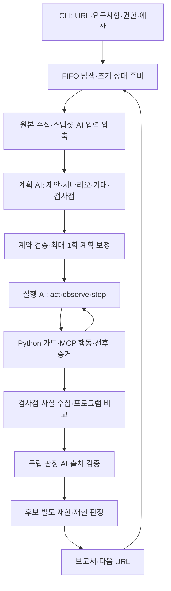
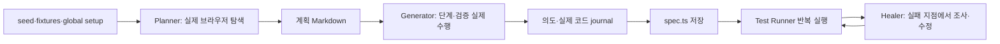

# WebTestPilot 전체 구조 리뷰와 Playwright 공식 에이전트 비교

검토일: 2026-10-13, 한국 시간. 현재 실행 제품인 `integration/`의 Python 소스 24개·6,651줄을 구조 범위로 삼고, 핵심 호출 경로·계약·설정·QA 스킬·저장된 실제 결과를 확인했다. 팀별 이전 프로토타입과 `archives/`는 현재 실행의 의존성이 아니다. 모든 함수의 모든 분기를 실행 검증한 리뷰는 아니다.

이번 작업은 소스 수정과 유료 AI 호출 없이 진행했다. 로컬 계약 검사 6개를 실행했고 모두 통과했다. 모델 HTTP 전송 함수를 차단한 상태에서 검사했다. 실제 사이트의 새 검사는 수행하지 않았다. 구현 확인, 저장 증거에서 재현한 문제, 설계상 제안을 구분해서 읽어야 한다.

## 1. 현재 구조에서 먼저 이해할 점

현재 프로그램은 **페이지를 방문하고, AI가 JSON 계획을 만들고, 실행 AI가 행동을 선택하고, Python이 행동·사실을 기록한 뒤 별도 AI가 판정하는 검사 엔진**이다. 일반 경로의 최종 산출물은 실행 가능한 Playwright Test 파일이 아니라 JSON 계획·증거·판정이다.

Playwright 공식 경로는 **seed 테스트로 준비한 브라우저를 탐색하고, 계획을 실제로 수행하면서 행동·검증 코드를 기록하고, 테스트 파일을 작성한 뒤 Test Runner로 실행하는 방식**이다. 우리 프로젝트에도 공식 테스트용 설정과 생성 파일 경로가 따로 있지만, `python -m integration`이 그 테스트 파일 생성 경로를 호출하지는 않는다. 이 두 경로를 구분해야 비교 기준이 정확해진다.

우리 쪽에 이미 있는 기반은 상당하다. 실행 성공과 관찰 성공을 분리하고, 행동·스냅샷·사실의 출처를 연결하며, 기대값 변경과 근거 없는 통과를 막는다. 남은 문제는 이 보호 장치를 없애서 해결할 문제가 아니다. **관측 손실, 대상과 값의 혼동, 초기 상태와 반복 실행의 연결, 비용과 평가 기준**을 바로잡아야 한다.

### 1.1 기본 경로

### 1.2 주요 파일과 책임

| 큰 주제 | 세부 책임 | 현재 구현 |
| --- | --- | --- |
| 실행 시작 | CLI 검증, 모델 선택, 브라우저·MCP 수명 | [__main__.py](C:/Users/lsc05/Documents/ChatGPT/WebTeste/integration/__main__.py:125), [models.py](C:/Users/lsc05/Documents/ChatGPT/WebTeste/integration/models.py:298) |
| 탐색 | URL 정규화, 중복 제거, FIFO, 그래프, robots, 범위·쓰기 정책 | [crawl.py](C:/Users/lsc05/Documents/ChatGPT/WebTeste/integration/preprocessor/crawl.py) |
| 관측 | DOM·컨트롤·폼·링크·리소스·이벤트·native validity·raw 파일 | [collector.py](C:/Users/lsc05/Documents/ChatGPT/WebTeste/integration/preprocessor/collector.py:643) |
| 관측 표현 | element key, locator, action context, 압축 입력, 전후 diff | [preprocess.py](C:/Users/lsc05/Documents/ChatGPT/WebTeste/integration/preprocessor/preprocess.py) |
| 증거 연결 | action ID, before/after snapshot, 이벤트·리소스 연결과 실패 저장 | [evidence.py](C:/Users/lsc05/Documents/ChatGPT/WebTeste/integration/preprocessor/evidence.py:168) |
| 계획 | 기존 제안 요청 + 실행 계획 생성, 스킬, 계약 검증·보정 | [planning.py](C:/Users/lsc05/Documents/ChatGPT/WebTeste/integration/planning.py), [staged.py](C:/Users/lsc05/Documents/ChatGPT/WebTeste/integration/staged.py:254), [plan_contract.py](C:/Users/lsc05/Documents/ChatGPT/WebTeste/integration/plan_contract.py:183) |
| 실행 | 최신 관측의 대상 선택, 제한된 보조 행동, 단계 진행 | [executor.py](C:/Users/lsc05/Documents/ChatGPT/WebTeste/integration/executor.py:147) |
| 실제 행동 | 같은 탭·고유 대상 검증, MCP 도구 스키마, 결과 구분 | [runtime.py](C:/Users/lsc05/Documents/ChatGPT/WebTeste/integration/runtime.py:264), [mcp.py](C:/Users/lsc05/Documents/ChatGPT/WebTeste/integration/mcp.py:45), [mcp_client.py](C:/Users/lsc05/Documents/ChatGPT/WebTeste/integration/mcp_client.py) |
| 사실·비교·판정 | checkpoint fact 수집, 비교, 모델 claims와 실제 사실 대조 | [checkpoints.py](C:/Users/lsc05/Documents/ChatGPT/WebTeste/integration/checkpoints.py), [judgments.py](C:/Users/lsc05/Documents/ChatGPT/WebTeste/integration/judgments.py) |
| 초기화·재현 | 초기 조건 복원, 실행 epoch, 의존 시나리오 재실행 | [reset.py](C:/Users/lsc05/Documents/ChatGPT/WebTeste/integration/reset.py), [reproduction.py](C:/Users/lsc05/Documents/ChatGPT/WebTeste/integration/reproduction.py:33) |
| 비용·재사용 | 호출 전 예산, 실제 사용량, 증거 축약, 통과 계획 캐시 | [cost.py](C:/Users/lsc05/Documents/ChatGPT/WebTeste/integration/cost.py), [optimization.py](C:/Users/lsc05/Documents/ChatGPT/WebTeste/integration/optimization.py) |
| 고정 회귀 | 저장한 계획·기대를 바꾸지 않고 API 없이 실행·비교 | [regression.py](C:/Users/lsc05/Documents/ChatGPT/WebTeste/integration/regression.py:40) |

`staged.inspect_page`가 단계 순서를 관리하고 `Runtime`이 공통 상태·행동·저장을 맡는다. 각 단계가 공유하는 flow 사전에 `status`, `execution_unknown`, `observation_incomplete`, `rounds`, `actions`, execution epoch 등이 들어 있다. 단계가 파일로 분리돼 있어도 상태 관리까지 완전히 독립적인 구조는 아니다. 현재 병목을 고치기 전에 이 공유 상태를 대규모로 재설계할 필요는 없다.

## 2. 탐색·준비·관측은 어떻게 동작하나

### 2.1 실행 환경과 URL 탐색

CLI는 새 출력 폴더, Chromium 한 context·한 tab, CDP 연결, 로컬 MCP stdio 세션을 준비한다. 기본 모델은 mock이며 실제 공급자는 Anthropic 또는 Timely다. 계획·실행·판정 모델을 각각 구성할 수 있지만 기본 CLI의 출력 토큰 상한은 세 단계에 같은 값을 전달한다. 최근 부분 검사의 서로 다른 상한은 별도 실행 보조 스크립트에서 설정한 것이다.

`URLQueue`는 URL을 정규화하고 중복을 제거해 FIFO로 방문한다. 초기 링크, 리다이렉트, 행동 후 발견한 링크를 그래프에 연결한다. 범위 밖 문서 이동, robots, 팝업, 허용되지 않은 HTTP method는 별도 가드와 상태로 기록한다. 이미지·파일·API 응답은 HTML 페이지와 구분한다. HTML이 아닌 모든 URL에 계획 AI를 호출하는 구조는 아니다.

**한계:** 페이지를 많이 방문했다고 사용자 흐름을 많이 검증한 것은 아니다. FIFO는 중요한 기능 우선순위나 같은 상품 템플릿의 반복 여부를 비용 관점에서 결정하지 않는다. 다만 시나리오 안에는 여러 준비 동작과 페이지 이동을 표현할 수 있다. 이를 단순한 한 페이지 클릭 검사만 가능하다고 해석하면 안 된다.

### 2.2 초기 상태와 준비 완료

`prepare_page`와 `reset.py`는 승인된 브라우저 초기 상태 또는 Maison 서버 초기화 fixture를 준비한다. 독립 `initial` 시나리오는 초기 상태를 복원하고, `current` 시나리오는 명시한 앞선 시나리오에 의존한다. 복원 후 `observed_start`로 URL·제목·텍스트·컨트롤 상태를 비교한다.

이 비교는 **관측된 화면이 같다는 확인**이다. 서버 데이터 전체, IndexedDB 등 보이지 않는 모든 상태가 같다는 증명은 아니다. 브라우저 초기화와 서버 초기화의 의미가 다르므로 둘을 같은 재현 조건으로 집계하면 안 된다.

기본 수집은 `domcontentloaded`와 짧은 settle wait를 사용한다. collector에는 `ready_selector` 지원이 있으나 기본 통합 CLI 경로에서 앱별 준비 조건을 제공하지 않는다. 최근 무료 연결 탐색의 첫 실패에서도 제목·URL은 준비됐지만 상품 목록은 로딩 중이었다. 준비 상태를 도메인별 seed 또는 명시적인 관측 조건으로 표현할 필요가 있다.

### 2.3 원본과 AI 관측 입력

collector는 HTML/CSS/JS·렌더링 DOM·스크린샷과 DOM 요소·폼·링크·콘솔·네트워크·validation 상태를 수집한다. test ID → role/name → label → CSS 후보를 실제 count와 노드 동일성으로 확인해 locator를 선택한다. element key는 test ID/id/locator 또는 CSS·위치 등을 바탕으로 생성되므로 강한 key와 약한 key의 안정성이 다르다.

행동 중 `light=True`는 반복되는 전체 PNG·렌더링 소스 저장을 생략한다. DOM·locator·이벤트·품질 수집은 유지한다. 원본에 있어도 모델이 모두 보는 것은 아니다. `build_ai_input`은 기본 약 12KB·컨트롤 60개·링크 30개 등의 예산으로 압축한다. `Runtime.observation`은 본문 일부·content node 40개·action context 등을 보충한다. 보충 입력을 합한 전체 요청 크기는 12KB로 제한되는 것이 아니다.

**저장 증거로 재현한 문제:** 상품 목록 원본에는 visible 상품 링크 13개가 있지만 동일 스냅샷을 현재 함수로 압축하면 AI 입력의 상품 링크는 0개다. 출력은 11,945바이트로 12,288바이트 예산 안이다. 예산 준수 자체는 성공했지만 기능 정보 보존은 실패했다. main 우선순위 안에서도 비링크 컨트롤이 앞서고, 크기 초과 시 링크부터 제거하는 정책이 원인이다.

**개선 아이디어:** 공식 접근성 트리처럼 구조와 부모 문맥을 함께 보고, 기능별 필요한 영역을 좁혀 다시 읽을 수 있게 한다. 목록에서는 카드명·href·클릭 대상의 최소 묶음을 보존한다. 전역 예산을 크게 늘리거나 화면의 모든 링크를 항상 모델에 보내는 방식은 우선 해법으로 삼지 않는다.

## 3. 계획·실행은 어떻게 동작하나

### 3.1 계획 생성과 고정

`planning.build_evidence_request`의 제안 형식에 `staged.COMPILE_SYSTEM`과 `qa_test_plan` 계약을 결합한다. 한 응답에 페이지 요약, 검사 제안, 질문, 실행 시나리오와 미계획 사유를 요청한다. Anthropic 계획 단계에만 등록 스킬과 서버 code execution을 붙이고 `pause_turn`은 같은 컨테이너를 이어 사용한다. 실행·판정 단계에는 이 스킬이 들어가지 않는다.

계획에는 행동뿐 아니라 초기 상태, 의존 관계, 전제조건, 준비/검사 단계, 기대 근거, checkpoint 사실, 비교 연산이 포함된다. `validate_plan`은 관측 대상·URL·지원 연산·단계 수·제안 대응 등을 확인한다. 새 실제 모델 계획은 마지막에 `exercise` 하나가 있어야 하고 그 앞은 `prepare`다. 계약에 맞지 않으면 최대 한 번 전체 계획 보정을 요청한다. 공급자 오류나 잘린 응답을 무한히 재시도하지 않는다.

**차이:** 공식 Planner는 seed를 실행한 살아 있는 브라우저에서 탐색 도구를 쓸 수 있다. 우리 계획 모델은 수집한 관측을 받고 계획 JSON을 반환하며 계획 단계에서 브라우저 탐색 도구를 직접 쓸 수 없다. 링크가 압축에서 빠지거나 메뉴 뒤에 기능이 있으면 실행 AI가 뒤늦게 발견해야 한다.

**개선 아이디어:** 처음부터 무제한 탐색 에이전트를 추가하기보다, 불확실한 계획에 필요한 영역을 제한적으로 다시 관측하는 경로를 고려한다. 비용·coverage 근거가 확인되면 이후 Planner 탐색을 확장한다. 기대값과 실행 의도는 검토 후 고정한다.

### 3.2 실행 AI와 실제 MCP 행동

`executor.execute`는 전제조건과 의존 시나리오 완료 여부를 확인하고 execution epoch를 만든다. `_run`은 시나리오별 대화에서 최신 compact 관측과 현재 단계 번호를 보내고 정확히 한 도구를 받는다.

- `act`: 고정한 계획의 연산·값·URL을 유지하며 최신 observed key로 대상을 찾는다.
- `observe`: 필요한 관측을 다시 수집하며 이미지와 제한된 wait를 요청할 수 있다.
- `stop_scenario`: 자동화의 장애를 기록하며 제품의 버그 판정을 내리지는 않는다.

제한된 supporting click·Escape/Tab은 계획 단계 진행 없이 대상을 드러내기 위해 허용된다. 연속 관측·보조 동작·실패 보정에 상한이 있다. 실제 행동 결과를 받은 경우에만 커서를 진행한다.

`Runtime.act`는 최신 snapshot, 고유 locator, 같은 origin에서 관측한 URL, 보정 관계와 한도를 확인한다. MCP bridge는 서버가 광고한 스키마를 검증하고 실제 고유 요소에 임시 mark를 붙여 같은 탭에서 조작한다. 이 mark는 제거하며 영구 locator로 재사용할 대상이 아니다. 결과는 `executed`, `not_executed`, `unknown`으로 나뉜다. 실행 여부가 불명확하거나 실행 후 증거를 확보하지 못하면 행동을 반복하지 않는다.

현재 실행 연산은 click/fill/press/navigate다. 공식 도구의 select/hover/drag/upload/dialog 등과 같은 폭을 제공하지 않는다. native select의 선택값을 읽는 사실 수집 지원과 select 조작 지원도 구분해야 한다. 실제 필요한 기능과 fixture를 먼저 정해 연산을 늘리는 편이 좋다.

### 3.3 반복 실행 경로

기본 경로는 알려진 계획이라도 실행 AI 대화를 사용한다. 반면 `integration.regression.FixedDriver`는 저장 계획의 행동과 비교를 추론 없이 실행하는 기존 경로다. API 없이 회귀를 돌릴 기반이 이미 있으므로 새 실행 엔진을 먼저 만들 필요는 없다.

통과 계획 캐시는 grounded functional/routing 계획만 저장한다. exact URL·관측·요구사항·모델 설정 등이 fingerprint에 포함되고 실패·후보·heuristic 계획은 캐시되지 않는다. 잘못된 재사용을 막는 조건이지만, 상품 템플릿 전체나 발견된 버그의 고정 회귀를 자동으로 만들어 주지는 않는다. 캐시가 존재한다는 사실과 실제 적중률을 분리해서 봐야 한다. 최근 검사에서는 관련 최적화가 적용되기 어려운 heuristic 기대뿐이었다.

## 4. 증거·판정·재현은 어떻게 동작하나

### 4.1 행동 증거와 checkpoint 사실

`SnapshotAPI.action`은 행동 전 snapshot을 저장하고 실제 행동을 수행한 뒤 행동 후 snapshot과 diff·이벤트·리소스 ID를 저장한다. 실행 실패, capture 실패, persistence 실패를 분리한다. 요청이 실제 서버 반응의 원인이라는 인과 증명까지 하는 것은 아니며 이벤트 연결은 시간과 action context에 근거한다.

checkpoint는 start/after_step/end 중 지정한 시점에 URL·텍스트·숫자·visible href 목록·컨트롤·bbox·validity를 읽는다. 같은 시점의 동일 사실은 재사용한다. 누락된 대상·모호함·수집 부족은 `missing`과 reason으로 기록하며 일부 사유에 한 번 실제 관측을 갱신한다. 갱신하면 checkpoint 전체를 새 snapshot에 묶어 이전 사실과 섞지 않는다.

**저장 증거로 확인한 핵심 문제:** 종료 수량을 text=`2`로 찾으면 실제 수량이 1일 때 값 비교 대신 `target_absent`가 된다. 목록 종료 개수를 text=`13 pieces`로 찾는 것도 같다. 현재 target 계약은 element key 또는 정확한 match이며 content node의 지속적 locator binding은 없다. 한 번 더 같은 target으로 읽어도 이 문제는 해결되지 않는다.

**개선 아이디어:** 대상을 “수량 표시 요소”로 식별하고 현재 값은 따로 읽는다. 초기 snapshot의 고유 노드에서 값에 의존하지 않는 binding을 검증해 유지하거나, 문맥이 있는 안정된 locator를 사용한다. 대상 식별에 기대값을 넣지 않는다. 유일하지 않은 대상에서 임의로 첫 요소를 선택하지 않는다.

### 4.2 프로그램 비교와 별도 AI 판정

`evaluate_checks`는 수집한 사실로 eq/ne/contains/숫자 비교/set_equal 등을 계산한다. 기대는 literal 또는 이전 checkpoint 사실과 numeric offset으로 표현한다. self-reference, JSON type 불일치 등은 계약 검증에서 막는다.

이후 새로운 대화의 판정 AI가 설명·verdict·인용 ID·fact claims를 반환한다. `bind`는 claims를 실제 사실과 대조하고, 시나리오 밖 ID, 근거 누락, 증거 불완전, 실제 비교와 반대되는 verdict를 거부한다. `heuristic` 기대는 passed를 증명할 수 없다. 일부 형식·claims 오류만 해당 항목을 한 번 보정하고 정상 항목과 증거·기대값은 유지한다.

이것은 이미 유용한 강점이다. 다만 source quote가 실제 제공됐다는 확인은 그 인용이 업무 규칙 전체를 입증한다는 의미 검증과 다르다. `observed_ui`의 근거 타당성도 요구사항 검토 대상으로 남는다. UI 이미지를 해석해야 하거나 업무 의미가 불명확한 부분에는 AI가 필요하고, 이미 완전한 사실로 정해진 수치 비교에는 프로그램이 판정의 중심이 될 수 있다.

**개선 아이디어:** 먼저 “사실 비교 결과”와 “제품 결함 판정”을 보고서에서 구분한다. 검토된 요구사항으로 고정한 functional/routing 회귀에는 기존 FixedDriver를 사용한다. UI·모호한 기대·새 기능 탐색만 독립 AI 판정 경로를 유지하는 방향을 검증한다. 이는 모든 AI 판정을 제거하자는 제안이 아니다.

### 4.3 후보 재현과 확정

후보는 추가 재현을 한 번 시도한다. 초기 조건을 복원하고 같은 execution epoch의 의존 시나리오와 성공했던 단계만 다시 수행한다. 대상은 다시 확인하고 같은 checkpoint 사실을 모은다. 상태·증거가 불완전하면 재현 확정으로 가지 않는다. 그 뒤 별도 모델이 재현 여부를 판정한다. 완전한 재현과 grounded 기대가 있어야 confirmed로 승격한다.

재현은 Healer와 역할이 다르다. 우리 재현은 동일 증상 재발을 확인하며 테스트 코드나 제품 코드를 고치지 않는다. 공식 Healer는 실패한 테스트를 조사해 테스트 코드를 수정할 수 있다.

최근 3페이지에서 후보 사례 3개를 별도 재현했지만 전부 heuristic 기대여서 자동 확정은 0개였다. 이 수치는 탐지 실패와 요구사항 부재를 구분해 해석해야 한다. 같은 관련 상품 이동 문제가 두 상품에서 발생했으므로 후보 사례 수를 고유한 근본 버그 수로 바로 계산해서도 안 된다.

### 4.4 보고서와 상태

`Runtime.persist`는 flow·대화·finding·전체 report를 계속 기록한다. `accounting`은 execution/evidence/comparison/judgment/verdict 차원을 분리한다. flow나 wrapper의 `completed`는 단계 종료이며 기능 통과를 뜻하지 않는다. 실제 기능 통과는 엄격한 `test_status` 조건을 따른다. 판정 보류가 유효한 JSON이라는 이유로 통과율에 넣으면 안 된다.

공식 테스트 경로에는 `playwright.config.ts`의 실패 trace·스크린샷 보존 설정이 있다. 기본 통합 경로는 자체 JSON·PNG·raw 증거를 저장하며 그 Test Runner trace 설정을 사용하지 않는다. trace가 필요한 실패 조사에는 native trace를 제한적으로 연결하는 방안이 있으며, 기존 JSON 출처 연결은 유지한다.

## 5. 비용 관리에서 무엇이 실제로 병목인가

`_exchange`가 대부분의 모델 호출을 관리하고 재현 판정은 별도 호출 경로다. 호출·round·행동·runtime 한도와 비용 예약을 확인한다. 실제 사용량에는 provider·반환 모델·토큰·cache·skill 버전을 기록한다. `cost.summary`는 알려진 직접 Anthropic 단가만 계산하고 알 수 없는 provider/usage를 무료로 처리하지 않는다. 비용 수치는 도구 비용·세금 등이 제외된 토큰 추정이다.

| 최근 3페이지 단계 | 호출 | 입력 토큰 | 출력 토큰 | 토큰 비용 추정 |
| --- | ---: | ---: | ---: | ---: |
| 계획 | 3 | 220,541 | 12,640 | $1.1350 |
| 실행 AI | 7 | 68,122 | 1,610 | $0.1523 |
| 판정 | 3 | 291,203 | 3,141 | $0.6138 |
| 재현 판정 | 3 | 133,677 | 830 | $0.2757 |
| 합계 | 16 | 713,543 | 18,221 | $2.1768 |

이 기록에서는 계획이 약 52%, 판정·재현 판정이 약 41%, 실행 AI가 약 7%였다. 클릭 턴을 줄이는 것만으로 현재 비용 문제 전체가 해결되지 않는다. input 재전송과 계획·판정 evidence의 범위를 함께 봐야 한다. cache read/creation 토큰은 모두 0이었다. 공급자가 계산한 계획 입력에는 서버 도구가 있는 응답의 사용량도 들어 있으므로 이를 전부 로컬 스킬 파일 크기 탓으로 단정하지 않는다.

현재 `request_reserve`는 JSON UTF-8 바이트 전체를 토큰처럼 계산해 이미지 base64까지 2배 입력 예약에 포함한다. 실제 저장 이미지 하나를 넣은 최소 요청의 예약만 약 $4.0557이다. 최근 목록의 카드 이동 검사도 실제 소비액 약 $0.51 시점에 이런 큰 이미지 예약 때문에 중단됐다. 이 문제는 API를 더 싸게 쓰는 문제와 **예산 차단의 정확성** 문제를 함께 가진다. 이미지의 전송 크기와 visual token 계산을 분리하되 실제 예산 차단은 유지해야 한다. 공식 이미지 계산 근거는 [기존 부분 검사 보고서](C:/Users/lsc05/Documents/ChatGPT/WebTeste/docs/reviews/QA_LINKED_SMOKE_2026-10-13.md)에 보존돼 있다.

`project_judgment`는 완전한 grounded functional/routing 증거일 때만 관련 facts 중심으로 축약한다. 최근 사례는 전부 heuristic이라 긴 입력을 보내는 경로가 남았다. 안전 조건을 완화하기 전에, 관측 facts와 각 판단에 필요한 문맥을 어떻게 보존할지 저장 사례로 확인해야 한다. 재현 판정도 original/replay·checkpoint가 중복된 큰 입력을 가지므로 별도 측정 대상이다.

## 6. Playwright 공식 코드에서 얻을 수 있는 아이디어

공식 소스는 검토 당시 main 커밋 **`a3401cfe0dcf317101572d025fa46248d0779b42`**로 고정했다. 로컬 테스트 패키지 1.64.0과 통합 MCP 0.0.83의 기반 alpha 버전은 서로 다른 설치본이다. 아래 분석은 고정한 공개 upstream 구조이며, 로컬 모든 세부 동작이 동일하다는 주장은 아니다. Apache 2.0 LICENSE를 포함한 공개 파일 16개를 로컬에 보존했다. 이전 위치 두 경로의 404도 manifest에 남겼고 실제 `playwright-core/src/tools/backend/` 위치를 찾아 분석했다.

### 6.1 Planner: 계획 전에 실제로 탐색

Planner 정의는 `planner_setup_page`로 시작하고 브라우저 snapshot·이동·클릭 도구로 인터페이스를 탐색하도록 한다. `plannerTools.ts`는 프로젝트와 seed를 고르고 seed를 실행한 상태에서 계획을 작성하게 한다. 저장 계획에는 suite/test/seed/단계별 perform·expect가 들어간다. seed 파일이 있다고 앱 초기화가 자동 보장되지는 않으며 필요한 준비는 seed·fixture에 실제로 작성해야 한다.

가져올 아이디어는 “계획 이전에 필요한 상태를 실제로 확인”하는 점과 “행동마다 확인할 결과를 연결”하는 점이다. 우리 `after_step` checkpoint가 이미 있는 기반이므로 모든 체크를 종료 후에만 하도록 만들 필요가 없다. [Planner 정의](https://github.com/microsoft/playwright/blob/a3401cfe0dcf317101572d025fa46248d0779b42/packages/playwright/src/agents/playwright-test-planner.agent.md), [Planner 도구](https://github.com/microsoft/playwright/blob/a3401cfe0dcf317101572d025fa46248d0779b42/packages/playwright/src/mcp/test/plannerTools.ts).

### 6.2 Generator: 행동·검증 기록을 실행 코드로 연결

Generator 정의는 계획의 각 행동과 검증을 실제 수행하고 `generator_read_log`를 읽은 후 테스트 파일을 쓰도록 한다. `GeneratorJournal`은 계획·seed·step intent와 생성된 코드를 모은다. `sendMessageToPausedTest`는 성공 응답의 실제 code와 intent를 기록한다. `generator_write_test`는 설정된 testDir 안에 파일을 저장하지만, 쓰는 것만으로 정확한 테스트나 통과를 보증하지는 않는다. Test Runner로 다시 검증해야 한다.

우리도 행동 기록이 있으나 기본 경로에서는 확인된 행동·locator·assertion을 실행 파일로 완성하지 않는다. 먼저 현재 JSON에서 **의도 → 실제 대상 → action 결과 → checkpoint 값 → 비교 결과**가 한 항목으로 추적되게 정리하고, 기존 FixedDriver로 검토된 시나리오를 반복 실행하는 것이 작은 시작점이다. 필요할 때 확인된 semantic locator와 assertions를 `.spec.ts`로 내보내는 기능을 검증할 수 있다. [Generator 정의](https://github.com/microsoft/playwright/blob/a3401cfe0dcf317101572d025fa46248d0779b42/packages/playwright/src/agents/playwright-test-generator.agent.md), [Generator 도구](https://github.com/microsoft/playwright/blob/a3401cfe0dcf317101572d025fa46248d0779b42/packages/playwright/src/mcp/test/generatorTools.ts), [Journal·실행 연결](https://github.com/microsoft/playwright/blob/a3401cfe0dcf317101572d025fa46248d0779b42/packages/playwright/src/mcp/test/testContext.ts).

### 6.3 관측 ref와 locator의 연결

공식 snapshot 도구는 접근성 트리와 target/depth/boxes를 지원한다. `Tab.targetLocators`는 현재 snapshot ref를 실제 locator로 해석하고 normalize하며, 오래된 ref는 새 snapshot을 요구한다. 우리도 최신 snapshot과 고유 locator를 검사한다. 지금 차이는 단순히 locator 검증의 유무가 아니라, 읽기 대상에 대한 binding과 영역별 관측 경로의 폭이다.

접근성 트리에는 잘 이름 붙은 요소가 유리하며 아이콘 버튼·잘못된 ARIA·복잡한 목록에서는 추가 문맥이 필요하다. 공식 출력도 모든 제품의 기능 의미를 자동 보장하지 않는다. 우리 DOM/native validation 수집을 버리지 말고, 비교용 접근성 snapshot을 동일 저장 화면에서 시험해 정보 보존과 크기를 비교하는 접근이 적절하다. [Snapshot 도구](https://github.com/microsoft/playwright/blob/a3401cfe0dcf317101572d025fa46248d0779b42/packages/playwright-core/src/tools/backend/snapshot.ts), [대상 해석](https://github.com/microsoft/playwright/blob/a3401cfe0dcf317101572d025fa46248d0779b42/packages/playwright-core/src/tools/backend/tab.ts).

### 6.4 검증을 실제 assertion과 코드로 기록

`verify.ts`는 요소·텍스트·목록·입력값 검증을 별도 도구로 제공하고 assertVisible/assertSnapshot/assertValue/assertChecked 행동으로 기록한다. `Response.addAction`은 이를 코드 생성 출력에 연결한다. 이 패턴에서는 조작만 성공했다는 사실과 기대 결과를 검증했다는 사실이 별개다.

주의할 점도 있다. 이 커밋의 일부 사전 검증은 count나 현재 값을 직접 확인하며, 모든 verify 도구가 반복 대기하는 `expect` 호출은 아니다. 공식 코드를 그대로 복사하면 모든 비동기 준비 문제가 해결된다고 가정하지 않는다. 우리 측에는 이미 실제 fact 비교가 있으므로 검증 목적·대상·읽은 값·실패 유형을 명확히 하고, 반복 실행 경로에서 적절한 Playwright assertion 대기를 사용하는 아이디어를 취한다. [검증 도구](https://github.com/microsoft/playwright/blob/a3401cfe0dcf317101572d025fa46248d0779b42/packages/playwright-core/src/tools/backend/verify.ts), [기록과 코드 출력](https://github.com/microsoft/playwright/blob/a3401cfe0dcf317101572d025fa46248d0779b42/packages/playwright-core/src/tools/backend/response.ts).

### 6.5 Healer: 실패 당시 상태에서 조사

`test_debug`는 하나의 test ID를 한 worker로 실행하고 오류 지점에서 멈춰 조사한다. backend는 오류·URL·제목·접근성 snapshot과 console 오류를 제공한다. Healer 정의는 locator·동기화·데이터·테스트 가정 문제를 조사하고 수정 후 재실행한다.

같은 정의는 assertion/기대값 수정과 확신한 제품 문제의 `test.fixme()`도 허용한다. 따라서 수정 후 녹색 결과가 최초 기능 문제가 해결됐다는 증명은 아니다. 우리에게 가져올 부분은 실패 상태를 보존하고 조사하는 절차다. 기대값 변경, test 수정, 제품 수정, skip을 구분하고 최초 실패 결과는 보존한다. 현재 재현 엔진을 Healer로 바꾸기 전에 무엇을 수정할 권한이 있는지 범위를 정해야 한다. [Healer 정의](https://github.com/microsoft/playwright/blob/a3401cfe0dcf317101572d025fa46248d0779b42/packages/playwright/src/agents/playwright-test-healer.agent.md), [실행·디버그 도구](https://github.com/microsoft/playwright/blob/a3401cfe0dcf317101572d025fa46248d0779b42/packages/playwright/src/mcp/test/testTools.ts), [오류 당시 상태](https://github.com/microsoft/playwright/blob/a3401cfe0dcf317101572d025fa46248d0779b42/packages/playwright/src/mcp/test/browserBackend.ts).

### 6.6 무엇을 재사용하고 무엇을 유지할까

| 주제 | 우리 코드 | 공식 코드에서 얻는 아이디어 | 적용 방향 |
| --- | --- | --- | --- |
| 초기 상태 | reset + observed baseline | seed + fixtures + 실제 준비 | 기존 reset에 준비 완료 조건을 명시 |
| 계획 | 단일 압축 관측의 JSON 계획 | 탐색 후 단계별 행동·검증 | 필요한 영역을 제한적으로 더 관측 |
| 대상 | verified element key, content는 정확 match | snapshot ref → normalized locator | 값과 독립적인 읽기 binding |
| 증거 | 전후 JSON·fact·ID 연결 | intent + 행동/검증 code journal | 현재 기록을 의미별 묶음으로 연결 |
| 재시험 | 별도 FixedDriver 경로 존재 | 저장 spec + Test Runner | 기존 회귀를 우선 사용, 이후 코드 export 검토 |
| 판정 | 근거·claims·reproduction 가드 | 실행 assertions 중심 | 고정 비교와 모호한 AI 판단 분리 |
| 실패 조사 | 재현으로 동일 증상 확인 | 오류 위치 pause·snapshot 조사 | 최소 실패 증거 묶음, 기대 변경 이력 보존 |

공식 도구가 사용하는 내부 `playwright-core/lib/coreBundle`와 내부 runner를 그대로 import하는 새 제품 의존성은 피한다. 공개 Playwright API·이미 설치된 Test Runner·현재 회귀 코드를 우선 활용한다. 공식 모델 호스트의 실행 정책과 모델 자체까지 저장소가 제공하는 것은 아니므로 Markdown 정의 복사만으로 동일한 품질이 나오지는 않는다.

## 7. 발견 사항의 우선순위와 완료 기준

| 우선순위 | 문제·종류 | 확인한 근거 | 수정의 완료 기준 |
| --- | --- | --- | --- |
| P1 | 상품 링크 압축 손실 — 구현 문제 | 원본 상품 링크 13개 → AI 입력 0개 | 같은 예산에서 대표 카드명·href·고유 클릭 대상 유지 |
| P1 | 기대값을 읽기 target에 사용 — 계약·계획 문제 | `13 pieces`, 종료 text=`2`의 target_absent | 값이 바뀌거나 기대에 못 미쳐도 실제 값 available·비교 수행 |
| P1 | 이미지 비용 예약 과대 — 구현 문제 | 단일 이미지 최소 요청 예약 $4.0557, 실제 중단 기록 | 모델별 이미지 비용과 전송 크기 분리·진짜 부족은 계속 차단 |
| P2 | 앱 준비 완료 조건 부족 — 설계·fixture 문제 | 기본 short settle, 로딩 중 최초 탐색 실패 | 로딩 fixture에서 준비 전 계획 호출 없음·기한 초과 명확히 기록 |
| P2 | 재사용 가능한 실행 경로 활용 부족 — 설계 문제 | FixedDriver는 존재, 기본 CLI는 매번 실행 AI | 검토한 동일 계획의 무료 반복 실행·기대/출처/초기 상태 고정 |
| P2 | 판정·재현의 큰 입력 — 측정·설계 문제 | 판정·재현 입력 424,880토큰, 비용 약 $0.89 | 필요한 facts·출처 보존한 동일 사례 비교, 누락/오판 증가 없음 |
| P2 | 최근 보호 장치의 CI 연결 누락 — 검증 문제 | 명시 CI 명령에 최근 테스트 모듈 6개 없음 | 새 계약·비용·회귀 검사에 실패시키는 CI 명령 연결 |
| P3 | 문서·이름·버전 안내 불일치 — 유지보수 문제 | README의 미업로드 설명과 후속 등록 이력 혼재 | 최신 source contract·skill 버전·실행 경로 명시, 이력은 분리 |

최근 누락된 명시 CI 모듈은 test_cost/test_core_evidence/test_expectation_sources/test_atomic_controls/test_judgment_repair/test_fixed_regression다. 이번 리뷰의 6개 로컬 검사는 비용·근거·핵심 증거·비교 계약을 검사했으며 전체 브라우저 CI나 제품 QA 성능을 대신하지 않는다. “기존 검사 통과”와 “현실 실패 사례를 검사에 넣었는가”를 함께 확인해야 한다.

재현한 구현 문제와 장기 설계 제안을 한꺼번에 고치면 원인을 비교하기 어려워진다. **평가 기준 고정 → 관측/target/예산 문제 각각 수정 → 초기 조건·고정 회귀 정비 → 필요한 범위의 탐색·코드 export** 순서가 적절하다. 큰 리팩터링이나 모든 공식 도구 복제부터 시작할 근거는 현재 없다.

## 8. 다음 수정에 사용할 평가 기준

동일 URL만 맞춘 비교는 부족하다. 최근 이전/새 비교도 같은 세 URL이지만 11개와 6개 시나리오여서 A/B가 아니다. 아래 항목을 고정한다.

| 고정할 입력 | 이유 |
| --- | --- |
| 시나리오 목표·행동·기대·근거·checkpoints·checks | 실제 결과에 맞춰 기준을 바꾸는 문제 방지 |
| 앱 버전·데이터·로그인·서버/브라우저 초기화·viewport | 초기 상태 차이 분리 |
| 모델·effort·스킬 버전·출력 상한·예산·도구 | 모델/설정 차이를 코드 개선으로 오인하지 않기 |
| 동일 사례의 실패·통과 fixture | 알려진 버그만 계속 맞추는 테스트 방지 |
| 평가용 정답표는 실행 입력에서 분리 | 정답을 모델에 주는 평가 오염 방지 |

측정값은 한 점수로 합치기 전에 따로 공개한다: 준비 완료, 계획 계약 유효, 의도한 대상 행동 완료, required fact available, 비교 수행, 유효한 판정, 실제 기대/증거와 일치한 판정, 후보 재현, 자동 확정, skip·미계획·예산 중단, API 비용과 wall time. 유효한 inconclusive는 제품 통과가 아니다.

먼저 현재 저장한 여섯 사례를 최소 비교 집합으로 사용한다. 목록 필터의 개수 읽기, 목록 카드 이동, 두 상품의 수량, 두 상품의 관련 카드 이동이다. 원본과 고정 증거 replay로 읽기·압축·예산 계산은 무료로 검사한다. 실제 행동 안정성과 AI 품질은 같은 계획·초기 상태로 별도 확인해야 한다. 그때 필요한 유료 호출은 새 실행 범위와 예산을 정한 뒤 진행한다.

완료 기준 예시: 기대 수량이 2이고 실제가 1이어도 fact=`1`을 읽고 mismatched로 비교해야 한다. target_absent를 passed로 바꾸면 개선이 아니다. 관련 카드 URL이 관측 href와 같더라도 카드명과 상세명 검사가 실패할 수 있어야 한다. 새로운 selector가 더 잘 동작해도 원래 상품과 다른 대상을 클릭하면 실행 성공으로 세면 안 된다.

## 9. 검토 근거와 보존 파일

- [현재 소스 해시](C:/Users/lsc05/Documents/ChatGPT/WebTeste/.tools/qa-architecture-review-20261013/local-source-manifest.json), [모듈·심볼 목록](C:/Users/lsc05/Documents/ChatGPT/WebTeste/.tools/qa-architecture-review-20261013/module-inventory.json).
- [공식 소스 커밋·파일 해시](C:/Users/lsc05/Documents/ChatGPT/WebTeste/.tools/qa-architecture-review-20261013/official-source-manifest.json). 공식 원본은 같은 폴더의 `official/`에 보존했으며 공개 소스를 읽기만 했다.
- [무료 검사·진단 결과](C:/Users/lsc05/Documents/ChatGPT/WebTeste/.tools/qa-architecture-review-20261013/offline-review.json), [리뷰 검증·보존 해시](C:/Users/lsc05/Documents/ChatGPT/WebTeste/.tools/qa-architecture-review-20261013/review-verification.json).
- [최근 실제 3페이지 검사와 비용](C:/Users/lsc05/Documents/ChatGPT/WebTeste/docs/reviews/QA_LINKED_SMOKE_2026-10-13.md), [이전 12페이지 비교](C:/Users/lsc05/Documents/ChatGPT/WebTeste/docs/reviews/QA_RETEST_COMPARISON_2026-10-13.md), [기존 비용·신뢰성 수정 이력](C:/Users/lsc05/Documents/ChatGPT/WebTeste/docs/reviews/QA_COST_RELIABILITY_FIXES_2026-10-13.md).

이 문서는 수정 기준을 만들기 위한 구조 리뷰다. 원래 테스트 실패, 수정 전후 로그, 저장 스냅샷과 기존 보고서는 덮어쓰지 않았다. 제품 소스 수정과 추가 유료 실행은 이번 리뷰에 포함하지 않았다.
